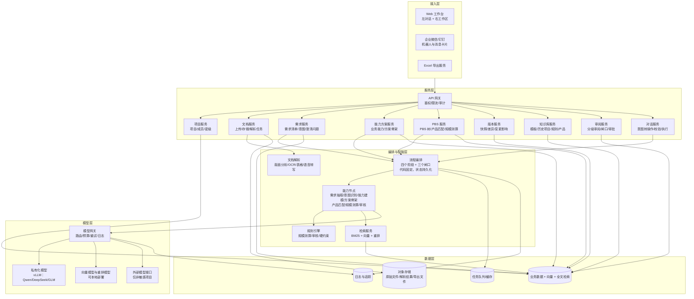
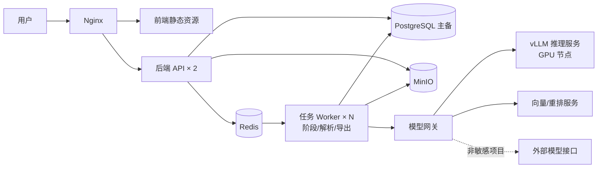
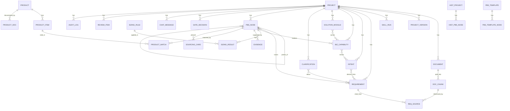
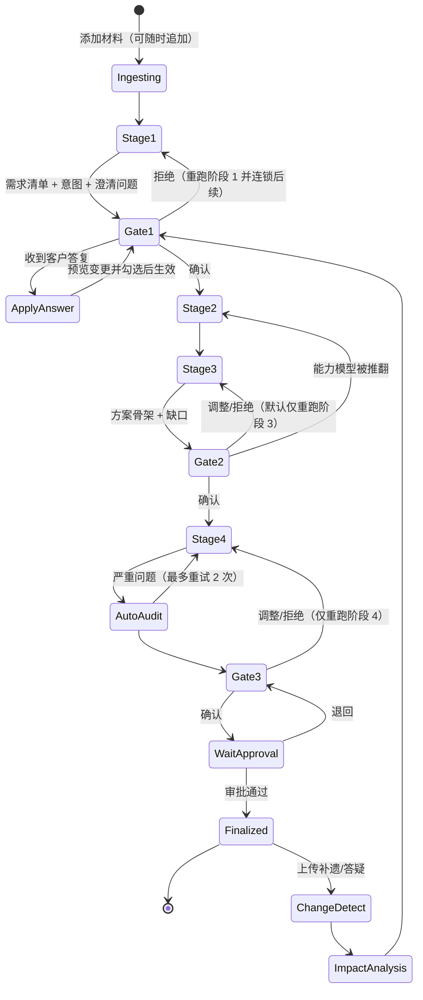
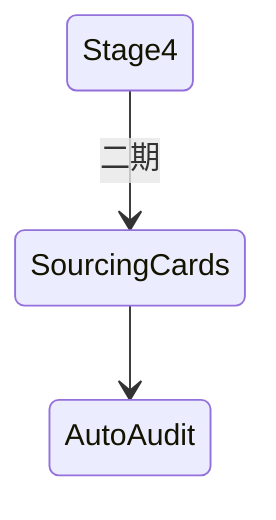
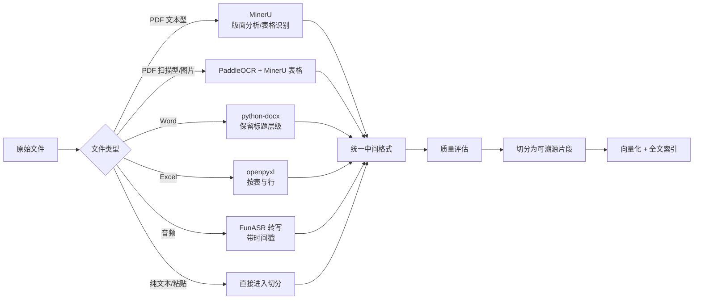
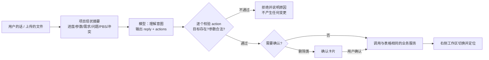
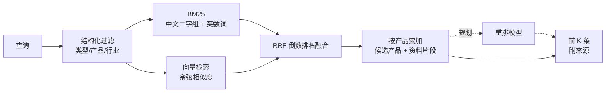
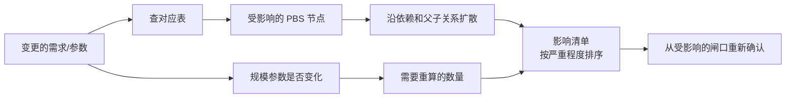
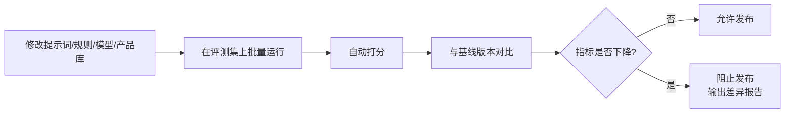

# PBS 拆解 Agent 技术设计文档

> 历史设计资料：保留原始讨论与目标，包含已废弃的固定阶段、人工闸口及技术选型。当前实现以 [architecture.md](architecture.md) 和仓库代码为准，不以本文作为新增功能或恢复旧流程的依据。

| 项目 | 内容 |
| --- | --- |
| 版本 | v4 |
| 配套文档 | 产品方案见 `PBS_Agent_设计方案.md`（v4） |
| 读者 | 研发、算法、测试、运维 |
| 状态 | 待评审 |

**修订说明（v4）**：

1. **编排方式改为“固定流程 + 受限的模型调用”，不再使用 LangGraph 或其他 Agent 框架。**流程是写死的四段（阶段），每一段是一串确定的函数调用，模型在其中只做受限的单次调用。理由见 1.1。
2. 流程按四个阶段、三个闸口重新划分（见 5），在需求与产品之间增加“真实意图”“业务能力”“方案骨架”三层。
3. 产品匹配由二期提前到一期，规则是“需求不得直接匹配产品，必须经产品能力层中转”。
4. 增加对话式助手的技术方案（见 6.9），以及模型可选、向量检索独立配置。
5. 新增 **“当前实现与目标架构”** 一节（第 19 节），说明已落地的原型（Node + SQLite + 原生前端）与本文目标架构（Python + PostgreSQL + React）的对应关系和迁移路径。

> 阅读提示：第 2～4、7、8、10～16 节描述的是**目标生产架构**；第 19 节说明现在代码里**已经做到哪一步**。引擎层（切分、抽取、匹配、测算、审核）的业务规则在两边一致，迁移时可以原样移植。

---

## 1. 设计原则

产品方案中的要求，对应到技术上的约束如下：

| 产品要求 | 技术原则 |
| --- | --- |
| 流程固定、有人工审阅和退回 | 流程由代码固定，**不让大模型决定流程走向**；三个闸口是持久化的人工确认点，每个阶段可单独重跑 |
| 每条结论可追溯 | 所有抽取结果都带**来源定位**（文件、页码、条款、字符位置）；所有生成结果都带**依据记录**；中间层（意图、能力）同样必须回指材料原文，不允许只依赖上一步的摘要 |
| 数量不能让大模型猜 | 大模型只抽取参数，**数量由规则引擎计算**；规则、原文、人工确认之外一律“待估” |
| 产品能力不能让大模型编 | 模型引用的产品能力、限制必须在产品库中真实存在，**由代码逐条核对，核对不过就丢弃**；冲突必须引用产品资料原文才采信 |
| 人工修改不被覆盖 | 数据层区分**系统生成值**和**人工确认值**，重跑时只更新未被人工锁定的字段 |
| 政企数据不出域 | **私有化优先**，模型网关按项目密级路由；整套系统可在客户或公司内网离线部署 |
| 宁可说“不确定” | 输出强制 JSON Schema 校验；无依据的结论落为“模型推断”或“无依据”等级 |
| 成本和耗时可控 | 任务分级选模型；按条款分块并行处理；token 预算在网关层强制 |
| 迭代不能退化 | 提示词、规则、模型版本化；离线评测集回归通过后才能发布 |

### 1.1 为什么不用 Agent 框架（LangGraph 等）

“要不要把意图、能力、方案、匹配做成几个独立的 Agent”取决于每一步是否需要**自己决定下一步做什么**。这里每一步都是“输入固定、输出固定”的单次调用，不需要：

| 环节 | 实际做的事 | 需要模型自主决策吗 |
| --- | --- | --- |
| 需求抽取、意图识别 | 一段材料进，结构化结果出 | 不需要 |
| 业务能力、方案骨架 | 已确认的上一阶段交付物进，下一阶段交付物出 | 不需要 |
| PBS 匹配 | 需求/能力 + 检索到的产品资料进，PBS 项出 | 不需要 |
| 测算、覆盖检查、审核 | 纯规则 | 不需要，也不应交给模型 |

用 Agent 反而带来三个问题：校验难以固定在流程的确定位置；多 Agent 互相传话使调用次数和 token 翻倍，用户在等结果；同一输入可能走出不同路径，回归测试做不了。

“不同阶段是不同角色”的直觉，落地方式是**不同的提示词、不同的输出 Schema、必要时不同的模型**，对应能力节点（第 6 节），而不是不同的 Agent。

**什么时候再引入工具循环**：只有出现“模型需要自己多轮查证”的场景才值得，例如产品库扩大到数百个、一次检索匹配不准，需要让模型在匹配时自己多查几次。届时只把“匹配”这一小段做成工具循环，其余流程不变。长流程需要暂停数天、回放和分支时，再评估持久化工作流框架。

---

## 2. 总体架构

### 2.1 逻辑架构



### 2.2 分层说明

| 层 | 职责 | 关键点 |
| --- | --- | --- |
| 接入层 | 工作台、即时通讯入口、Excel 导出 | 工作台是主入口，**左侧对话、右侧工作区**；企业微信/钉钉只做上传、通知和澄清问题处理 |
| 服务层 | 业务对象的增删改查、权限、审阅、对话执行 | 普通后端服务；对话服务不直接改数据，通过同一套业务服务执行 |
| 编排与智能层 | 流程、能力节点、规则、检索、解析 | 所有大模型调用都在这一层，统一经过模型网关 |
| 模型层 | 模型路由、私有化推理、向量化 | 按项目密级和任务类型选择模型；对话模型可由用户选择 |
| 数据层 | 业务数据、向量、文件、队列、日志 | 一期用一套库承载业务数据、向量和全文检索，降低私有化部署复杂度 |

### 2.3 部署形态

一期按**单体应用 + 独立任务 Worker** 部署，不拆微服务。服务层各模块是同一个后端应用中的不同模块，按模块边界组织代码，后续有需要再拆分。



---

## 3. 技术选型

| 领域 | 目标选型 | 理由 | 当前原型 | 信创替代 |
| --- | --- | --- | --- | --- |
| 后端语言与框架 | Python 3.11 + FastAPI | 大模型、文档解析生态最完整 | Node 22 + 原生 http | — |
| 流程编排 | **代码固定的阶段链 + 数据库中的闸口状态** | 流程固定，不需要框架；见 1.1 | 同左 | — |
| 任务队列 | Celery + Redis（或 arq） | 解析、各阶段、导出等长任务异步执行 | 进程内后台任务，进度写库、前端轮询 | — |
| 业务数据库 | PostgreSQL 15 | 关系数据、JSONB、向量（pgvector）、全文检索一套库 | node:sqlite | 人大金仓、openGauss |
| 中文全文检索 | PostgreSQL + zhparser（或 pg_jieba） | 关键词检索，补充向量检索的不足 | 自实现 BM25（中文二字组） | 同上 |
| 向量与重排 | 本地部署的中文向量模型 + 重排模型（如 Qwen3-Embedding、bge-reranker） | 中文效果好，数据不出域 | 云上 OpenAI 兼容向量服务，独立配置（`EMBED_*`）；**暂无重排** | — |
| 对象存储 | MinIO | 兼容 S3，可私有化 | 本地数据库内存储文本 | 国产对象存储 |
| 缓存与锁 | Redis | 队列、缓存、分布式锁 | 无 | 国产兼容产品 |
| 文档解析 | MinerU（版面与表格）+ PaddleOCR（扫描件）+ python-docx | 中文 PDF、表格、扫描件效果较好，可本地部署 | mammoth（docx）、pdf-parse；**不支持 OCR** | — |
| 语音转写 | FunASR | 中文效果好，可本地部署 | 无 | — |
| 模型网关 | LiteLLM | 统一接口；路由、预算、重试、日志 | B.AI 直连，用户可在界面选择模型 | — |
| 私有化推理 | vLLM | 吞吐高，支持主流开源模型 | 无 | 昇腾用 MindIE |
| 大模型 | 私有化：Qwen / DeepSeek / GLM；外部：经 B.AI | 一期在评测集上对比后定型 | B.AI 全部对话模型可选 | — |
| 前端 | React + TypeScript + Ant Design | 表格、树、表单组件成熟 | Vue 3 + Element Plus（无打包，运行时模板） | — |
| Excel 导出 | openpyxl（按公司模板填充） | 保持公司模板格式 | exceljs（固定版式） | — |
| 链路追踪与提示词管理 | Langfuse（自部署）+ OpenTelemetry | 记录每次模型调用；管理提示词版本 | 每次调用写入 `llm_calls` 表 | — |
| 部署 | Docker Compose（试点）→ Kubernetes（推广） | 试点简单；推广可扩展 | 单进程 | 国产容器平台 |

**为什么不用多个专门的数据库**：向量库、图数据库、搜索引擎都单独部署，会显著增加私有化交付和运维成本。一期数据规模（几千个产品能力条目、几百个历史项目）用一套库足够。

---

## 4. 核心数据模型

### 4.1 实体关系



### 4.2 关键表设计

以下为关键字段，通用字段（`created_at`、`updated_at`、`created_by`、`tenant_id`）省略。

**项目与文档**

```sql
CREATE TABLE project (
    id              UUID PRIMARY KEY,
    name            TEXT NOT NULL,
    customer_name   TEXT,
    customer_type   TEXT CHECK (customer_type IN ('B', 'G')),
    industry        TEXT,
    mode            TEXT CHECK (mode IN ('quick', 'bid')),   -- 快速评估 / 投标拆解
    sensitivity     TEXT CHECK (sensitivity IN ('public', 'internal', 'sensitive')),
    status          TEXT,          -- draft / processing / reviewing / finalized
    current_version INT DEFAULT 0
);

CREATE TABLE document (
    id              UUID PRIMARY KEY,
    project_id      UUID REFERENCES project(id),
    file_name       TEXT,
    doc_type        TEXT,          -- tender / addendum / qa / minutes / oral / chat / audio / other
    storage_key     TEXT,
    sha256          TEXT,          -- 去重与变更识别
    parse_status    TEXT,          -- pending / parsing / done / partial / failed
    parse_quality   JSONB,
    batch_no        INT            -- 第几批材料，用于变更识别；材料可随时追加
);

CREATE TABLE doc_chunk (
    id              UUID PRIMARY KEY,
    document_id     UUID REFERENCES document(id),
    page_from       INT,
    page_to         INT,
    clause_no       TEXT,          -- 条款号，如 "3.2.1"；无条款号的材料用 S001 这类句序号
    heading_path    TEXT[],
    chunk_type      TEXT,          -- text / table / image
    content         TEXT,
    char_start      INT,
    char_end        INT,
    quality_flag    TEXT,          -- ok / low_ocr / table_suspect
    embedding       VECTOR(1024),
    tsv             TSVECTOR
);
```

**需求、意图与澄清问题**

```sql
CREATE TABLE requirement (
    id                  UUID PRIMARY KEY,
    project_id          UUID REFERENCES project(id),
    req_code            TEXT,          -- REQ-012，项目内稳定编号
    text                TEXT NOT NULL,
    category            TEXT,          -- functional / performance / environment / security / xinchuang / integration /
                                       -- implementation / service / commercial / qualification / background / out_of_scope
    priority            TEXT,          -- must / important / optional
    is_hard_constraint  BOOLEAN,
    is_disqualifying    BOOLEAN,       -- 废标项（★ 只认条款开头）
    inferred            BOOLEAN,       -- 会议纪要、口述中由系统推导出的需求
    sizing_params       JSONB,         -- 经校验的规模参数；被拦截的参数另存并记录原因
    evidence_level      TEXT,
    review_tier         TEXT,          -- must_review / spot_check / batch
    status              TEXT,          -- generated / confirmed / rejected / deleted
    delete_reason       TEXT,
    locked_fields       TEXT[],
    origin              TEXT,          -- ai / human / clarification
    source_note         TEXT,
    fingerprint         TEXT
);

CREATE TABLE intent (
    id              UUID PRIMARY KEY,
    project_id      UUID REFERENCES project(id),
    intent_kind     TEXT CHECK (intent_kind IN ('explicit', 'implicit', 'strategic')),
    text            TEXT,
    basis           TEXT,              -- 判断依据：材料原文或行业知识；隐性/战略意图不得为空
    confidence      TEXT,              -- 低置信度进入待确认清单
    req_ids         UUID[],
    status          TEXT,              -- generated / confirmed / modified / rejected
    origin          TEXT
);

CREATE TABLE req_source (
    requirement_id  UUID REFERENCES requirement(id),
    chunk_id        UUID REFERENCES doc_chunk(id),
    quote           TEXT,
    char_start      INT,
    char_end        INT
);

CREATE TABLE clarification (
    id              UUID PRIMARY KEY,
    project_id      UUID REFERENCES project(id),
    question        TEXT,
    reason          TEXT,
    source          TEXT,              -- checklist / sizing_param / model / manual
    param           TEXT,              -- 对应的测算参数（如有）
    related_req_ids UUID[],
    assignee        TEXT,
    answer          TEXT,
    answer_source   TEXT,
    proposal        JSONB,             -- 模型分析的变更建议，用户勾选前不生效
    applied         JSONB,             -- 实际应用的变更
    status          TEXT               -- open / assigned / answered / applied / dismissed
);

CREATE TABLE param_override (
    project_id      UUID REFERENCES project(id),
    name            TEXT,              -- 如 dock_count
    value           NUMERIC,
    source          TEXT,              -- clarification / manual
    question_id     UUID,
    PRIMARY KEY (project_id, name)
);
```

**业务能力与方案骨架**

```sql
CREATE TABLE biz_capability (
    id              UUID PRIMARY KEY,
    project_id      UUID REFERENCES project(id),
    name            TEXT,
    activity        TEXT,              -- 挂接的业务活动，不得为空
    scene           JSONB,             -- 5W：who / where / when / what / why
    intent_ids      UUID[],
    priority        TEXT,
    status          TEXT,
    origin          TEXT
);

CREATE TABLE solution_module (
    id              UUID PRIMARY KEY,
    project_id      UUID REFERENCES project(id),
    name            TEXT,
    capability_ids  UUID[],            -- 必须引用能力
    scope           TEXT,
    phase           TEXT,              -- 建设路径：分期
    milestone       TEXT,
    gap             TEXT,              -- 能力缺口说明（方案内 / 待补）
    status          TEXT
);

CREATE TABLE gate_decision (
    id              UUID PRIMARY KEY,
    project_id      UUID REFERENCES project(id),
    gate_no         SMALLINT CHECK (gate_no IN (1, 2, 3)),
    decision        TEXT,              -- confirmed / adjusted / rejected
    rerun_scope     TEXT,              -- 被拒绝时重跑的阶段范围
    reviewer        UUID,
    comment         TEXT,
    at              TIMESTAMPTZ
);
```

**PBS、产品匹配与规模测算**

```sql
CREATE TABLE pbs_node (
    id                  UUID PRIMARY KEY,
    project_id          UUID REFERENCES project(id),
    node_code           TEXT,
    parent_id           UUID REFERENCES pbs_node(id),
    level               SMALLINT,
    layer               TEXT,
    name                TEXT,
    description         TEXT,
    sort_order          INT,
    depends_on          UUID[],
    source              TEXT,          -- own_product / purchase / develop / service
    product_id          UUID,          -- 仅 source = own_product 时有值
    matched_items       UUID[],        -- 命中的产品能力条目，必须真实存在于 product_item
    blocked_by          JSONB,         -- 被哪个产品的哪条限制挡住（拆出外采/自研时）
    evidence_chunks     BIGINT[],      -- 检索到的产品资料片段，必须属于该产品
    sizing_rule         TEXT,          -- 同一规则在项目内只能出现一次
    quantity            NUMERIC,
    qty_basis           TEXT,          -- rule / source_text / license / manual / unestimated
    manual_qty          BOOLEAN,       -- 人工填写的数量不会被规则或重新生成覆盖
    unit                TEXT,
    reference_projects  UUID[],
    evidence_level      TEXT,
    review_tier         TEXT,
    status              TEXT,
    stale_reason        TEXT,          -- 需求或参数变化后标记“待复核”
    locked_fields       TEXT[],
    origin              TEXT           -- ai / human / template / rule / rematch
);

CREATE TABLE pbs_req_link (
    pbs_node_id     UUID REFERENCES pbs_node(id),
    requirement_id  UUID REFERENCES requirement(id),
    link_type       TEXT,              -- satisfies / supports（配套）
    rationale       TEXT,
    origin          TEXT,
    PRIMARY KEY (pbs_node_id, requirement_id)
);

CREATE TABLE product_match (
    id              UUID PRIMARY KEY,
    pbs_node_id     UUID REFERENCES pbs_node(id),
    match_type      TEXT,              -- capability（命中能力）/ product_line / blocked（被限制挡住）
    product_id      UUID,
    item_id         UUID,              -- 命中的 product_item
    conflict        JSONB,             -- 与硬约束需求的冲突，必须附产品资料原文
    run_id          UUID
);

CREATE TABLE sizing_rule (
    id              UUID PRIMARY KEY,
    rule_code       TEXT UNIQUE,
    name            TEXT,
    applies_to      JSONB,
    params          JSONB,             -- 所需参数定义、单位、关键词；可声明从其他参数推算
    expression      TEXT,
    addon           BOOLEAN,           -- 附加授权（扩容、按路数授权），必须单独成项
    product_id      UUID,              -- 规则所属产品（如有）
    version         INT,
    owner           TEXT,
    enabled         BOOLEAN
);

CREATE TABLE sizing_result (
    id              UUID PRIMARY KEY,
    pbs_node_id     UUID REFERENCES pbs_node(id),
    rule_id         UUID REFERENCES sizing_rule(id),
    rule_version    INT,
    inputs          JSONB,             -- 实际使用的参数值及状态：原文明确 / 客户确认 / 人工设定 / 按规则推算 / 默认值
    assumed_inputs  TEXT[],
    result_value    NUMERIC,
    result_unit     TEXT,
    explanation     TEXT
);
```

**依据、审阅、版本、审计、对话**

```sql
CREATE TABLE evidence (
    id              UUID PRIMARY KEY,
    target_type     TEXT,              -- requirement / intent / capability / pbs_node / match
    target_id       UUID,
    evidence_type   TEXT,              -- doc_quote / history_project / product_item / product_doc_chunk / rule / model_inference
    ref_id          UUID,
    snippet         TEXT,
    run_id          UUID
);

CREATE TABLE review_item (
    id              UUID PRIMARY KEY,
    project_id      UUID,
    target_type     TEXT,
    target_id       UUID,
    tier            TEXT,
    reasons         TEXT[],
    decision        TEXT,
    reviewer        UUID,
    reviewed_at     TIMESTAMPTZ,
    duration_ms     INT
);

CREATE TABLE project_version (
    id              UUID PRIMARY KEY,
    project_id      UUID,
    version_no      INT,
    snapshot_key    TEXT,
    summary         JSONB,
    approved_by     UUID,
    approved_at     TIMESTAMPTZ
);

CREATE TABLE audit_log (
    id              BIGSERIAL PRIMARY KEY,
    project_id      UUID,
    actor           UUID,
    action          TEXT,
    target_type     TEXT,
    target_id       UUID,
    before_value    JSONB,
    after_value     JSONB,
    reason          TEXT,
    at              TIMESTAMPTZ DEFAULT now()
);

CREATE TABLE chat_message (
    id              BIGSERIAL PRIMARY KEY,
    project_id      UUID,
    role            TEXT,              -- user / assistant
    content         TEXT,
    payload         JSONB,             -- 执行结果、确认卡片、跳转目标、快捷操作
    created_at      TIMESTAMPTZ DEFAULT now()
);

CREATE TABLE llm_call (
    id              BIGSERIAL PRIMARY KEY,
    project_id      UUID,
    job_id          TEXT,
    step            TEXT,              -- extract / intent / capability / pbs / answer / rematch / chat / product_doc ...
    model           TEXT,
    cached          BOOLEAN,
    ms              INT,
    prompt_tokens   INT,
    completion_tokens INT,
    ok              BOOLEAN
);
```

**知识库**

```sql
CREATE TABLE pbs_template (
    id UUID PRIMARY KEY, industry TEXT, name TEXT, version INT, enabled BOOLEAN
);
CREATE TABLE pbs_template_node (
    id UUID PRIMARY KEY, template_id UUID, parent_id UUID,
    level SMALLINT, layer TEXT, name TEXT, is_required BOOLEAN, is_license BOOLEAN, guidance TEXT
);
CREATE TABLE hist_project (
    id UUID PRIMARY KEY, name TEXT, industry TEXT, customer_type TEXT,
    year INT, won BOOLEAN, summary TEXT, summary_embedding VECTOR(1024),
    req_digest JSONB, lessons TEXT, data_quality TEXT
);
CREATE TABLE hist_pbs_node (
    id UUID PRIMARY KEY, hist_project_id UUID, parent_id UUID,
    level SMALLINT, layer TEXT, name TEXT, quantity NUMERIC, unit TEXT, source TEXT,
    added_in_delivery BOOLEAN
);
CREATE TABLE industry_checklist (
    id UUID PRIMARY KEY, industry TEXT, item TEXT, topic TEXT,
    keywords TEXT[], when_keywords TEXT[],   -- 材料中没出现 keywords 才提问；when 限定触发条件
    question_template TEXT, severity TEXT
);
CREATE TABLE biz_capability_model (            -- K4 业务能力模型库
    id UUID PRIMARY KEY, industry TEXT, name TEXT, activities TEXT[], description TEXT
);

-- 产品能力库（K5）：一期交付
CREATE TABLE product (
    id UUID PRIMARY KEY, name TEXT UNIQUE, summary TEXT, unit TEXT,
    xinchuang TEXT,                            -- 信创适配原文，用于核对信创类硬约束
    deploy_modes TEXT[], certifications TEXT[], doc_updated_at DATE, owner TEXT
);
CREATE TABLE product_item (
    id UUID PRIMARY KEY, product_id UUID,
    kind TEXT CHECK (kind IN ('capability', 'limit')),   -- 能力 / 限制，同等重要
    text TEXT,
    source_doc BIGINT, source_quote TEXT
);
CREATE TABLE product_doc (
    id BIGSERIAL PRIMARY KEY, product_id UUID, name TEXT, text TEXT,
    status TEXT,                               -- 解析中 / 待确认 / 已入库 / 解析失败
    draft JSONB                                -- 模型整理的能力、限制草稿，人工确认后入库
);
CREATE TABLE chunk (                           -- 统一的检索片段
    id BIGSERIAL PRIMARY KEY, kind TEXT,       -- summary / capability / limit / xinchuang / manual / history
    product_id UUID, doc_id BIGINT, history_id TEXT,
    text TEXT, hash TEXT,
    embedding VECTOR(1024), tsv TSVECTOR
);
CREATE TABLE embed_cache (hash TEXT, model TEXT, vector BYTEA, PRIMARY KEY (hash, model));
```

**二期预留**

```sql
CREATE TABLE sourcing_card (
    id UUID PRIMARY KEY, pbs_node_id UUID, options JSONB,
    hints TEXT[], data_completeness JSONB, chosen_option TEXT,
    decided_by UUID, decided_at TIMESTAMPTZ
);
-- 若第 18 节确认做报价：新增 product_bom（K6）、quote_unit、price_range 等表，当前不预留。
```

### 4.3 “系统生成值”和“人工确认值”的处理

这是“人工修改不被覆盖”的实现基础：

- 每条需求、意图、能力和 PBS 节点都有 `origin` 和 `locked_fields`（人工改过的字段）。
- 人工编辑时，该字段写入 `locked_fields`，并在 `audit_log` 中记录修改前后的值。
- 阶段重跑时，能力节点产出“候选值”，写回前做合并：
  - 未锁定的字段：直接更新。
  - 已锁定的字段：不更新；如果候选值与当前值不同，生成一条“建议复核”的审阅项。
  - 人工新增的条目：永不删除。
  - **人工填写的数量（`manual_qty`）**：不被规则、参数变化或重新生成覆盖；规则本应得出的值仅作为参考显示。
- 重新生成 PBS 时，人工改过的节点原样保留；模型新生成的节点若与它们重复（同名，或同一产品的非附加授权节点），丢弃新节点、保留人工版本，并写一条审核提示。
- 需求被修改或删除、测算参数变化，导致某节点的内容或数量改变时，该节点标记 `stale_reason` 并取消确认，等待复核；不自动修改人工锁定的内容。

---

## 5. 流程设计

### 5.1 四个阶段、三个闸口

流程由代码固定，状态持久化在数据库。每个阶段是“一个有人消费的交付物 + 一个确认点”；阶段之间只传递**已确认**的交付物，阶段内部子步骤可以回指材料原文。

| 阶段 | 内部子步骤 | 输入 | 交付物 | 闸口 |
| --- | --- | --- | --- | --- |
| 阶段 1 需求与意图理解 | 材料研判 → 需求解析 → 业务背景 → 真实意图识别 | 材料 | 需求清单、意图、业务背景、澄清问题 | 闸口 1：确认真实意图 |
| 阶段 2 业务场景与能力建模 | 5W 场景推演 → 业务能力归纳 | 已确认的意图 | 场景树、业务能力 | 随阶段 3 检视 |
| 阶段 3 解决方案架构设计 | 能力组合 → 方案模块 → 建设路径 | 业务能力 | 方案骨架、能力缺口 | 闸口 2：确认方案方向 |
| 阶段 4 产品匹配与 PBS 生成 | 检索 → 匹配 → 校验补漏 → 规模测算 → 自动审核 | 已确认的方案骨架 | PBS 与产品匹配结果 | 闸口 3：确认 PBS 结果 |



### 5.2 实现要点

- **状态持久化**：闸口决策、各交付物的状态、任务进度都写数据库。服务重启后，未完成的任务标记为失败并提示重新执行，不会悄悄丢失；已确认的交付物不受影响。
- **闸口**：`Gate1/2/3` 是人工确认点，没有确认，下一个阶段不启动。
- **重跑范围**：闸口 1 拒绝 → 重跑阶段 1 并连锁后续；闸口 2 拒绝 → 默认仅重跑阶段 3，能力模型被推翻才回退阶段 2；闸口 3 拒绝 → 仅重跑阶段 4。重跑只处理范围内的数据，人工锁定的内容不覆盖。
- **局部重跑**：在阶段内可以进一步指定范围，例如“只重跑第 3 章的需求”“只对 PBS-2.3 重新匹配”。
- **并行**：需求抽取按材料、按章节分块并行；PBS 生成先出骨架，再按子树并行展开。
- **后台任务**：每个耗时步骤作为后台任务运行，进度逐步写库，前端轮询显示；同一项目同一时间只允许一个任务。
- **幂等与缓存**：节点输出带输入哈希，输入不变时可复用；生产默认每次真实调用，缓存仅用于演示彩排。
- **快速评估模式**：连续运行四个阶段，不设闸口，意图和方案只展示要点，PBS 只到 L3，规模测算只给区间。

### 5.3 二期扩展点

在 `AutoAudit` 之前插入决策卡片节点，其余不变：



---

## 6. 能力节点设计

每个能力节点遵循统一规范：

- **输入**：从数据库读取，不依赖上一个节点在内存中的结果。
- **输出**：符合 JSON Schema 的结构化数据，**经代码校验后才写库**。
- **提示词**：从提示词仓库按版本加载，不写死在代码里。
- **模型**：通过任务类型向模型网关申请，由网关决定具体模型；用户在界面选择的对话模型对所有节点生效。
- **追踪**：每次调用记录节点名、模型、token、耗时、是否成功。

**统一原则：模型负责理解和生成，代码负责校验。**模型的每一类输出都有对应的确定性校验（见各节），校验不过的内容丢弃或降级，不靠提示词自觉。

### 6.1 文档解析与切分



- **切分策略**：识别到条款号（“3.2.1”）时按条款切分，每条一个片段，**一条条款不被拆散**；没有条款号的材料（会议纪要、口述）按段落、列表项和句子切分，片段编号为 S001、S002……所有片段都可回指。
- **★/▲ 标记**：只在条款开头才算（“★ 系统应支持……”）。条款正文里提到“★”（例如“未响应任一★条款的，按无效投标处理”）不算 ★ 条款。
- **来源定位**：每个片段记录页码（如有）、条款号、章节路径和所属材料；前端据此在原文中高亮。
- **质量标记**：OCR 置信度低或表格结构不一致的页标记 `quality_flag`，由其抽取的需求自动进入“必须逐项审阅”。

### 6.2 需求理解

| 步骤 | 输入 | 输出 | 模型等级 |
| --- | --- | --- | --- |
| 原子需求抽取 | 一批连续片段 | 原子需求列表，每条带原文引用、类别、优先级、规模参数 | 强 |
| 缺失与冲突检测 | 全量需求摘要 + 行业检查清单 | 澄清问题 | 强 |

**输入类型决定提示词**：招标文件只抽取原文明确写出的要求；会议纪要和口述允许把口语化诉求转写成规范需求，其中由现状、痛点推导出的标记为“推断”；客户明确说“这次先不做”的内容归入“范围外”，不参与 PBS。

**防止编造的校验**（代码执行，不依赖模型）：

- `quote` 必须能在对应片段中逐字找到（忽略空白、标点和引号差异）；找不到的需求保留但标为“引用未通过校验”，进入必须逐项审阅。
- **规模参数三重核对**：引用在片段中；数字后面紧跟该参数的单位；片段中出现该参数的关键词。任一不满足则拦截，记录原因，不用于测算。例如“全市 42 个委办局”不会被当成“对接系统数=42”，“不少于 2 个业绩”不会被当成培训人数。
- ★/▲ 标记由条款开头的正则识别，不由模型判断。

**依据等级与审阅分级**：

| 条件 | 依据等级 | 审阅分级 |
| --- | --- | --- |
| 有精确原文引用 | 原文明确 | 批量确认 |
| 硬约束、废标项、“★/▲” | 原文明确 | 必须逐项审阅 |
| 引用未通过校验 | 原文明确（存疑） | 必须逐项审阅 |
| 会议纪要、口述中推导出的需求 | 推断需求 | 建议抽查 |
| 缺失检测推断出的内容 | 模型推断 | 必须逐项审阅 |
| 信息不足无法判断 | 无依据 | 转为澄清问题 |

### 6.3 真实意图识别（阶段 1 的最后一步）

- 输入：已抽取的需求、业务背景（行业、客户角色、业务阶段、约束）、材料原文。
- 输出：显性意图（关联需求）、隐性意图（判断依据 + 置信度）、战略意图（判断依据），以及待确认清单。
- **校验**：隐性、战略意图的 `basis` 为空则丢弃；置信度不足的不输出为结论，转为澄清问题；每条显性意图必须关联至少一条需求。
- 区分“材料事实”与“分析推断”，前端用不同样式显示。
- 可选绑定历史项目（K8）和行业问题库（K2）作为旁证，旁证必须注明来源。

### 6.4 业务能力建模（阶段 2）与方案骨架（阶段 3）

- **阶段 2**：从已确认的意图，按 5W 推演场景树，从业务活动归纳业务能力。**提示词中禁止出现产品名称**。校验：每条能力必须挂接 ≥ 1 个业务活动；每个意图被至少一个场景覆盖或列入“未覆盖原因”；5W 字段完整。
- **阶段 3**：能力组合 → 方案模块 → 建设路径，缺口如实暴露。可参考方案组合库（K7，二期），但不得脱离本案能力清单。校验：每个方案模块引用能力 ID；缺口显式列出；建设路径至少一期。
- 阶段 2 是**分析型**任务，阶段 3 是**设计型**任务，提示词模式不同，所以分开；闸口 2 拒绝时只需重跑阶段 3。

### 6.5 相似项目检索

- **结构化过滤**：行业、客户类型、项目规模区间。
- **混合召回**：本项目需求摘要与历史项目摘要，BM25 + 向量，RRF 融合。
- **重排**：用重排模型精排，取前 3～5 个作为参考（当前原型暂未接入重排，见第 19 节）。
- **展示**：向用户展示参考了哪几个项目及相似原因。
- **兜底**：最高分低于阈值时判定为“没有相似项目”，只按模板生成，并提示用户。

### 6.6 产品匹配与 PBS 生成（阶段 4）

**核心规则：需求不得直接匹配产品。**必须经“业务能力 → 产品能力 → 产品”逐层中转，每一层给出匹配依据，缺任何一层视为无效匹配。

**步骤**：

1. **检索候选**：对每条需求（或能力）在产品库和产品手册中做混合检索（BM25 + 向量，RRF 融合），汇总到产品，得到候选产品（默认前 12 个）和检索到的资料片段（默认前 40 条，每条带编号 K12）。候选不足 3 个时用整个产品库补齐。
2. **模型生成与匹配**：输入需求清单、PBS 模板、候选产品（完整的能力与限制）、检索到的片段、相似历史项目、可用测算规则；输出每个叶子的来源（自有产品 / 外采 / 自研 / 服务）、匹配的产品、命中的产品能力（逐字引用）、被挡住时的限制（逐字引用）、引用的资料片段编号、承接的需求、测算规则、数量及其原文引用。
3. **代码强制校验**（不依赖模型自觉，且可重复执行）：

| 校验 | 处理 |
| --- | --- |
| 声称的产品能力 / 限制不在产品库中 | 移除该引用，记一条“匹配校验”，节点降级为“模型推断” |
| 引用的资料片段不在本次检索结果中，或属于其他产品 | 移除该引用 |
| 非自有产品却带了 `product_ref` | 清除 |
| 自有产品许可节点 | 数量固定为 1 套，不挂测算规则 |
| 附加授权（扩容、按路数授权）挂在产品本身的节点上 | 拆成单独一项，产品本身保持 1 套 |
| 附加授权存在但缺少基础产品 | 自动补上基础产品节点 |
| 同一测算规则挂在多个节点 | 只保留一处（优先人工改过的，其次规则所属产品，再次名称最接近的），其余移除 |
| 自有硬件（无人机、机场等）有对应的数量规则 | 自动挂上规则 |
| 数量没有规则、原文引用或人工确认 | 一律置为“待估” |
| 模型给出的约束冲突，证据不在产品的“限制”或“信创”字段原文中 | 忽略，记一条匹配校验 |

4. **覆盖检查与补漏**：每条“必须”类需求（背景、商务、资质、范围外除外）必须被至少一个节点承接；未承接的先由规则补充（如按文本触发的测算规则），再由模型补漏（关联到已有节点，或新增节点），补漏后重新执行全部校验。
5. **单项重新匹配**：用户可对某一节点要求重新匹配，系统只重新检索与该节点相关的需求并让模型重新判断来源、产品和依据；结果作为**建议**返回，用户采纳后才修改节点，并标记为人工确认。

**约束冲突**：模型对每个用到的自有产品检查是否违反硬约束类需求（环境、信创、安全、部署方式、资质），列出冲突并**引用产品“限制”或“信创”字段原文**。例如产品信创字段写“数据库仅支持 MySQL”，而需求是 ★ 要求国产数据库，则产生一条阻断级冲突。

**依据记录**：每个节点记录依据等级（原文明确 / 推断需求 / 人工补充 / 规则补充 / 历史案例 / 人工确认 / 模型推断）和匹配类型（能力匹配 / 产品项 / 限制拆出）。

### 6.7 规模测算

- **模型只做参数抽取**：规模参数与原文引用一同抽取，并经 6.2 的三重核对。
- **参数来源与优先级**（高到低）：客户答复 / 人工设定 → 原文明确（多处不一致时按参数声明取最大值或最严值，并标记待确认）→ 按规则推算（如机场数量由道路里程推算）→ 规则默认值 → 缺失。只有“原文明确”“客户确认”“人工设定”三种状态视为已确认，其余状态的参数会生成澄清问题，并在使用它的数量上标注“参数待确认”。
- **规则表达式**：受限的表达式语言，只允许白名单函数和已声明的参数，不允许执行任意代码。

```json
{
  "rule_code": "R03",
  "name": "飞行管控平台扩容授权",
  "applies_to": { "product": "SkyOps" },
  "addon": true,
  "params": { "dock_count": { "unit": "个", "derive": [{ "expr": "ceil(road_km / 12)", "note": "单个机场沿道路有效覆盖约 12 公里" }] } },
  "expression": "max(0, ceil((dock_count - 20) / 10))",
  "unit": "个"
}
```

- **触发**：规则可由文本关键词触发（`required_when`），也可由参数条件触发（`required_if`）；触发了但 PBS 中没有对应节点，会补充节点或提示疑似漏项。
- **重算**：任何会改变参数的操作（修改需求、应用客户答复、人工设定参数）都会立即重算所有受影响节点的数量，被改变的节点标记“待复核”并说明原因（“数量由 10 变为 12”）；人工填写的数量不受影响。
- **规则版本**：结果记录规则版本号，规则更新后可批量重算并提示差异。

### 6.8 自动审核

全部用确定性规则实现，不调用大模型：

| 规则 | 级别 | 实现 |
| --- | --- | --- |
| 约束冲突（产品违反硬约束需求） | 阻断（必须项）/ 警告 | 校验过的冲突记录 |
| 必须项、废标项、★ 条款有对应节点 | 阻断 / 警告 | 查询需求与节点关联 |
| ★ 条款在材料中存在但未抽取出需求 | 阻断 | 对照切分结果 |
| 服务层必需项是否存在 | 警告 | 对照模板中的必需分类 |
| 测算参数待确认 / 缺失 | 警告 | 看使用它的节点 |
| 疑似漏项（触发了规则但没有对应节点） | 警告 | `triggeredRules` |
| 引用未通过校验、参数被拦截、片段未抽取 | 提示 | 抽取阶段记录 |
| 匹配校验、数量校验、生成结果修正 | 提示 | 校验阶段记录，原样展示给用户 |
| 数量待估 | 提示 | 节点无数量 |
| 漏项提示（历史项目交付阶段才补的节点） | 提示 | 对照 `added_in_delivery` |

审阅分级依据这些结果自动生成：被阻断/警告引用的条目、★/▲/引用存疑的需求、依据为“模型推断”的节点、外采/自研且数量待估的节点、参数待确认的节点，归入“必须逐项审阅”。

### 6.9 对话式助手

对话是用户驱动整个流程的主要方式，**模型只负责把话翻译成受限的操作，不直接改数据**。



- **白名单操作**：添加材料、抽取需求、确认/修改/删除/新增需求、设定参数、录入客户答复、生成 PBS、修改/删除 PBS 项、重新匹配、确认 PBS 项、标记完成、切换页面。模型不能调用清单之外的操作。
- **校验先行**：一轮对话里先校验全部操作，无效的跳过并向用户说明；有效的依次执行，耗时的步骤（抽取、生成、重新匹配、答复分析）作为后台任务显示进度。
- **通过同一套业务服务执行**：对话操作与表格操作走同一份逻辑，所以“人工修改不被覆盖”“同一规则只用一次”“数量依据”等规则对对话同样有效。
- **需要预览的操作**：客户答复先由模型分析会带来哪些变更（设定参数、修改/新增/删除需求），以卡片形式展示，用户勾选后才生效，并校验每条变更的引用出自客户答复原话、数字确实出现在答复中；重新匹配先给建议，用户采纳后才修改。
- **提问不改数据**：依据追问、覆盖查询、影响查询只依据当前项目的材料、需求、PBS 和产品库回答；意思不明确或缺少必要信息时追问，不猜。
- 每轮对话的结果、跳转目标和快捷操作写入 `chat_message`，随项目保存。
- 对话所用的模型由用户在界面选择（范围为模型网关提供的全部对话模型），保存为全局设置，对所有节点生效。

### 6.10 产品库与产品手册

- **维护方式**：界面增删改；Excel 模板批量导入（按产品名称更新或新增）；上传产品手册。
- **手册处理**：模型阅读手册，整理出能力、**限制**、信创适配的草稿，每条附手册原文引用并校验；人工逐条确认（可取消勾选、修改）后入库，可合并到已有产品；手册原文按段落切分（约 400 字）进入检索索引。
- **限制与能力同等重要**：系统靠限制判断哪些需求不能算自有产品覆盖。产品没有填写限制时，匹配页提示“限制信息缺失”。
- 产品入库、修改、删除时同步更新检索索引。

### 6.11 二期：决策卡片

- 自有+定开、外采、自研三栏数据分别来自产品库、供应商库、工时库的查询，**模型只负责整理描述文字，不生成数字**。
- 查询不到的数据字段写入 `null`，前端显示“无数据”。
- 提示规则（如“同类缺口近一年出现 ≥ 3 次”）用 SQL 统计实现。
- 若第 18 节确认要做报价与商务方案，则在此处增加标准报价单元（K6）与商务说明的生成，同样遵循“数字不由模型生成”。

---

## 7. 检索设计

### 7.1 混合检索



- **两路各取前 30**，用 RRF（`1/(60+名次)`）融合，不需要调权重。同时被两路排在前面的片段得分最高。
- **BM25**：把文本切成中文二字组加英文数字词，按词频和逆文档频率打分；专有名词和指标（“国密 SM4”“等保三级”）靠这一路命中，不能省。
- **向量**：查询和片段分别向量化后算余弦；片段向量按“内容哈希 + 模型名”缓存，只有新增或修改的内容才重新计算；换模型自动重算。
- **查询指令**：Qwen3-Embedding 这类模型要求查询带任务指令、文档不带；系统按模型名自动处理，其他模型直接发原文。
- **批大小**：按所用向量服务的限制分批（text-embedding-v2 每批最多 25 条）。
- **优雅降级**：启动时探测向量服务；不可用（地址、密钥、模型名错误或被网关拒绝）时自动退回纯 BM25，不影响使用；向量服务在运行中失败也会降级。探测失败时会尝试列出服务实际提供的向量模型，方便修正配置。
- **重排**：规划接入重排模型（如 gte-rerank、bge-reranker），对“需求—片段”逐对打分后取前 K。当前没有这一步，最终的精排由大模型完成，再由代码校验引用；产品库扩大到几十个以上后应优先补上。
- **按产品聚合的偏向**：能力条目多的产品命中的片段多，累加分偏高。重排接入后，聚合方式应改为取各产品的最高分片段，或归一化。

### 7.2 检索场景

| 场景 | 检索对象 | 过滤条件 |
| --- | --- | --- |
| 需求分类时查行业规范 | 行业规范库 | 行业 |
| 缺失检测 | 行业检查清单 | 行业，且触发条件满足 |
| 相似项目 | 历史项目摘要 | 行业、客户类型、规模 |
| PBS 生成时检索候选产品和资料 | 产品摘要、能力、限制、信创、产品手册片段 | 无（全库） |
| 单项重新匹配 | 同上 | 仅用该节点承接的需求作为查询 |
| 对话式追问 | 当前项目的材料、需求、节点 | 当前项目 |

---

## 8. 模型网关与模型策略

### 8.1 路由规则

每次调用带上 `task_type` 和 `project_sensitivity`，网关按以下规则路由：

| 项目密级 | 允许的模型 |
| --- | --- |
| `sensitive`（G 端默认、敏感企业项目） | 只允许私有化模型 |
| `internal` | 私有化模型优先；经审批可使用外部模型 |
| `public` | 私有化模型或外部模型均可 |

| 任务等级 | 典型任务 | 模型选择（候选，评测后定型） |
| --- | --- | --- |
| 强 | 原子需求抽取、意图识别、缺失与冲突检测、方案骨架、PBS 匹配 | 私有化：Qwen 大参数版 / DeepSeek；外部：同级别模型 |
| 中 | 分类、规模参数抽取、客户答复分析、对话意图转操作、手册整理 | 私有化：Qwen 中等参数版 |
| 轻 | 格式整理、摘要、标题生成 | 私有化：Qwen 小参数版 |
| 向量与重排 | 检索 | 向量模型与重排模型（优先本地） |

外部模型统一通过已接入的 B.AI 接口（OpenAI 兼容）调用。**向量服务与对话模型分开配置**（`EMBED_BASE_URL`、`EMBED_API_KEY`、`EMBED_MODEL`），因为对话网关可能不开放向量接口（例如 B.AI 只放行推理类路径）。

### 8.2 用户可选模型

- 对话区提供模型下拉框，选项来自模型网关的模型列表（缓存 5 分钟，展开时刷新），按厂商分组；向量、图像、语音等非对话模型归入单独一组。
- 所选模型保存为全局设置，对所有节点生效；任务进行中不可切换；选择时核对列表，不在列表中的拒绝；列表暂时拉不到时放行并提示“未核对”。
- 不同模型对 JSON 严格输出和逐字引用的遵循程度差异大，小模型更容易被校验丢弃引用。导出页的“模型调用”表记录每次实际使用的模型、耗时和 token，便于对比。

### 8.3 网关职责

- **强制密级**：敏感项目请求外部模型时直接拒绝，不依赖业务代码自觉。
- **预算控制**：按项目设置 token 上限（快速评估约 10 万，投标拆解约 80 万）；达到 80% 时告警，达到上限时暂停并通知用户。
- **重试与降级**：超时或报错时重试；仍失败时切换同等级备用模型；全部失败则节点标记失败，可手动重试。
- **结构化输出**：要求模型只输出 JSON；解析失败时让模型修正后重试一次；仍失败则任务失败并给出原因。
- **日志**：所有调用写入调用记录，包括步骤、模型、token、耗时、是否成功。敏感项目的日志只存在内网。

### 8.4 提示词管理

- 提示词存放在仓库 `prompts/` 目录，按 `节点名/版本号` 组织。
- 每个提示词包含：角色说明、任务说明、输出 Schema、少量示例、禁止事项（例如“不得编造原文中不存在的需求”“业务能力阶段禁止出现产品名”）。
- 发布流程：修改提示词 → 在离线评测集上跑回归 → 指标不下降 → 合并发布。

---

## 9. 版本管理与变更影响分析

### 9.1 版本快照

- 每次审批通过生成一个正式版本，把该时刻的需求、意图、能力、方案骨架、PBS、产品匹配、对应关系、规模测算结果序列化为 JSON 存入对象存储，`project_version` 记录索引。
- 工作中的数据只有一份“当前草稿”，正式版本只读。

### 9.2 新材料的需求比对

客户发补遗或答疑后：

1. 新材料按正常流程解析和抽取，得到“候选需求集”。
2. 与当前需求逐条匹配：先按来源条款号匹配（补遗通常写明修改的条款），再用向量加文本相似度匹配剩余条目，由模型判断是“未变化”“修改”还是“不相关”。
3. 输出变更清单：新增、修改（附前后对比）、删除。

客户对澄清问题的答复走同样的思路，但已实现为“模型分析 → 预览 → 勾选采纳”的闭环（见 6.9）。

### 9.3 变更影响分析



- 影响分析用数据库查询和图遍历实现，不调用大模型。
- 受影响的节点生成审阅项并标记“待复核”。人工锁定过的节点只提示，不自动修改。
- 意图受影响时，回到闸口 1；只有方案受影响时，回到闸口 2 或 3。

### 9.4 版本对比

- 以需求编号和节点编号为键，比较两个版本快照，输出新增、删除、修改的条目和字段差异。
- 前端提供并排对比和导出“版本差异报告”。

---

## 10. 接口设计

### 10.1 主要接口（REST）

| 方法 | 路径 | 说明 |
| --- | --- | --- |
| POST | `/api/projects` | 创建项目 |
| POST | `/api/projects/{id}/materials` | 添加材料（粘贴文字或文件，可随时追加） |
| POST | `/api/projects/{id}/analyze` | 抽取需求（阶段 1），异步任务 |
| GET | `/api/jobs/{job_id}` | 查询任务状态和分步进度 |
| GET | `/api/projects/{id}` | 项目全貌（进度、材料、需求、参数、问题、PBS、审核结果） |
| PUT | `/api/projects/{id}/requirements/{code}` | 编辑、确认、删除（需填原因）、恢复需求 |
| POST | `/api/projects/{id}/requirements/confirm` | 批量确认 |
| PUT | `/api/projects/{id}/params/{name}` | 人工设定测算参数 |
| POST | `/api/projects/{id}/intents/confirm` | 闸口 1：确认真实意图 |
| POST | `/api/projects/{id}/capabilities` | 阶段 2、3：生成业务能力与方案骨架 |
| POST | `/api/projects/{id}/gates/{n}` | 提交闸口决策，拒绝时指定重跑范围 |
| PUT | `/api/projects/{id}/questions/{qid}` | 分派负责人、修改、忽略澄清问题 |
| POST | `/api/projects/{id}/questions/{qid}/answer` | 录入客户答复，模型分析变更建议（异步） |
| POST | `/api/projects/{id}/questions/{qid}/apply` | 应用勾选的变更 |
| POST | `/api/projects/{id}/pbs/generate` | 生成 PBS（阶段 4，异步，保留人工改过的节点） |
| POST/PUT/DELETE | `/api/projects/{id}/pbs[/{iid}]` | 新增、修改（含更换产品、数量、规则）、删除节点 |
| POST | `/api/projects/{id}/pbs/{iid}/rematch` | 重新匹配，返回建议（异步） |
| POST | `/api/projects/{id}/pbs/{iid}/accept` | 采纳重新匹配的建议 |
| POST | `/api/projects/{id}/pbs/confirm` | 确认节点 |
| GET/POST | `/api/projects/{id}/chat` | 读取对话记录与快捷操作；发送一轮对话（异步） |
| POST | `/api/projects/{id}/chat/{mid}/cards/{ci}` | 处理对话中的确认卡片 |
| GET | `/api/projects/{id}/export.xlsx` | 导出 Excel |
| POST | `/api/projects/{id}/versions` | 提交审批并生成版本 |
| GET | `/api/projects/{id}/versions/diff?from=1&to=2` | 版本对比 |
| GET/POST/PUT/DELETE | `/api/products[/{id}]` | 产品库增删改查 |
| POST | `/api/products/import`、GET `/api/products/template.xlsx` | Excel 批量导入与模板 |
| POST | `/api/docs`、`/api/docs/{id}/confirm` | 上传产品手册；确认模型整理的草稿并入库 |
| POST | `/api/products/search` | 检索测试（查看关键词和向量得分） |
| GET/PUT/DELETE | `/api/models[/current]` | 可选模型列表、选择、恢复默认 |

### 10.2 进度推送

耗时步骤作为后台任务运行，进度逐步写库。原型通过前端轮询（约 1 秒）显示分步进度；生产环境可改为 SSE 推送，并在全部完成后发送企业微信或钉钉通知。

```json
{ "status": "处理中",
  "steps": [
    { "name": "检索产品库与手册", "state": "done", "detail": "12 个候选产品，38 段资料" },
    { "name": "模型生成 PBS 并匹配产品", "state": "running" },
    { "name": "校验匹配与补漏", "state": "pending" } ] }
```

### 10.3 对接外部系统（三期）

- **CRM**：按商机编号同步项目基本信息；定稿后回写 PBS 摘要。
- **报价系统**：导出结构化 JSON（PBS 节点、数量、单位、来源）。
- **项目管理系统**：定稿版本作为交付的输入；交付阶段的变更单回流到历史项目库。

---

## 11. 前端设计要点

工作台采用**左对话、右工作区**的布局：对话驱动流程，右侧展示实时结果，也可以直接在表格里查看和微调。项目名与客户信息放在全局顶栏，页面内不再重复页头。

| 区域/页面 | 主要组件 | 关键交互 |
| --- | --- | --- |
| 对话区 | 消息流、进度、确认卡片、快捷操作、文件拖入、模型下拉框 | 说需求、粘贴或拖入材料、改数量、问依据；删除类操作弹确认卡片；客户答复以变更卡片形式勾选采纳；重新匹配以对比卡片采纳 |
| 材料 | 材料列表、示例填入、原文预览 | 粘贴或上传、追加材料、重新抽取（人工改过的需求不被覆盖） |
| 需求 | 表格 + 原文抽屉 | 按审阅分级、类别、状态筛选；批量确认；行内修改；删除需填原因并可恢复；测算参数可点击修改 |
| 澄清 | 问题卡片 + 答复对话框 + 变更建议对话框 | 分派负责人；录入答复；勾选变更后应用 |
| PBS | 分组表格 + 三张依据卡 + 编辑抽屉 | 展开看：为什么要有这一项（需求与原文高亮）、匹配依据（命中的能力、被挡住的限制、检索到的手册片段）、数量怎么来的（规则、公式、参数及状态）；更换产品并勾选命中的能力；人工数量标记；单项重新匹配；覆盖与风险面板实时刷新 |
| 导出 | 交付前检查、模型调用统计、操作记录 | 逐项检查、导出 Excel、标记完成 |
| 产品库 | 表格、编辑对话框、手册草稿确认、检索测试 | 增删改；Excel 导入导出；上传手册后逐条确认；输入一句需求查看关键词和向量得分 |

原文预览：纯文本材料直接展示片段并高亮引用；PDF 用 PDF.js 渲染，按页码和字符位置高亮。

---

## 12. 安全与合规

| 方面 | 措施 |
| --- | --- |
| 部署 | 支持完全离线的内网部署；G 端项目默认只使用私有化模型 |
| 数据隔离 | 每个项目独立授权，只有项目成员可见；知识库按部门授权 |
| 模型调用 | 网关按项目密级强制路由；外部调用记录完整日志；外部模型不开启数据留存 |
| 向量服务 | 敏感项目的向量化同样走私有化服务；云上向量服务仅用于非敏感项目或试用 |
| 密钥管理 | 模型和向量服务的密钥只放在环境变量或配置文件中，不入版本库，不在界面和日志中显示 |
| 传输与存储 | 全链路 HTTPS；数据库和对象存储开启加密；支持国密算法（SM2/SM3/SM4） |
| 账号 | 对接企业统一身份认证（LDAP/OIDC）；按角色控制权限 |
| 审计 | 查看、编辑、确认、导出、运行全部记录；审计日志只追加、不可修改 |
| 导出控制 | 导出文件加水印（用户、时间、项目）；敏感项目导出需审批 |
| 提示词注入 | 招标文件和用户输入作为数据传入，与指令分隔；对“忽略以上指令”类内容做检测和标记；**对话中的操作全部经白名单和目标校验，即使被诱导也无法执行清单之外的操作** |
| 等保 | 按等保二级设计，敏感环境可按三级加固 |

---

## 13. 可观测性

| 类别 | 内容 | 工具 |
| --- | --- | --- |
| 模型调用 | 每次调用的步骤、模型、输入输出、token、耗时、成功与否 | `llm_call` 表 / Langfuse |
| 阶段与任务 | 每个任务的步骤、状态、耗时、失败原因 | 任务表 + Grafana |
| 校验丢弃 | 因库内找不到而被丢弃的产品能力/限制引用数、被拦截的规模参数数、数量被降级为待估的节点数 | 审核结果统计 |
| 服务 | 接口延迟、错误率、队列长度 | Prometheus + Grafana |
| GPU | 显存、利用率、推理吞吐、排队时长 | vLLM 指标 + Prometheus |
| 检索 | 当前检索模式（混合/关键词）、降级原因、向量服务可用性 | 启动日志与健康检查 |
| 业务指标 | 审阅耗时、采纳率、人工修改量、必须项召回率、闸口一次通过率 | 从审阅和审计记录统计，生成周报 |

**告警**：任务失败率超阈值、单项目 token 超预算、检索降级为关键词超过 N 分钟、GPU 排队时长过长、解析失败率突增、匹配引用被丢弃率突增（说明模型或产品库出了问题）。

---

## 14. 离线评测体系

### 14.1 评测数据

```
eval/
├── datasets/
│   ├── project_001/
│   │   ├── inputs/                    # 原始需求材料（招标文件、纪要、口述各有）
│   │   ├── gold_requirements.json
│   │   ├── gold_intents.json          # 标准意图（含隐性意图及依据）
│   │   ├── gold_pbs.json
│   │   ├── gold_matches.json          # 标准产品匹配：每节点的来源、产品、命中能力、是否被限制挡住
│   │   └── gold_sizing.json
│   └── ...
├── products/                          # 评测用产品库快照（含能力与限制）
├── annotation_guide.md
└── reports/
```

### 14.2 评测流程



### 14.3 自动打分方法

| 指标 | 计算方式 |
| --- | --- |
| 需求召回率 / 准确率 | 预测需求与标准需求做匹配，统计匹配数 |
| 必须项召回率 | 只统计优先级为“必须”的需求 |
| 意图召回率 / 依据有效率 | 隐性、战略意图与标准意图匹配；判断依据是否真实出自材料 |
| PBS 节点召回率 | 节点名称与层级位置匹配（同义词表 + 模型判断） |
| **来源判断正确率** | 每个节点的来源（自有/外采/自研/服务）是否与标准一致 |
| **产品匹配正确率** | 自有产品节点匹配的产品是否正确；命中的产品能力是否合理 |
| **限制拆出召回率** | 标准答案中因产品限制应拆出外采/自研的节点，有多少被正确拆出 |
| **匹配引用有效率** | 模型给出的产品能力/限制引用，有多少在产品库中真实存在（越高说明模型越不编造） |
| 约束冲突召回率 | 标准答案中的信创、环境等冲突有多少被发现 |
| 层级正确率 | 匹配上的节点中，父节点也匹配的比例 |
| 规模测算误差 | 与标准答案数量的相对误差；“待估”不计入误差但单独统计比例 |

用模型判断“是否等价”的部分，先用人工标注的 200 对样本校准，判断一致率达到 90% 以上才用于自动打分。

### 14.4 接入 CI

提示词、规则、节点代码的改动在合并前自动触发评测（可只跑一个 5 个项目的快速子集），完整评测每晚运行一次。另有一组**不调用模型的确定性测试**（切分、参数拦截、匹配校验、数量规则、人工修改保护、答复闭环、对话操作校验），用脚本化的假模型覆盖完整旅程，每次提交都跑。

---

## 15. 容量与资源估算

### 15.1 假设

- 试点阶段：同时进行的项目 ≤ 10 个，每天新增 ≤ 5 个投标拆解项目。
- 单个投标项目：约 200 页材料、200 条需求、150 个 PBS 节点，token 消耗约 50 万～80 万（四个阶段合计）。
- 产品库：几十到几百个产品、几千条能力与限制条目、手册片段几千到上万段。

### 15.2 私有化部署参考配置（试点）

| 组件 | 配置 | 数量 | 说明 |
| --- | --- | --- | --- |
| 应用服务器 | 16 核 / 32 GB | 2 | 后端 API + Worker |
| 数据库服务器 | 16 核 / 64 GB / SSD 1 TB | 2（主备） | PostgreSQL + pgvector |
| 对象存储 | 8 核 / 16 GB / 4 TB | 1（试点）～3 | MinIO |
| GPU 推理服务器（大模型） | 8 × 80 GB 显存级 GPU | 1 | 部署一个大参数模型 + 一个中等参数模型 |
| GPU 推理服务器（解析与向量） | 1～2 × 24 GB 显存级 GPU | 1 | OCR、版面分析、向量与重排模型 |

以上为起步配置，具体 GPU 型号和数量需在第 0 期按选定的模型和信创要求实测确定。

### 15.3 耗时预算拆解（投标拆解模式，目标 ≤ 30 分钟）

| 阶段 | 目标耗时 | 主要手段 |
| --- | --- | --- |
| 解析 | ≤ 5 分钟 | 按页并行 |
| 阶段 1 需求抽取与意图识别 | ≤ 10 分钟 | 按块并行，并发 8～16 |
| 阶段 2/3 能力与方案骨架 | ≤ 5 分钟 | 各单次调用，输入为已确认的摘要 |
| 阶段 4 检索与 PBS 生成 | ≤ 8 分钟 | 检索并行；骨架单次调用，展开按子树并行 |
| 规模测算与审核 | ≤ 1 分钟 | 规则计算 |

各闸口的人工确认时间不计入。

---

## 16. 代码结构

目标结构（Python 实现）：

```
pbs-agent/
├── backend/
│   ├── app/
│   │   ├── api/                 # 接口路由
│   │   ├── services/            # 项目、文档、需求、能力方案、PBS、版本、审阅、知识库、对话
│   │   ├── stages/              # 四个阶段的编排（固定流程 + 闸口状态）
│   │   │   ├── stage1_requirements_intent.py
│   │   │   ├── stage2_capability.py
│   │   │   ├── stage3_solution.py
│   │   │   └── stage4_match_pbs.py
│   │   ├── nodes/               # 能力节点
│   │   │   ├── segment.py       # 切分
│   │   │   ├── extract.py       # 需求与参数抽取、引用与参数校验
│   │   │   ├── intent.py
│   │   │   ├── capability.py
│   │   │   ├── solution.py
│   │   │   ├── retrieve_match.py  # 检索 + 匹配
│   │   │   ├── enforce.py       # 匹配校验、数量规则、附加授权拆分、规则去重
│   │   │   ├── sizing.py
│   │   │   ├── audit.py
│   │   │   ├── clarify.py
│   │   │   ├── answer.py        # 客户答复 → 变更建议
│   │   │   ├── rematch.py
│   │   │   └── product_doc.py   # 手册 → 能力与限制草稿
│   │   ├── chat/                # 对话：意图转操作、操作校验、执行
│   │   ├── rules/               # 规则引擎与内置规则
│   │   ├── retrieval/           # 混合检索（BM25 / 向量 / RRF / 重排）
│   │   ├── llm/                 # 模型网关客户端、结构化输出校验、模型列表
│   │   ├── parsing/             # 文档解析适配器
│   │   ├── versioning/          # 快照、比对、影响分析
│   │   ├── export/              # Excel 模板填充
│   │   └── models/              # 数据库模型
│   ├── prompts/                 # 提示词（按节点/版本）
│   ├── schemas/                 # 各节点输出的 JSON Schema
│   ├── migrations/
│   └── tests/
├── frontend/
│   └── src/
│       ├── pages/               # 项目、产品库
│       ├── workspace/           # 对话区 + 材料/需求/澄清/PBS/导出
│       ├── components/          # 依据卡、原文抽屉、确认卡片
│       └── api/
├── eval/
├── deploy/
└── docs/
```

当前原型的目录对应关系见第 19 节。

---

## 17. 开发计划（对应产品方案的阶段）

### 17.1 第 0 期（2～3 周）：技术验证

| 任务 | 产出 |
| --- | --- |
| 用 5 个历史项目的招标文件测试解析效果 | 各类文件的解析质量报告，确定解析方案 |
| 用 B.AI 接口和候选私有化模型对比需求抽取、意图识别、产品匹配效果 | 模型选型建议，含效果、速度、成本 |
| 录入试点行业主要产品的能力与限制；试验检索效果 | 产品库初版；向量模型和重排模型选型 |
| 手工整理 5 个项目的标准答案，验证标注规范 | 标注规范初稿、评测脚本雏形 |
| 确认部署环境、GPU 和信创要求 | 部署方案和硬件清单 |

### 17.2 一期（8～10 周）

| 周 | 后端与算法 | 前端 |
| --- | --- | --- |
| 1～2 | 数据模型、项目与文档服务、解析与切分、检索基础（BM25 + 向量） | 项目首页、材料添加 |
| 3～4 | 阶段 1：需求抽取与校验、意图识别、澄清问题与答复闭环、闸口 1 | 需求、意图、澄清；对话区雏形 |
| 5 | 阶段 2/3：业务能力建模、方案骨架、闸口 2 | 能力与方案骨架页 |
| 6～7 | 阶段 4：检索、产品匹配与校验、PBS 生成、规模测算、自动审核、闸口 3；产品库与手册处理 | PBS 页（三张依据卡、编辑、重新匹配）、产品库 |
| 8 | 对话式助手（意图转操作、校验、卡片）、版本快照、Excel 导出 | 对话区完善、导出 |
| 9～10 | 变更比对、影响分析；评测集回归、性能调优、试点部署 | 版本对比、体验打磨、试点培训 |

### 17.3 二期（8～10 周）

决策卡片（自有+定开/外采/自研）、缺口统计、业务场景库与方案组合库、重排模型接入、产品匹配的满足程度细分；视第 18 节结论决定报价与商务方案。

---

## 18. 技术风险

| 风险 | 应对 |
| --- | --- |
| 中文扫描件和复杂表格解析质量不稳定 | 第 0 期实测选型；低质量页标记并强制人工审阅；保留原文截图对照；当前原型不支持 OCR，扫描件须先转文字 |
| 私有化模型效果不如外部大模型 | 第 0 期在评测集上对比；关键步骤用更大参数模型；用结构化拆解降低单步难度 |
| 长文档上下文超出模型窗口 | 按条款分块处理，全局任务（缺失检测、意图、方案骨架）只输入摘要加必要原文 |
| 模型输出格式不稳定 | JSON 解析失败时让模型修正重试；仍失败则任务失败并报告原因 |
| 大模型编造原文、产品能力或限制 | 原文引用逐字校验；产品能力和限制只能引用产品库中真实存在的条目，找不到即丢弃；数字由规则或人工产生；冲突必须有产品资料原文 |
| 产品库只写能力、不写限制 | 录入规范要求同时填写限制；手册整理时重点抽取限制；匹配页提示“限制信息缺失”；评测加入“限制拆出召回率” |
| 隐性、战略意图被过度推断 | 必须给判断依据和置信度，不足的转为澄清问题；闸口 1 由人确认后继续 |
| 重跑覆盖人工修改 | 锁定字段机制 + 合并策略 + 重复项处理 + 审计日志；用自动化测试覆盖这部分逻辑 |
| 对话操作被模型误解或被诱导 | 白名单操作 + 目标校验 + 删除确认卡片 + 变更预览；所有操作记入操作记录 |
| 关键词检索对用词不同的描述召回差 | 接入向量检索（已做，可降级）；规划重排；必要时增加“业务能力”中间层统一用词 |
| 向量服务不可用或模型名配置错误 | 启动时探测并自动降级为关键词检索；日志给出原因和该服务可用的向量模型列表 |
| 向量化耗时与成本 | 片段向量按内容哈希缓存，只对新增/修改内容重算；分批请求 |
| GPU 资源不足导致排队 | 按任务分级选模型；限制并发项目数；排队时长告警 |
| 信创环境兼容性 | 数据库选 PostgreSQL 兼容的国产数据库；第 0 期在目标环境上做部署验证 |
| 原型与目标架构的差异造成迁移风险 | 引擎层业务规则与目标一致且有测试覆盖，可原样移植；见第 19 节 |

---

## 19. 当前实现与目标架构

仓库中的 `app/` 是已经可以运行的原型，覆盖需求审阅、澄清闭环、PBS 生成与编辑、产品库与手册、对话式助手、Excel 导出的完整旅程。它与本文目标架构的关系如下。

### 19.1 已落地

| 能力 | 状态 |
| --- | --- |
| 材料切分（条款号 / 句序号）、★▲ 只认条款开头 | 已实现，有测试 |
| 需求抽取与引用、参数三重校验；会议纪要/口述的“推断”“范围外” | 已实现 |
| 澄清问题：检查清单 + 参数缺失 + 模型识别，去重，客户答复 → 变更建议 → 勾选应用 | 已实现 |
| 测算参数覆盖（客户确认 / 人工设定）、按规则推算、参数变化自动重算并标记待复核 | 已实现 |
| 检索：BM25 + 向量（RRF 融合），向量不可用自动降级；产品手册切片入检索 | 已实现；向量服务独立配置 |
| PBS 生成与匹配校验：能力/限制/片段引用核对、附加授权拆分、规则去重、数量规则、约束冲突须有原文 | 已实现，有测试 |
| 人工修改保护：人工数量、人工改过的节点、重复项处理 | 已实现，有测试 |
| 单项重新匹配（建议 → 采纳）| 已实现 |
| 产品库：增删改、Excel 导入导出、手册上传 → 模型整理 → 人工确认入库 | 已实现 |
| 对话式助手：白名单操作、校验、确认卡片、快捷操作、模型可选 | 已实现 |
| 自动审核与审阅分级、Excel 导出（含需求对应表、参数、审核结果） | 已实现 |

### 19.2 尚未实现（与本文的差距）

| 项 | 说明 |
| --- | --- |
| **真实意图识别、业务能力建模、方案骨架、闸口 1/2/3** | 本版新增的设计，**尚无代码**。目前只有“需求审阅 → 澄清 → PBS”三段，需求到产品之间没有意图、能力、方案骨架这三层，匹配仍是“需求 → 产品”。这是下一步的主要开发内容 |
| 重排模型 | 未接入，最终精排由大模型完成 |
| 版本快照、版本对比、补遗变更识别、审批 | 未实现 |
| 登录、权限、密级路由、水印 | 未实现（原型为单人使用） |
| OCR、语音转写、扫描件 | 未实现 |
| 评测集与自动打分 | 未实现；目前只有确定性测试 |
| 企业微信/钉钉、快速评估模式 | 未实现 |
| 业务能力模型库、方案组合库 | 未建 |

### 19.3 技术栈对应与迁移

| 原型 | 目标 | 迁移说明 |
| --- | --- | --- |
| `engine/`（Node）| `nodes/`（Python）| 纯函数，业务规则一致，逐模块移植，现有测试用例转成 Python 测试 |
| `server/db.mjs`（node:sqlite）| PostgreSQL | 表结构已按目标模型设计，字段可对应 |
| `server/rag.mjs` | `retrieval/` | BM25 + 向量 + RRF 逻辑直接对应；改用 PostgreSQL 全文检索与 pgvector |
| `server/jobs.mjs` | 任务队列 | 进度写库的接口不变 |
| `server/chat.mjs` | `chat/` | 白名单操作与校验逻辑直接对应 |
| `web/`（Vue 3 + Element Plus，无打包）| React + TypeScript + Ant Design | 页面结构和交互不变，按组件重写 |

迁移不是下一步的重点：先在原型上补齐意图、能力、方案骨架和闸口，用业务方的真实材料验证方向，再决定是否迁移到目标栈。
