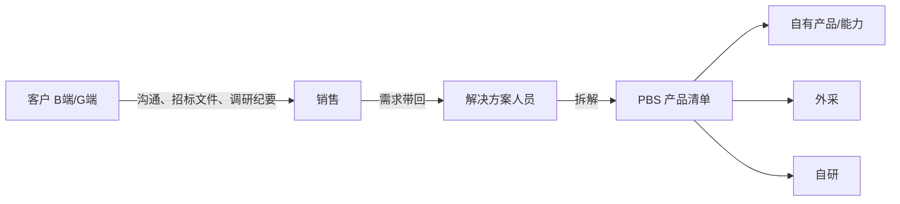
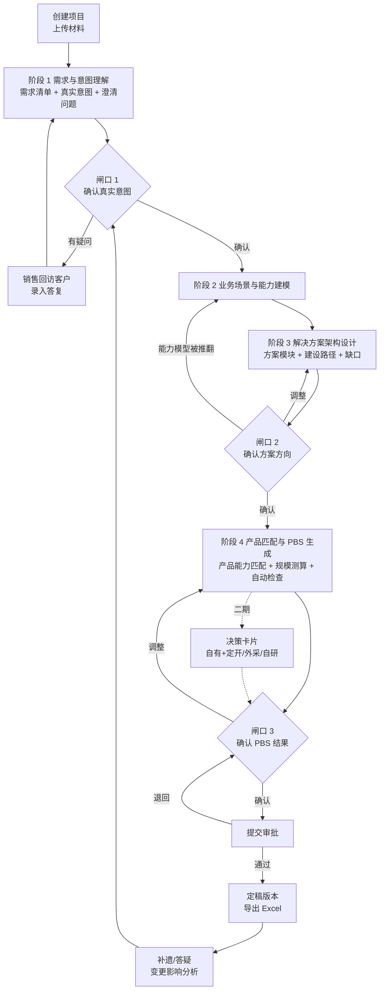
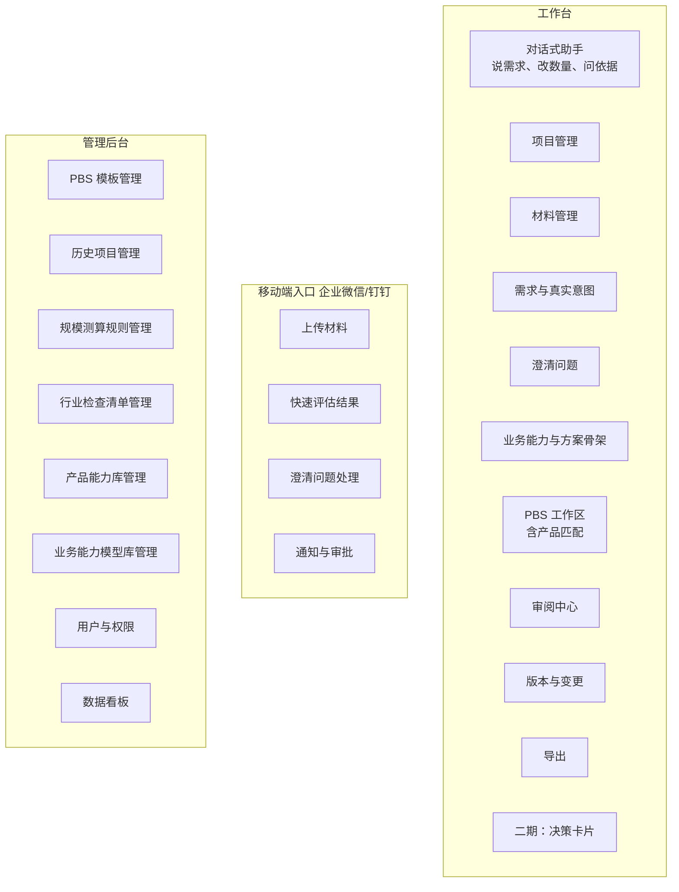

# PBS 拆解 Agent 产品设计方案

> 历史设计资料：保留原始讨论与目标，包含已废弃的固定阶段、人工闸口及技术选型。当前实现以 [architecture.md](architecture.md) 和仓库代码为准，不以本文作为新增功能或恢复旧流程的依据。

| 项目 | 内容 |
| --- | --- |
| 文档类型 | 产品需求文档（PRD） |
| 版本 | v4 |
| 状态 | 待评审 |
| 配套文档 | 技术实现见 `PBS_Agent_技术设计.md`（待按 v4 同步）；阶段与知识库划分参考业务方提供的《PBS拆解专家 归集设计 V2.1》 |
| 读者 | 业务负责人、解决方案部门、销售部门、研发、测试、设计 |

**修订记录**

| 版本 | 主要变化 |
| --- | --- |
| v1 | 初版：流程、多 Agent 分工、知识库、技术架构 |
| v2 | 补充用户与场景、基线与目标、第 0 期、版本管理、规模测算、失败处理、评估体系；来源决策改为决策卡片 |
| v3 | 按产品需求文档重写：增加功能清单与优先级、用户故事、业务规则、验收标准、页面说明、权限、通知、埋点、上线计划；技术实现内容移至技术设计文档 |
| v4 | 吸收《归集设计 V2.1》：需求到产品之间增加“真实意图”“业务能力”“方案骨架”三层；确立四个阶段、三个人工闸口和按阶段重跑的规则；产品匹配由二期提前到一期，并规定“需求不得直接匹配产品，必须经产品能力层中转”；知识库按 K1～K8 梳理；成本、报价与毛利是否纳入范围待业务方确认（公司现有 PBS 表是成本核算工具，见第 18 节第 11 条） |

---

## 1. 一页摘要

| 项目 | 内容 |
| --- | --- |
| **要解决的问题** | 解决方案人员把客户需求拆成产品清单（PBS）并判断自有/外采/自研，目前依赖个人经验，耗时长、容易漏项、结论无法追溯 |
| **产品是什么** | 一个帮解决方案人员读懂客户需求背后的真实意图、归纳业务能力、经产品能力匹配到具体产品、生成 PBS 初稿并检查漏项的工作台。所有结论都标明依据，在三个闸口由人确认后生效 |
| **目标用户** | 主要用户：解决方案人员；次要用户：销售、解决方案负责人 |
| **两种模式** | 快速评估（商机早期，几分钟出粗略结果）、投标拆解（正式投标，逐条对应招标条款） |
| **核心指标** | 出 PBS 初稿耗时；必须项需求召回率 |
| **一期范围** | 需求清单、真实意图、澄清问题、业务能力模型、方案骨架、PBS 初稿、基于产品能力库的产品匹配、需求与 PBS 对应表、基础规模测算、三个确认闸口、分级审阅、版本管理、Excel 导出 |
| **二期范围** | 自有+定开/外采/自研决策卡片、缺口统计、扩展知识库（业务场景库、方案组合库）；报价与商务方案是否纳入待确认（见第 18 节） |
| **前置条件** | 第 0 期数据摸底通过，且试点行业的主要产品已录入产品能力库 |

---

## 2. 背景与问题

### 2.1 业务流程现状



公司主要面向企业客户（B 端）和政府客户（G 端）。销售接触客户、拿到需求后，交给解决方案人员拆成 PBS。PBS 中一部分由公司已有产品和能力满足，其余需要外采或自研。拆解结果是后续方案评审、报价和交付的基础。

### 2.2 痛点

| 痛点 | 表现 | 影响 | 需在第 0 期量化 |
| --- | --- | --- | --- |
| 需求信息散 | 招标文件、纪要、聊天记录、口头转述格式不一 | 整理需求花大量时间，容易漏项 | 每个项目平均材料数量和类型 |
| 拆解耗时长 | 投标周期紧，经常加班赶工 | 方案质量受时间压缩影响 | 每个项目出 PBS 初稿的人天 |
| 漏项 | 交付阶段才发现漏掉的需求 | 变更或自行承担成本，影响毛利和客户关系 | 近一年漏项导致的变更单数量和金额 |
| 依赖个人经验 | 不同人拆出来的粒度、命名、结论差别大 | 质量不稳定，新人上手慢 | 新人独立完成拆解所需时间 |
| 产品能力不透明 | 产品功能边界、信创适配情况分散在各类文档 | 匹配靠记忆，容易误判 | 产品资料数量、格式、更新时间 |
| 外采/自研缺依据 | 成本、工期、风险靠经验判断 | 决策难以复盘 | 现有决策方式和审批流程 |
| 无法追溯 | 说不清某一项对应哪条需求、为什么这样选 | 评审和复盘困难 | — |

### 2.3 目标与基线

现状值为待验证的假设，第 0 期通过访谈和抽查历史项目实测后更新。

| 指标 | 现状（待实测） | 一期目标 | 二期目标 |
| --- | --- | --- | --- |
| 出 PBS 初稿耗时（投标拆解，含人工审阅） | 假设 3～5 人天 | ≤ 0.5 人天 | ≤ 0.5 人天（含产品匹配） |
| 必须项需求召回率 | 未统计 | ≥ 95% | ≥ 97% |
| PBS 节点采纳率 | 无 | ≥ 70% | ≥ 80% |
| 人工审阅耗时（约 200 条需求的项目） | 无 | ≤ 2 小时 | ≤ 2 小时 |
| 交付阶段发现的漏项数 | 从历史变更单统计 | — | 较基线下降 50% |
| 试点团队周活跃使用率 | 无 | ≥ 60% | 全部门 ≥ 60% |

**收益测算口径**：节省人天 × 人天成本 × 年项目数，加上漏项导致的变更和亏损减少额。第 0 期结束后按实测数据填写。

---

## 3. 用户与场景

### 3.1 用户角色

| 角色 | 想要什么 | 担心什么 | 主要使用的功能 |
| --- | --- | --- | --- |
| 资深方案人员 | 省掉整理需求、搭框架这些重复工作 | 拆错了还得改；自己的判断被替代 | 需求清单、PBS 初稿、漏项检查 |
| 新人方案人员 | 知道该拆成什么样、类似项目以前怎么做 | 看不懂为什么这样拆 | 相似项目参考、依据说明、澄清问题 |
| 销售 | 尽快知道需求能不能做、大概多少钱 | 填表麻烦 | 上传材料、处理澄清问题、查看快速评估结果 |
| 解决方案负责人 | 方案质量稳定、风险可控 | 下面的人过度依赖系统 | 审批、查看风险项、决策卡片 |
| 知识库管理员 | 模板、规则、历史项目好维护 | 维护工作量大 | 知识库管理后台 |

### 3.2 两种使用模式

| 项目 | 快速评估 | 投标拆解 |
| --- | --- | --- |
| 时机 | 商机早期，需求模糊 | 已有招标文件或明确的需求说明 |
| 典型输入 | 会议纪要、聊天记录、销售口述 | 招标文件、技术规范书、补遗、答疑 |
| 主要使用者 | 销售、方案人员 | 方案人员 |
| PBS 颗粒度 | 到子系统（L3） | 到模块或功能点（L4/L5） |
| 数量与规模 | 只给区间 | 给出具体数量和计算依据 |
| 处理时长 | ≤ 5 分钟 | ≤ 30 分钟（后台处理，分步出结果） |
| 人工审阅 | 快速浏览 | 按风险分级审阅 |
| 版本管理 | 不进入版本管理，可转为投标拆解 | 进入版本管理，需审批定稿 |
| 阶段与闸口 | 四个阶段连续运行，不设闸口，意图和方案只展示要点 | 三个闸口逐步确认，被拒绝时只重跑对应阶段（见 6.1） |

### 3.3 用户旅程：投标拆解

| 步骤 | 用户动作 | 系统表现 | 用户感受目标 |
| --- | --- | --- | --- |
| 1 | 销售创建项目，通过对话粘贴或上传招标文件、纪要等材料，选择密级 | 显示处理进度 | 上传简单，知道要等多久 |
| 2 | 等待 | 约 10～15 分钟后先出需求清单和真实意图，通知方案人员 | 不用干等全部完成 |
| 3 | 方案人员审阅需求清单和真实意图（**闸口 1**） | 优先展示需要重点看的条目；隐性意图附判断依据 | 不用逐条看几百条；知道客户真正想要什么 |
| 4 | 方案人员把澄清问题分派给销售 | 销售在企业微信收到问题 | 问题具体，可直接拿去问客户 |
| 5 | 销售录入客户答复 | 系统分析答复带来的变化，勾选后才生效，受影响的条目提示复核 | 答复后不用重新跑一遍 |
| 6 | 方案人员确认意图，查看业务能力和方案骨架（**闸口 2**） | 场景、能力、方案模块、建设路径、缺口已生成，此阶段不出现产品名 | 方案方向先对齐，再谈产品 |
| 7 | 方案人员确认方案方向，查看 PBS 初稿 | PBS 树、产品匹配依据、对应表、规模测算已生成 | 初稿结构合理，每项看得到为什么选这个产品、或为什么要外采 |
| 8 | 方案人员调整 PBS（也可以直接在对话里说“机场改成 12 个”） | 修改后自动检查覆盖情况，受影响的数量重算并标记复核 | 改起来顺手，漏了会提醒 |
| 9 | 方案人员确认 PBS 结果（**闸口 3**），提交审批 | 负责人收到审批通知 | — |
| 10 | 审批通过，导出 Excel | 按公司模板导出 | 可以直接用于评审 |
| 11 | 客户发补遗 | 上传后列出变化和影响，从受影响的闸口开始重新确认 | 知道该改哪里 |

### 3.4 用户旅程：快速评估

1. 销售在企业微信或工作台上传会议纪要或聊天截图，选择“快速评估”。
2. 约 5 分钟内收到结果：需求要点、粗略 PBS（到子系统）、规模和成本区间、主要缺口和风险、需要追问客户的问题。
3. 销售和方案人员据此判断是否继续投入。
4. 决定跟进时，一键转为投标拆解项目，已有内容作为起点。

---

## 4. 产品定位与边界

### 4.1 定位

**帮解决方案人员出初稿、查漏项、给依据的助手**，不是自动出方案的机器。

### 4.2 做什么

- 把多源需求材料整理成结构化需求清单，每条能找到原文出处。
- 在需求之上识别客户的**真实意图**（显性、隐性、战略），隐性和战略意图必须给出判断依据。
- 从业务场景推演、归纳**业务能力**，能力必须挂接在具体的业务活动上。
- 把能力组合成**方案骨架**（方案模块、建设路径），并如实暴露能力缺口。
- 经“产品能力”层中转，把业务能力匹配到自有产品，生成 PBS 初稿和需求与 PBS 的对应表，检查漏项。
- 发现缺失和矛盾，生成可以直接拿去问客户的澄清问题。
- 按公司规则测算数量。
- 管理需求变更和版本。
- 二期：为产品满足不了的缺口提供自有+定开、外采、自研的对比信息。

### 4.3 不做什么

- 不对客户报价、不做承诺。**报价单元、单价和商务方案是否纳入范围，见第 18 节待确认问题，确认前不做。**
- 不替代自有/外采/自研的最终决策。
- 不生成研发设计或代码。
- 一期、二期不生成完整标书。

### 4.4 责任划分

- 系统输出均为**草稿**，经人确认后才生效。
- 每项结论记录确认人。报价、方案、决策出错的后果，由确认人和审批人按公司现有流程承担。
- 此规则写入使用规范，并在首次使用时提示用户确认。

---

## 5. 竞品与参考

| 参考 | 做法 | 对本产品的启发 |
| --- | --- | --- |
| [商汤 Solution Agent](https://www.infoq.cn/article/xRUYrVgUlZQMRjJ1MM4F) | 政企投标场景：产品资料整理成分层产品库，需求结构化后逐层匹配，评估定制开发成本，生成方案并审核 | 和本场景最接近。约 50 页材料处理约 30 分钟，可作为处理时长参考 |
| [澜舟科技央企智能投标](https://hub.baai.ac.cn/view/51576) | 解析、生成、审核分角色处理 | 生成和审核分开，审核独立把关 |
| [PYRAMYD RFX Manager](https://www.pyramyd.ai/solutions/rfx-manager) | 需求逐条对应产品能力；对应不上的进入“缺口”，用于改进产品路线 | 缺口统计反馈给产品部门 |
| [ZBrain Solution Recommendation Agent](https://zbrain.ai/agents/Sales/all/Proposal-Development/solution-recommendation-agent/) | 结合历史赢单丢单和成本数据评估方案，高风险转人工 | 按风险分级交给人处理 |
| [Pre-Sales Document Assistant](https://github.com/fabricioartur/pre-sales-document-assistant) | 输出需求矩阵、风险清单、澄清问题、是否投标建议 | 输出物参考 |

**本产品的差异点**：

1. 重点放在 PBS 拆解和漏项检查，不做标书生成。
2. 数量用公司规则计算，不靠模型估算。
3. 支持补遗和多轮澄清带来的需求变更。
4. 政企项目默认在内网运行，数据不出公司。

---

## 6. 产品方案概览

### 6.1 核心业务流程

**四个阶段、三个确认闸口。**一个阶段是“有人消费的交付物 + 一个确认点”；阶段之间只传递已确认的阶段交付物，阶段内部各子步骤可以回指材料原文。每个阶段对应的是一段固定的处理流程，由系统按顺序执行，不是由模型自己决定下一步做什么。

| 阶段 | 做什么（内部子步骤） | 交付物 | 闸口 |
| --- | --- | --- | --- |
| 阶段 1 需求与意图理解 | 材料研判 → 需求解析 → 业务背景 → 真实意图识别（显性/隐性/战略） | 需求与意图模型 | 闸口 1：确认真实意图 |
| 阶段 2 业务场景与能力建模 | 5W 场景推演 → 从业务活动归纳业务能力 | 业务场景-能力模型 | 无独立闸口，随阶段 3 一并检视 |
| 阶段 3 解决方案架构设计 | 能力组合 → 方案模块 → 建设路径，缺口如实暴露 | 方案骨架 | 闸口 2：确认方案方向 |
| 阶段 4 产品匹配与 PBS 生成 | 业务能力 → 产品能力 → 产品 → PBS 项 → 规模测算 → 自动检查 | PBS 与产品匹配结果 | 闸口 3：确认 PBS 结果 |



**重跑范围规则**（用户通过对话或按钮发起，避免“改一处全部重做”）：

| 被拒绝的闸口 | 默认重跑范围 | 说明 |
| --- | --- | --- |
| 闸口 1 | 阶段 1，并连锁后续阶段 | 意图变了，后面都要重新推演 |
| 闸口 2 | 仅阶段 3 | 能力模型被推翻时才回退到阶段 2 |
| 闸口 3 | 仅阶段 4 | 方案方向不变，只调整匹配和 PBS |

**与快速评估的关系**：快速评估连续运行四个阶段，不设闸口，意图和方案只展示要点；转为投标拆解后，从闸口 1 开始逐步确认。

**两条贯穿全流程的规则**：

1. **证据链不衰减。**意图、能力、匹配结论都必须能回指到材料原文，不允许只依赖上一步的摘要。
2. **需求不得直接匹配产品。**必须经“业务能力 → 产品能力 → 产品”逐层中转，每一层给出匹配依据，中间缺任何一层都视为无效匹配。

### 6.2 功能架构



### 6.3 功能清单与优先级

优先级说明：P0 为一期必须上线；P1 为一期尽量上线，可延后到一期后续迭代；P2 为二期及以后。

| 模块 | 功能 | 优先级 | 阶段 |
| --- | --- | --- | --- |
| 项目管理 | 创建项目（模式、密级、行业、客户类型） | P0 | 一期 |
| 项目管理 | 项目成员与权限 | P0 | 一期 |
| 项目管理 | 快速评估转投标拆解 | P1 | 一期 |
| 材料管理 | 上传 PDF、Word、Excel、图片 | P0 | 一期 |
| 材料管理 | 上传录音并转文字 | P2 | 二期 |
| 材料管理 | 解析质量提示 | P0 | 一期 |
| 需求清单 | 自动生成需求清单（分类、优先级、硬约束、废标项） | P0 | 一期 |
| 需求清单 | 原文定位与高亮 | P0 | 一期 |
| 需求清单 | 编辑、新增、删除、合并、拆分需求 | P0 | 一期 |
| 需求清单 | 批量确认 | P0 | 一期 |
| 真实意图 | 识别显性、隐性、战略意图，隐性和战略意图必须给出判断依据和置信度 | P0 | 一期 |
| 真实意图 | 闸口 1：确认真实意图（可改写、删除、补充） | P0 | 一期 |
| 业务能力 | 5W 场景推演与业务能力归纳，能力挂接业务活动 | P0 | 一期 |
| 方案骨架 | 能力组合、方案模块、建设路径、能力缺口；闸口 2：确认方案方向 | P0 | 一期 |
| 流程控制 | 按闸口拒绝范围重跑对应阶段（见 6.1） | P0 | 一期 |
| 澄清问题 | 自动生成澄清问题 | P0 | 一期 |
| 澄清问题 | 分派给销售、录入答复、应用到需求 | P0 | 一期 |
| 澄清问题 | 企业微信/钉钉处理澄清问题 | P1 | 一期 |
| PBS 工作区 | 生成 PBS 初稿 | P0 | 一期 |
| PBS 工作区 | 展示参考的历史项目 | P0 | 一期 |
| PBS 工作区 | 编辑 PBS 树（增删改、拖拽调整层级） | P0 | 一期 |
| PBS 工作区 | 需求与 PBS 对应表、未覆盖需求提示 | P0 | 一期 |
| 产品匹配 | 业务能力 → 产品能力 → 产品逐层匹配，展示命中的产品能力或被哪条限制挡住 | P0 | 一期 |
| 产品匹配 | 硬约束核对（信创、环境、部署方式、资质）并列出冲突 | P0 | 一期 |
| 规模测算 | 按规则计算数量并显示依据 | P0 | 一期 |
| 规模测算 | 参数缺失时按假设值计算并提示 | P0 | 一期 |
| 审阅中心 | 按风险分级审阅 | P0 | 一期 |
| 审阅中心 | 自动检查漏项 | P0 | 一期 |
| 审阅中心 | 闸口 3：确认 PBS 结果；提交审批与审批 | P0 | 一期 |
| 版本与变更 | 定稿版本、版本对比 | P0 | 一期 |
| 版本与变更 | 上传补遗后的变更识别与影响分析 | P1 | 一期 |
| 导出 | 按公司模板导出 Excel | P0 | 一期 |
| 导出 | 导出版本差异报告 | P1 | 一期 |
| 对话式助手 | 在对话中完成上述操作、追问依据，模型把话转成受限的操作，由系统校验后执行 | P0 | 一期 |
| 快速评估 | 移动端上传并查看快速评估结果 | P1 | 一期 |
| 管理后台 | PBS 模板、历史项目、规模测算规则、行业检查清单管理 | P0 | 一期 |
| 管理后台 | 产品能力库管理（产品、产品能力、限制、信创适配、手册上传） | P0 | 一期 |
| 管理后台 | 业务能力模型库管理 | P1 | 一期 |
| 管理后台 | 数据看板 | P1 | 一期 |
| 决策卡片 | 自有+定开/外采/自研对比 | P2 | 二期 |
| 缺口统计 | 同类缺口统计并通知产品部门 | P2 | 二期 |
| 知识库扩展 | 业务场景知识库、解决方案组合知识库 | P2 | 二期 |
| 报价与商务方案 | 标准报价单元、单价区间、商务说明（是否纳入待确认，见第 18 节） | 待定 | 待定 |
| 系统对接 | CRM、报价、项目管理系统 | P2 | 三期 |

---

## 7. 功能需求详述

### 7.1 项目管理

**用户故事**

- 作为销售，我想快速创建一个项目并上传材料，这样方案人员可以马上开始处理。
- 作为方案人员，我想看到我负责的所有项目及其进度，这样我能安排工作。

**功能说明**

- 创建项目时填写：项目名称、客户名称、客户类型（B/G）、行业、模式（快速评估/投标拆解）、密级、负责的方案人员、投标截止日期（可选）。
- 项目列表按状态展示：待处理、处理中、审阅中、待审批、已定稿。
- 项目详情页显示：基本信息、材料列表、处理进度、当前版本、待办事项数量。

**业务规则**

- **密级**：分为“公开”“内部”“敏感”三级。G 端项目默认“敏感”，不可调低；B 端项目默认“内部”。
- 密级决定数据能否使用外部模型服务（具体见第 12 节）。
- 项目创建人默认是项目成员，可添加其他成员。
- 快速评估项目可一键转为投标拆解，原有需求和 PBS 作为初稿保留。

**验收标准**

- 创建项目的必填项不超过 6 个，1 分钟内可完成。
- G 端项目的密级下拉框中无法选择低于“敏感”的选项。
- 快速评估转投标拆解后，原有需求和 PBS 完整保留。

### 7.2 材料上传与解析

**用户故事**

- 作为销售，我想把客户发来的各种文件直接上传，不用先整理格式。
- 作为方案人员，我想知道哪些页面识别得不好，这样我能重点核对。

**功能说明**

- 支持上传 PDF、Word、Excel、图片（含聊天截图）；二期支持录音。
- 支持一次上传多个文件；每个文件标注类型：招标文件、补遗、答疑、调研纪要、聊天记录、其他。
- 上传后显示处理进度：解析中、生成需求清单中、生成 PBS 中。
- 解析完成后显示质量提示，例如“第 12～15 页为扫描件，识别质量较低”。

**业务规则**

- 单个文件不超过 100 MB，单个项目材料总量不超过 1 GB。
- 同一文件重复上传时提示“该文件已上传”。
- 项目定稿后再上传的文件，自动标记为新一批材料，进入变更流程（见 7.8）。
- 识别质量低的页面中抽取出的需求，自动列入“必须逐项审阅”。

**验收标准**

- 上传后 10 秒内显示进度。
- 识别质量低的页面在材料列表和需求清单中都有明确标记。
- 文件格式不支持时给出明确提示和支持的格式列表。

### 7.3 需求清单

**用户故事**

- 作为方案人员，我想看到一份完整、分类清楚的需求清单，每条都能点开看原文。
- 作为方案人员，我想优先看必须项和废标项，确保不漏。
- 作为方案人员，我想快速确认没有疑问的条目，把时间花在有问题的地方。

**功能说明**

需求清单以表格形式展示，主要字段：

| 字段 | 说明 |
| --- | --- |
| 编号 | 如 REQ-012，项目内唯一，版本变化时保持不变 |
| 需求内容 | 一条只表达一件事 |
| 分类 | 功能 / 非功能 / 约束条件 / 集成 / 商务 |
| 优先级 | 必须 / 重要 / 可选 |
| 标记 | 硬约束、废标项、★、▲ |
| 来源 | 文件名、页码、条款号；点击在原文中高亮 |
| 依据等级 | 见附录 A |
| 审阅分级 | 必须逐项审阅 / 建议抽查 / 可批量确认 |
| 状态 | 待确认 / 已确认 / 已删除 / 已变更 |
| 关联 PBS 节点 | PBS 生成后显示 |

支持的操作：

- 按分类、优先级、标记、审阅分级、状态筛选。
- 编辑需求内容和字段。
- 手动新增需求（标记为“人工新增”）。
- 合并重复需求、拆分复合需求。
- 删除需求（需填写原因）。
- 批量确认。

**业务规则**

- 每条需求必须有来源。人工新增的需求来源可以填写“客户口头确认”等说明。
- 一条需求包含多个要求时拆成多条。例如“支持 1000 人同时在线并通过等保三级”拆为两条。
- 招标文件中“★/▲”条款和废标条款自动标记为“必须”，并列入“必须逐项审阅”。
- 人工修改过的内容，系统重新生成时不会覆盖，只会在可能需要更新时提示“建议复核”。
- 删除的需求不真正删除，可在“已删除”中查看和恢复。

**验收标准**

- 每条系统生成的需求都能定位到原文。
- 所有“★/▲”条款和废标条款都出现在“必须逐项审阅”中。
- 人工修改后重新生成，修改内容保持不变。
- 批量确认支持一次确认 100 条以上。

### 7.3A 真实意图（闸口 1）

**用户故事**

- 作为方案人员，客户写出来的需求往往不是他真正要的，我想在拆 PBS 之前先确认系统是不是理解对了。
- 作为新人，我想知道一条需求背后的业务目的，这样不会机械地照字面去拆。

**功能说明**

- 在需求清单之上，系统归纳三类意图：

| 类型 | 含义 | 要求 |
| --- | --- | --- |
| 显性意图 | 材料里直接写明的目标 | 关联到具体需求 |
| 隐性意图 | 材料没有直说，但从需求、背景、行业推断得出 | 必须给出判断依据（材料原文或行业知识）和置信度 |
| 战略意图 | 客户更长远的目的（如满足考核、为后续建设铺垫） | 必须给出判断依据 |

- 同时输出**业务背景**（行业、客户角色、业务阶段、约束条件）和**待确认清单**；置信度不足的意图自动进入待确认清单，并转为澄清问题。
- **闸口 1**：方案人员逐条确认、改写、删除或补充意图。确认后才进入业务能力建模。

**业务规则**

- 隐性和战略意图没有判断依据的，不允许输出。
- 区分“材料事实”和“分析推断”，页面上用不同样式展示。
- 意图确认前，后续阶段不启动；客户答复改变了意图时，自动提示重新确认。

**验收标准**

- 每条隐性、战略意图都能查看判断依据。
- 被人工改写或补充的意图，重新生成时不被覆盖。

### 7.3B 业务能力与方案骨架（闸口 2）

**用户故事**

- 作为方案人员，我想先看到“要具备哪些业务能力、怎么组合成方案”，再去对产品，而不是直接对着需求挑产品。
- 作为负责人，我想在产品匹配之前确认方案方向，方向错了后面全部作废。

**功能说明**

- **业务能力模型**：按 5W（谁、在哪、什么时间、做什么、为什么）推演业务场景，从场景里的业务活动归纳业务能力。每条能力标注挂接的业务活动、来源意图和优先级。
- **方案骨架**：把能力组合成方案模块，给出建设路径（分期、范围、里程碑），并列出**能力缺口**（方案内能覆盖 / 待补）。
- 此阶段**不出现任何产品名称**，只讲能力。
- **闸口 2**：方案人员确认方案方向，可以调整模块划分、增删能力、改分期。

**业务规则**

- 每条能力必须挂接至少一个业务活动，不允许凭空产生能力。
- 每个意图必须被至少一个场景覆盖，或显式列入“未覆盖原因”。
- 每个方案模块必须引用能力；缺口必须如实列出，不得隐去。
- 闸口 2 被拒绝时，默认只重跑方案骨架；能力模型本身被推翻时，才回退到业务能力建模。

**验收标准**

- 能力 → 业务活动 → 意图的链路可点击追溯。
- 方案骨架中的缺口，在后续产品匹配阶段都有对应处理（匹配到产品，或标记为外采、自研、服务）。

### 7.4 澄清问题

**用户故事**

- 作为方案人员，我想自动得到一份该问客户的问题清单，不用自己逐条琢磨哪里没说清。
- 作为销售，我想在手机上收到问题并直接录入客户的答复。

**功能说明**

- 系统根据以下情况生成澄清问题：
  - 缺失：对照行业检查清单，常见需求没有提到（如政务项目未说明数据安全等级）。
  - 矛盾：前后描述不一致（如总则说私有化部署，分项说使用公有云）。
  - 模糊：表述不清（如“高并发”没有具体数字）。
  - 规模参数缺失：测算数量需要的参数没有提供。
- 每个问题显示：问题内容、提出原因、关联的需求、建议的问法。
- 方案人员可以编辑、删除、合并问题，并分派给销售。
- 销售可在工作台或企业微信/钉钉中查看问题、录入答复、注明答复来源（口头、邮件、答疑文件）。
- 答复录入后，方案人员点击“应用答复”，系统更新相关需求并标记受影响的条目。

**业务规则**

- 问题状态：待分派、待答复、已答复、已应用、已忽略。
- 投标截止日期前 3 天仍未答复的问题，提醒销售和方案人员。
- 答复应用后，相关需求的修改记录中注明“来自澄清答复”。

**验收标准**

- 规模参数缺失时一定生成对应的澄清问题。
- 销售在企业微信中能完成查看和答复，无需登录工作台。
- 应用答复后，受影响的需求和 PBS 节点有明确标记。

### 7.5 PBS 工作区

**用户故事**

- 作为方案人员，我想拿到一份结构合理的 PBS 初稿，在此基础上调整，而不是从零开始。
- 作为新人，我想知道初稿参考了哪些历史项目，方便学习。
- 作为方案人员，我想随时知道还有哪些需求没有落到 PBS 里。

**功能说明**

- **PBS 树**：按层级展示

  ```
  L1 解决方案
  └── L2 系统（基础设施层 / 平台层 / 应用层 / 服务层）
      └── L3 子系统
          └── L4 模块/产品
              └── L5 组件/功能点/服务项
  ```

- **节点详情**：名称、描述、所属层、数量与单位、关联需求、依赖的其他节点、参考的历史项目、依据等级；以及**产品匹配**：来源（自有产品 / 外采 / 自研 / 服务）、匹配的产品、命中的产品能力，或被哪个产品的哪条限制挡住。
- **产品匹配**：每个节点按“业务能力 → 产品能力 → 产品”逐层匹配，页面以三张依据卡展示：为什么要有这一项（关联需求与原文）、匹配依据（命中的能力或限制，附产品手册中检索到的原文片段）、数量怎么来的（规则、公式、参数及其来源）。
- **参考项目**：工作区顶部显示“本次参考了以下历史项目”，可点击查看对方的 PBS。
- **编辑**：新增、删除、重命名节点；拖拽调整层级和顺序；修改数量；关联或取消关联需求；更换匹配的产品并勾选命中的能力；对单个节点“重新匹配”（由系统重新判断，用户确认后才采纳）。
- **覆盖检查**：侧边栏实时显示“未覆盖的需求”“没有需求支撑的节点”“缺少依赖的节点”“约束冲突”“待复核的节点”。
- **局部重新生成**：选中某个子树，要求系统重新生成该部分。

**业务规则**

- 层级必须连续，不能从 L2 直接到 L4。
- 每条“必须”需求至少关联一个 PBS 节点。
- 每个节点至少关联一条需求，或填写配套理由（如“为满足等保要求配套日志审计”）。
- 服务层必须检查是否包含实施部署、集成对接、培训、运维。缺少时提示，用户可选择“确认不需要”并填写原因。
- 没有找到相似历史项目时，只按公司 PBS 模板生成，顶部提示“没有可参考的历史项目，请重点审阅 PBS 结构”。
- 人工修改过的节点，局部重新生成时不会被覆盖。
- **产品匹配只能引用产品能力库中真实存在的能力和限制**，不能凭产品名称或描述推断产品具备某能力；系统给出的引用在库中找不到时自动丢弃，该节点降级为“模型推断”并转入必须逐项审阅。
- 产品“限制”中写明不包含、不支持、需定制的内容，不能算作自有产品覆盖，必须拆出外采、自研或服务节点，并注明挡住它的那条限制。
- 自有产品的软件许可固定按 1 套计，不挂规模测算规则；按量计费的附加授权（扩容、按路数授权）单独成为一个节点，避免把产品数量算成授权数量。
- 产品与硬约束类需求（信创、环境、部署方式、资质）冲突时，必须列出冲突并以产品资料中的原文为依据；没有原文依据的冲突不予采信。
- 同一条测算规则只能用于一个节点，防止重复计量。

**验收标准**

- PBS 初稿中每个节点都显示依据来源（模板、历史项目、系统推断）。
- 每个产品匹配结论都能查看引用的产品能力、限制和资料出处。
- 拖拽调整后，节点编号自动更新，关联关系保持不变。
- 覆盖检查在每次编辑后 3 秒内刷新。
- 存在未覆盖的“必须”需求时，无法提交审批。

### 7.6 规模测算

**用户故事**

- 作为方案人员，我想自动算出服务器、存储、授权、人天这些数量，并且知道是怎么算的。
- 作为方案人员，我想知道哪些数量是按假设值算的，避免报价出错。

**功能说明**

- 系统从需求中提取测算所需的参数（如用户数、并发数、数据量、保留年限、部署节点数），按公司规则计算数量。
- 每个数量显示：结果、使用的规则、使用的参数及其来源。
- 使用假设值的数量用醒目标记显示，并关联对应的澄清问题。
- 用户可以直接修改数量，修改后标记为“人工确认”。

**业务规则**

- **数量只按公司维护的规则计算，系统不自行估算。**
- 参数缺失时，规则中定义了假设值的按假设值计算并标记；没有定义假设值的数量留空，由人工填写。
- 规则更新后，已定稿版本不受影响；草稿中的数量提示“规则已更新，可重新计算”。
- 快速评估模式只给出区间（按参数的合理范围计算）。

**验收标准**

- 每个系统计算的数量都能查看计算过程。
- 使用假设值的数量 100% 有标记并关联澄清问题。
- 一期至少覆盖 10～20 条最常用的测算规则。

### 7.7 审阅中心

**用户故事**

- 作为方案人员，我想知道哪些内容必须仔细看、哪些可以快速过，这样审阅不会比自己做还累。
- 作为负责人，我想快速看到项目的风险点，再决定是否批准。

**功能说明**

- **分级审阅**：待审阅内容按三级分组展示

| 审阅级别 | 包含内容 | 审阅方式 |
| --- | --- | --- |
| 必须逐项审阅 | 硬约束、废标项、“★/▲”条款；依据等级为“模型推断”或“无依据”的内容；来自低质量页面的需求；使用假设值的数量；二期的所有决策卡片 | 逐项查看依据后确认或修改 |
| 建议抽查 | 依据等级为“有历史案例”的内容 | 浏览列表，有疑问再展开 |
| 可批量确认 | 依据等级为“原文明确”的普通条目 | 一键批量确认 |

- **自动检查结果**：列出未覆盖的必须需求、缺失的服务层项、缺少依赖的节点、未填写数量的节点，以及历史上同类项目在交付阶段才补上的内容。
- **审批**：方案人员提交审批，负责人查看项目摘要（需求数、节点数、风险项、自动检查结果）后通过或退回。

**业务规则**

- “必须逐项审阅”中的内容全部处理完才能提交审批。
- 自动检查中的严重问题（未覆盖的必须需求）未解决时不能提交审批；一般问题可以填写说明后提交。
- 退回时必须填写原因。

**验收标准**

- 约 200 条需求的项目，人工审阅耗时 ≤ 2 小时（试点实测）。
- 审阅中心显示每一级的数量和完成进度。
- 负责人可以在企业微信/钉钉中完成审批。

### 7.8 版本与变更

**用户故事**

- 作为方案人员，客户发了补遗，我想知道哪些需求变了、要改哪些地方。
- 作为负责人，我想对比两个版本，知道这次改了什么。

**功能说明**

- **版本**：审批通过后生成正式版本（v1、v2……）。正式版本只读；之后的修改在新的草稿上进行。
- **变更识别**：上传补遗、答疑或录入客户澄清后，系统列出新增、修改、删除的需求，修改的需求显示前后对比。
- **影响分析**：列出受影响的 PBS 节点和数量测算结果，按影响程度排序。
- **逐项处理**：用户逐项选择“接受变更”或“不接受”。接受后更新草稿。
- **版本对比**：任选两个版本，显示需求、PBS、数量的差异。

**业务规则**

- 人工修改过的内容受变更影响时，只提示“建议复核”，不自动修改。
- 补遗中明确删除的条款，对应需求标记为“已删除”，关联的 PBS 节点提示复核。
- 每次接受变更都记录到修改记录，注明来源文件。

**验收标准**

- 上传补遗后能列出所有变化的需求，且修改的需求有前后对比。
- 版本对比结果可导出为“版本差异报告”。

### 7.9 导出

**功能说明**

- 导出内容：需求清单、澄清问题、PBS 清单、需求与 PBS 对应表、规模测算表、版本差异报告。
- 导出格式与公司现有 PBS 模板和报价模板一致（模板在管理后台配置）。
- 导出文件名包含项目名称、版本号和日期。

**业务规则**

- 草稿状态可以导出，文件中标注“草稿”。
- 敏感项目导出需项目负责人同意；导出文件带水印（导出人、时间）。
- 所有导出操作记入日志。

**验收标准**

- 导出的 Excel 打开后格式与公司模板一致，无需二次调整即可用于评审。

### 7.10 对话式助手

对话是用户驱动整个流程的**主要方式**，右侧工作区（材料、需求、澄清、PBS、导出）是对话结果的实时展示，也可以直接在表格里查看和微调。

**用户故事**

- 作为方案人员，我想像和同事说话一样推进工作：“把这份纪要抽成需求”“机场改成 12 个”“为什么要自研车牌识别”，不用到处找按钮。
- 作为销售，我想把客户的答复直接转述给助手，由它判断会改变什么。

**功能说明**

- 工作台左侧是对话区，右侧是工作区；助手执行操作后，工作区自动切到对应页面并定位到相关条目。
- **可以在对话中完成的操作**：添加材料（粘贴文字或上传文件）、抽取需求、确认/修改/新增/删除需求、设定测算参数、录入客户答复、生成 PBS、修改 PBS 项和数量、对某一项重新匹配、确认 PBS 项、标记完成。
- **可以追问**：依据追问（“为什么要外采 GPU”）、覆盖查询（“还有哪些必须需求没落到 PBS”）、影响查询（“删掉这条需求会影响什么”）、相似项目查询。回答只依据当前项目的材料、需求、PBS 和产品库。
- 对话下方根据当前进度提供**快捷操作**（如“确认 12 条低风险需求”“生成 PBS”），点击即执行。
- 支持选择对话所用的模型（范围为模型网关提供的全部对话模型）。

**业务规则**

- **模型只负责把用户的话翻译成一组受限的操作，不直接改数据。**每个操作的目标（需求编号、PBS 项、参数名、产品）都由系统校验后，通过与工作区表格相同的业务逻辑执行，业务规则（人工修改不被覆盖、同一规则只用一次、数量依据等）对对话操作同样有效。
- 删除类操作先在对话中弹出确认卡片，用户确认后才执行。
- 客户答复先由模型分析会带来哪些变更，以卡片形式展示，用户勾选采纳的部分后才生效。
- 意思不明确或缺少必要信息（例如没说改成多少）时，助手追问，不猜。
- 不回答与当前项目无关的问题。
- 对话记录随项目保存，可清空。

**验收标准**

- 对话中发出的每个修改操作，都能在工作区看到结果，并记录在项目操作记录里。
- 模型给出不存在的编号或不被支持的操作时，系统拒绝并给出明确提示，不产生任何数据变更。

### 7.11 产品匹配的深化与决策卡片

> v4 起，**基础的产品匹配（业务能力 → 产品能力 → 产品，含限制与硬约束核对）已在一期交付**，见 7.5。本节只保留二期的深化内容。

**用户故事**

- 作为负责人，对于自有产品满足不了的部分，我想看到自有+定开、外采、自研三种做法的对比，再做决定。
- 作为产品负责人，我想知道哪些需求反复出现但我们没有产品，作为产品规划的输入。

**功能说明**

- **满足程度细分**：一期只区分“命中产品能力”和“被产品限制挡住”；二期细分为：

| 满足程度 | 含义 | 后续处理 |
| --- | --- | --- |
| 完全满足 | 标准产品直接满足 | 归入自有 |
| 配置满足 | 通过配置即可满足 | 归入自有，标注配置工作量 |
| 定开满足 | 需要二次开发 | 生成决策卡片 |
| 部分满足 | 只满足一部分 | 拆分节点，剩余部分生成决策卡片 |
| 不满足 | 无法满足 | 生成决策卡片 |

- **决策卡片**：并排对比三种做法

| 项目 | 自有 + 定开 | 外采 | 自研 |
| --- | --- | --- | --- |
| 方案描述 | 基于哪个产品、改什么 | 哪家供应商、哪个产品 | 新建什么能力 |
| 成本 | 定开人天区间 × 单价 | 采购价 + 集成 + 维保 | 研发人天区间 × 单价 + 维护 |
| 工期 | 定开周期 | 采购 + 集成周期 | 研发周期 |
| 风险 | 对产品主线的影响 | 供应商稳定性、兼容性 | 技术难度、人员 |
| 合规 | 已有资质 | 信创、客户准入名录 | 是否需新认证 |
| 战略与复用 | 能否沉淀为产品功能 | 是否形成依赖 | 历史上同类缺口出现次数 |

- **缺口统计**：管理后台按月统计同类缺口，出现 ≥ 3 次时通知产品部门。

**业务规则**

- 系统**不给出推荐结论**，只提供对比信息和提示，由负责人选择。
- 数据查不到时显示“无数据”，不估算。
- 提示规则（只提示不推荐）：
  - 硬件和通用软件许可（数据库、操作系统、安全设备）提示“通常外采”。
  - 某做法工期不满足项目要求时标记“工期不满足”。
  - 成本或风险超过阈值时标记“需升级审批”。
- 产品匹配只能引用产品能力库中已有的能力和限制，不能凭描述推断产品具备某能力（一期已生效）。
- 引用的产品资料超过 6 个月未更新时，标注“资料可能过期”。

**验收标准**

- 每个满足度判断都能查看引用的产品能力和资料出处。
- 决策卡片中所有数字都有来源，没有来源的显示“无数据”。

### 7.12 管理后台

| 功能 | 说明 | 维护方 | 阶段 |
| --- | --- | --- | --- |
| PBS 模板管理 | 按行业维护标准 PBS 层级、命名、必需节点（如服务层必需项） | 解决方案部门 | 一期 |
| 历史项目管理 | 导入历史项目的需求、PBS、交付阶段的变更；标记数据质量 | 解决方案部门 + PMO | 一期 |
| 规模测算规则管理 | 新增、修改、停用规则；设置参数和假设值；查看规则被使用的次数 | 解决方案部门 + 交付部门 | 一期 |
| 行业检查清单管理 | 维护各行业常见需求项和对应的澄清问题 | 解决方案部门 | 一期 |
| 产品能力库管理 | 产品、产品能力、限制（不包含/不支持/需定制）、信创适配、单位；支持 Excel 批量导入、上传产品手册由系统整理能力与限制后人工确认；手册同时进入检索 | 产品部门 | **一期** |
| 业务能力模型库管理 | 维护各行业标准业务能力及其与业务活动的对应 | 解决方案部门 | 一期 |
| 导出模板管理 | 上传和配置公司 PBS 模板、报价模板 | 解决方案部门 | 一期 |
| 用户与权限 | 账号、角色、部门 | 系统管理员 | 一期 |
| 数据看板 | 使用情况、效果指标、质量问题（见第 13 节） | 产品经理 | 一期 |
| 业务场景库、方案组合库管理 | 行业场景模板、成熟的方案组合模式 | 解决方案部门 | 二期 |
| 供应商库管理 | 外采产品、价格区间、资质、合作评价 | 采购部门 | 二期 |

**业务规则**

- 模板、规则修改后生成新版本，已定稿项目不受影响。
- 每条规则和模板都有负责人；超过 6 个月未更新时提醒负责人。

---

## 8. 页面清单

| 页面 | 主要内容 | 主要用户 | 阶段 |
| --- | --- | --- | --- |
| 我的项目 | 项目列表、状态筛选、待办提醒 | 全部 | 一期 |
| 创建项目 | 基本信息、模式、密级、上传材料 | 销售、方案人员 | 一期 |
| 项目概览 | 基本信息、处理进度、待办数量、当前版本 | 全部 | 一期 |
| 材料 | 文件列表、批次、解析质量 | 方案人员 | 一期 |
| 需求清单 | 左侧需求表格，右侧原文预览（点击高亮） | 方案人员 | 一期 |
| 真实意图 | 显性/隐性/战略意图、判断依据、业务背景、待确认清单；闸口 1 | 方案人员 | 一期 |
| 业务能力与方案骨架 | 场景树、业务能力、方案模块、建设路径、能力缺口；闸口 2 | 方案人员、负责人 | 一期 |
| 澄清问题 | 问题列表、分派、答复、应用 | 方案人员、销售 | 一期 |
| PBS 工作区 | 左侧 PBS 树，中间节点详情（含产品匹配依据），右侧关联需求和覆盖检查 | 方案人员 | 一期 |
| 审阅中心 | 分级待办、自动检查结果、提交审批 | 方案人员、负责人 | 一期 |
| 版本与变更 | 版本列表、版本对比、变更清单与影响 | 方案人员、负责人 | 一期 |
| 快速评估结果 | 需求要点、粗略 PBS、区间、风险、追问问题 | 销售、方案人员 | 一期 |
| 移动端卡片 | 快速评估结果、澄清问题、审批 | 销售、负责人 | 一期 |
| 决策卡片 | 产品库无法满足的缺口：自有+定开、外采、自研三种做法对比 | 方案人员、负责人 | 二期 |
| 管理后台 | 模板、历史项目、规则、检查清单、权限、看板 | 管理员 | 一期 |

**关键页面布局：PBS 工作区**

```
┌───────────────────────────────────────────────────────────────────────┐
│ 项目名称 · 投标拆解 · 草稿 v2      参考项目：P-2025-031、P-2024-118  [提交审批] │
├──────────────────┬───────────────────────────────┬────────────────────┤
│ PBS 树            │ 节点详情                        │ 关联需求 / 覆盖检查  │
│ ▾ L1 智慧政务平台  │ 名称：智能问答模块                │ 关联需求（3）        │
│   ▾ L2 应用层     │ 层：应用层  层级：L4             │  REQ-005 ...        │
│     ▾ L3 ...      │ 数量：1 套  依据：规则 R-APP-01   │  REQ-006 ...        │
│       • 智能问答  │ 依赖：PBS-2.1.2 数据中台          │                     │
│   ▸ L2 服务层 ⚠   │ 依据等级：有历史案例              │ 未覆盖的需求（2）⚠   │
│                  │ 参考：P-2025-031 同名模块         │  REQ-041 必须 ...    │
│ [+ 新增节点]      │ [局部重新生成]  [修改记录]        │ 缺失：培训服务 ⚠      │
└──────────────────┴───────────────────────────────┴────────────────────┘
```

---

## 9. 权限设计

| 操作 | 销售 | 方案人员 | 解决方案负责人 | 知识库管理员 | 系统管理员 |
| --- | --- | --- | --- | --- | --- |
| 创建项目 | ✓ | ✓ | ✓ | | |
| 上传材料 | ✓（自己的项目） | ✓ | ✓ | | |
| 查看需求清单和 PBS | ✓（自己的项目） | ✓（参与的项目） | ✓（本部门） | | |
| 编辑需求和 PBS | | ✓（参与的项目） | ✓ | | |
| 处理澄清问题 | ✓（分派给自己的） | ✓ | ✓ | | |
| 提交审批 | | ✓ | ✓ | | |
| 审批 | | | ✓ | | |
| 导出（内部、公开项目） | ✓（自己的项目） | ✓ | ✓ | | |
| 导出（敏感项目） | 需审批 | 需审批 | ✓ | | |
| 查看决策卡片（二期） | | ✓ | ✓ | | |
| 管理模板、规则、检查清单 | | | | ✓ | |
| 管理产品能力库（二期） | | | | ✓（产品部门） | |
| 管理用户与权限 | | | | | ✓ |
| 查看数据看板 | | | ✓ | ✓ | ✓ |

**说明**：

- 项目数据只对项目成员和本部门负责人可见。
- 销售默认看不到二期的成本和决策卡片，避免内部成本信息外传。

---

## 10. 通知

| 触发事件 | 通知对象 | 渠道 |
| --- | --- | --- |
| 需求清单生成完成 | 方案人员 | 企业微信/钉钉、工作台 |
| PBS 初稿生成完成 | 方案人员 | 企业微信/钉钉、工作台 |
| 处理失败需要人工介入 | 方案人员 | 企业微信/钉钉、工作台 |
| 澄清问题被分派 | 销售 | 企业微信/钉钉 |
| 澄清问题已答复 | 方案人员 | 工作台 |
| 截止日期前 3 天仍有未答复的问题 | 销售、方案人员 | 企业微信/钉钉 |
| 提交审批 | 负责人 | 企业微信/钉钉 |
| 审批通过或退回 | 方案人员 | 企业微信/钉钉 |
| 定稿后上传了新材料 | 方案人员、负责人 | 企业微信/钉钉 |
| 知识库条目超过 6 个月未更新 | 对应负责人 | 企业微信/钉钉（每月汇总） |
| 同类缺口出现 ≥ 3 次（二期） | 产品部门负责人 | 企业微信/钉钉（每月汇总） |

---

## 11. 异常情况与提示

原则：**宁可明确说“不确定”，也不硬给一个答案**。提示要告诉用户发生了什么、该做什么。

| 情况 | 系统处理 | 提示文案示例 |
| --- | --- | --- |
| 扫描件或图片识别质量差 | 标记低质量页面，抽取结果列入必须逐项审阅 | “第 12～15 页识别质量较低，请对照原文核对这些页面的需求。” |
| 表格解析可能有误 | 保留原表格截图供对照 | “以下表格可能解析有误，请对照右侧原文核对。” |
| 没有相似历史项目 | 只按模板生成 | “没有找到可参考的历史项目，本次 PBS 仅基于公司模板生成，请重点审阅结构。” |
| 规模参数缺失 | 按假设值计算或留空，生成澄清问题 | “缺少并发用户数，服务器数量暂按 500 并发计算，已生成澄清问题。” |
| 部分条目处理失败 | 保留已完成部分，可重试 | “有 6 条需求未能自动处理，可点击重试或手动处理。” |
| 处理时间超过预期 | 继续后台处理并告知 | “文件较多，预计还需 10 分钟，完成后会通知你。” |
| 本项目的处理额度用完 | 暂停处理并通知 | “本项目已达到处理额度上限，请联系管理员。” |
| 产品库中找不到匹配（二期） | 标记不满足，生成决策卡片 | “产品库中没有找到满足该需求的功能。” |
| 引用的产品资料过期（二期） | 可引用但标注 | “引用的产品手册已超过 6 个月未更新，请确认是否仍然适用。” |

---

## 12. 非功能需求

| 类别 | 要求 |
| --- | --- |
| 处理时长 | 快速评估 ≤ 5 分钟；投标拆解 ≤ 30 分钟，其中需求清单 ≤ 15 分钟内先出 |
| 页面响应 | 常规页面加载 ≤ 2 秒；编辑操作 ≤ 1 秒；覆盖检查刷新 ≤ 3 秒 |
| 并发 | 试点阶段支持同时处理 10 个项目 |
| 可用性 | 工作时间（8:00～22:00）可用性 ≥ 99%；处理中断后可从断点继续 |
| 数据合规 | 敏感项目（G 端默认）的数据和模型处理全部在公司内网完成，不使用外部模型服务；内部项目默认内网处理，经审批可用外部服务；公开项目可使用外部服务 |
| 数据安全 | 项目级权限隔离；查看、编辑、导出全部记录日志；导出文件带水印 |
| 审计 | 每条结论可追溯到确认人、确认时间和修改记录 |
| 部署 | 支持在公司内网独立部署；支持国产化软硬件环境 |
| 处理成本 | 每个项目设置处理额度上限，超出时暂停并通知（额度在模型选型后确定） |
| 浏览器 | 支持 Chrome、Edge 最新两个版本；支持国产浏览器 |

技术实现见技术设计文档。

---

## 13. 数据指标与埋点

### 13.1 指标体系

| 类别 | 指标 | 计算方式 | 用途 |
| --- | --- | --- | --- |
| 核心 | 出 PBS 初稿耗时 | 从上传材料到 PBS 审阅完成的时间 | 衡量效率 |
| 核心 | 必须项需求召回率 | 定稿中的必须项需求，有多少是系统初稿中就有的 | 衡量质量 |
| 质量 | 需求采纳率 | 系统生成的需求中，未被删除和大幅修改的比例 | 需求抽取质量 |
| 质量 | PBS 节点采纳率 | 系统生成的节点中，在定稿中保留的比例 | PBS 生成质量 |
| 质量 | 意图采纳率 | 系统识别的意图中，闸口 1 未被删除或大幅改写的比例 | 意图识别质量 |
| 质量 | 产品匹配采纳率 | 系统匹配的产品中，在定稿中未被更换的比例 | 产品匹配质量 |
| 质量 | 匹配引用被丢弃率 | 模型给出的产品能力、限制引用中，因库内找不到而被系统丢弃的比例 | 模型编造倾向、产品库完整度 |
| 质量 | 闸口一次通过率 | 三个闸口中，首次提交即被确认的比例 | 各阶段产出质量 |
| 质量 | 人工新增占比 | 定稿中人工新增的需求和节点占比 | 漏项程度 |
| 质量 | 澄清问题有效率 | 被分派给销售的问题占生成问题的比例 | 澄清问题质量 |
| 效率 | 人工审阅耗时 | 各级审阅的累计时长 | 审阅负担 |
| 效率 | 批量确认占比 | 批量确认的条目占全部条目的比例 | 分级审阅是否有效 |
| 使用 | 周活跃用户数 | 按角色统计 | 推广情况 |
| 使用 | 项目覆盖率 | 新项目中使用本系统的比例 | 推广情况 |
| 使用 | 快速评估转投标拆解比例 | — | 快速评估的价值 |
| 业务 | 交付阶段发现的漏项数 | 从项目管理系统的变更单统计 | 长期价值 |
| 护栏 | 严重错误数 | 用户反馈或审批退回中因系统错误导致的问题 | 质量底线 |

### 13.2 埋点事件

| 事件 | 关键属性 |
| --- | --- |
| 创建项目 | 模式、密级、行业、客户类型 |
| 上传材料 | 文件类型、数量、页数 |
| 处理阶段完成 | 阶段、耗时、生成条目数 |
| 处理失败 | 阶段、失败原因 |
| 查看原文依据 | 对象类型、依据等级 |
| 编辑需求或节点 | 对象类型、修改字段、是否系统生成 |
| 新增、删除、合并、拆分 | 对象类型、原因 |
| 批量确认 | 条目数、审阅级别 |
| 逐项审阅 | 审阅级别、结论、耗时 |
| 局部重新生成 | 范围 |
| 澄清问题操作 | 分派、答复、应用、忽略 |
| 意图与方案闸口 | 闸口编号、结论（确认/调整/拒绝）、重跑范围 |
| 产品匹配调整 | 更换产品、改命中能力、重新匹配的采纳或放弃 |
| 提交审批、审批结论 | 结论、退回原因 |
| 导出 | 导出内容、是否草稿 |
| 对话操作 | 操作类型、是否被系统拒绝、是否经确认卡片 |
| 反馈 | 有用/无用、文字反馈 |

---

## 14. 数据准备与知识库运营

### 14.0 知识库总览（K1～K8）

产品匹配和意图、能力推演依赖八类知识。一期优先建 K4、K5 以及已有的历史项目；其余可先由模型结合通用行业知识生成，质量逐步靠人工沉淀。

| 编号 | 知识库 | 服务的阶段 | 一期要求 |
| --- | --- | --- | --- |
| K1 | 行业业务知识库 | 阶段 1 意图理解 | 可选，先用通用知识 |
| K2 | 行业问题知识库（行业检查清单） | 阶段 1 意图与澄清 | 必须，试点行业各 1 份 |
| K3 | 业务场景知识库 | 阶段 2 场景推演 | 二期 |
| K4 | 业务能力模型库 | 阶段 2、3 | 建议，试点行业先建核心能力 |
| K5 | 产品能力知识库（含限制、信创适配） | 阶段 4 产品匹配 | **必须**，试点行业主要产品先录入 |
| K6 | 产品 BOM 与报价单元知识库 | 阶段 4 | 取决于是否做报价（第 18 节） |
| K7 | 解决方案组合知识库 | 阶段 3、4 | 二期 |
| K8 | 项目案例知识库（历史项目） | 阶段 1 旁证、阶段 4 | 必须，试点行业 ≥ 20 个 |

### 14.1 一期需要准备的数据

| 数据 | 内容 | 最低要求 | 负责方 |
| --- | --- | --- | --- |
| PBS 模板 | 公司标准层级、命名规范、试点行业的典型结构 | 试点行业各 1 套 | 解决方案部门 |
| 历史项目（K8） | 需求材料、最终 PBS、交付阶段的变更单 | 试点行业 ≥ 20 个 | 解决方案部门 + PMO |
| 产品能力库（K5） | 产品、产品能力、**限制（不包含/不支持/需定制）**、信创适配、产品手册 | 试点行业主要产品全部录入；每个产品至少列出主要能力和限制 | 产品部门 |
| 业务能力模型（K4） | 行业标准业务能力及其对应的业务活动 | 试点行业核心能力 | 解决方案部门 |
| 规模测算规则 | 服务器、存储、授权、实施人天等 | 10～20 条常用规则 | 解决方案部门 + 交付部门 |
| 行业检查清单（K2） | 常见需求项和澄清问题 | 试点行业各 1 份 | 解决方案部门 |
| 导出模板 | 公司 PBS 模板 | 现有模板 | 解决方案部门 |

> “限制”和“能力”同样重要：系统靠限制判断哪些需求不能算自有产品覆盖、需要外采或自研。只写能力、不写限制，会让系统倾向于把一切都算成自有产品。

### 14.2 二期需要准备的数据

| 数据 | 内容 | 负责方 |
| --- | --- | --- |
| 业务场景库（K3）、方案组合库（K7） | 行业场景模板、成熟方案组合 | 解决方案部门 |
| 产品 BOM 与报价单元（K6）、价格 | 标准报价单元、单价区间（视第 18 节结论） | 产品部门、财务 |
| 供应商库 | 外采产品、价格区间、资质、合作评价 | 采购部门 |
| 研发工时 | 各类功能的历史研发工时 | 研发部门 |

### 14.3 运营机制

- **更新机制**：产品发版时同步更新产品能力库，作为发版流程的一个环节；超过 6 个月未更新的条目自动提醒负责人。
- **考核**：知识库的完整度和更新及时性纳入相关部门考核。
- **质量抽查**：每月抽查知识库条目，结果在运营周报中公布。

---

## 15. 上线计划

### 15.1 阶段与退出条件

| 阶段 | 周期（参考） | 主要工作 | 进入下一阶段的条件 |
| --- | --- | --- | --- |
| **第 0 期：数据摸底与验证** | 2～3 周 | 盘点资料；实测基线；录入试点行业主要产品的能力与限制；手工跑通 5 个历史项目；确定试点行业、试点团队、部署方式 | 试点行业有 ≥ 20 个可用历史项目；PBS 模板可用；主要产品已录入产品能力库；基线数据完整；手工验证结果被方案人员认可 |
| **一期：意图 → 能力 → 方案 → 产品匹配 → PBS** | 8～10 周开发 + 4 周试点 | P0、P1 功能（四个阶段、三个闸口、对话式助手、产品匹配）；1～2 个试点行业 | 必须项召回率 ≥ 95%；节点采纳率 ≥ 70%；产品匹配采纳率 ≥ 70%；审阅耗时 ≤ 2 小时；试点团队周活跃 ≥ 60% |
| **二期：决策卡片 + 知识库扩展** | 8～10 周 | 自有+定开/外采/自研决策卡片、缺口统计、业务场景库与方案组合库；视第 18 节结论决定是否做报价与商务方案 | 决策卡片数据完整度达标 |
| **三期：推广与扩展** | 持续 | 推广到全部门和更多行业；对接 CRM、报价、项目管理系统 | — |

### 15.2 试点方案

- **试点范围**：1～2 个项目最多的行业，3～5 位方案人员（资深和新人都要有），以及对接的销售。
- **试点方式**：前 2 周新项目“双轨”运行，方案人员按原方式做一份，同时用系统做一份，对比结果；之后改为以系统为主。
- **试点用户参与**：从第 0 期开始邀请试点方案人员参与标注评测集和评审原型，提高认可度。
- **反馈渠道**：工作台内一键反馈；每周一次试点复盘会。

### 15.3 培训与推广

- 上线前培训：操作培训 1 小时，重点讲审阅分级和依据查看。
- 编写使用规范：包括责任划分、密级选择、导出规定。
- 推广阶段按行业逐个开放，每开放一个行业前先完成该行业的模板、历史项目和检查清单准备。

---

## 16. 运营与反馈闭环

| 反馈来源 | 分析人 | 频率 | 改进对象 |
| --- | --- | --- | --- |
| 用户的修改记录 | 产品经理 + 方案代表 | 每两周 | 需求抽取和 PBS 生成效果、模板、检查规则 |
| 澄清问题的客户答复 | 解决方案部门 | 每月 | 行业检查清单 |
| 交付阶段的变更单 | PMO + 解决方案部门 | 每月 | 漏项检查规则、历史项目库 |
| 用户反馈与严重错误 | 产品经理 | 每周 | 问题修复优先级 |
| 同类缺口统计（二期） | 产品部门 | 每月 | 产品规划 |

每次调整生成效果后，先用历史项目评测集验证，指标不下降才上线（评测方法见技术设计文档）。

---

## 17. 风险与应对

| 风险 | 影响 | 应对 |
| --- | --- | --- |
| 历史项目和资料不足或质量差 | 系统效果达不到可用水平 | 第 0 期先摸底，不满足条件不进入一期；数据不足时明确提示用户 |
| 知识库过时 | 结果错误，用户失去信任 | 指定负责人；纳入发版流程和考核；过期内容标注提醒 |
| 系统编造需求、产品能力或数量 | 报价和方案出错 | 需求必须有原文出处；产品能力和限制只能引用产品库，库内找不到的引用自动丢弃；数量按规则、原文或人工确认，其余一律“待估”；无依据的内容列为必须逐项审阅 |
| 隐性、战略意图被模型过度推断 | 方案方向跑偏，后续全部作废 | 隐性和战略意图必须给判断依据和置信度，不足的转为澄清问题；闸口 1 由人确认后才继续 |
| 产品库只写能力、不写限制 | 系统倾向把一切算成自有产品，漏掉外采和自研 | 录入规范要求同时填写限制；产品手册上传时由系统整理限制供人确认；对没有限制的产品在匹配页提示“限制信息缺失” |
| 对话操作被模型误解 | 误改数据 | 模型只输出受限操作，目标由系统校验；删除需确认卡片；客户答复的变更先预览后生效；所有操作记入操作记录可追溯 |
| 需求材料质量差 | 需求清单不完整 | 加强澄清问题；为销售提供结构化需求采集表 |
| 人工审阅负担过重 | 用户放弃使用 | 分级审阅；三个闸口按阶段拆分，每次只确认一类内容；试点实测审阅耗时并调整分级规则 |
| 方案人员不信任、不使用 | 项目失败 | 定位为助手；结论可追溯、可编辑；试点用户早期参与；双轨对比让用户看到效果 |
| 决策卡片被质疑或被忽视（二期） | 二期价值打折 | 只提供对比信息，不给推荐；数据缺失时明确标注 |
| 政企项目数据外泄 | 合规风险和客户信任风险 | 敏感项目只在内网处理；权限隔离；导出审批和水印 |
| 处理太慢或成本过高 | 体验差、成本不可控 | 分步出结果；后台处理并通知；每个项目设置处理额度 |

---

## 18. 待确认问题

第 0 期需要和业务方确认：

| 序号 | 问题 | 影响 | 需确认方 |
| --- | --- | --- | --- |
| 1 | 公司现有 PBS 是否有统一模板和层级规范？ | PBS 生成和导出 | 解决方案部门 |
| 2 | 产品资料以什么形式存在？大概多少个产品和模块？ | 产品能力库建设工作量 | 产品部门 |
| 3 | 能拿到多少个历史项目？是否有最终 PBS、变更单和实际工时？ | 是否满足一期条件 | 解决方案部门、PMO |
| 4 | 目前一个项目拆解平均多少人天？近一年漏项导致的变更和损失有多少？ | 基线和收益测算 | 解决方案部门、PMO、财务 |
| 5 | 外采决策由谁拍板？有没有成文规则或审批阈值？ | 决策卡片和审批流程 | 解决方案负责人、采购部门 |
| 6 | 采购价格、人天单价、历史工时能否提供给系统使用？ | 决策卡片的数据完整度 | 采购、研发、财务 |
| 7 | G 端项目对数据处理有什么要求？公司是否已有内网可用的模型和算力？ | 部署方式和成本 | 信息安全、IT |
| 8 | 需要对接哪些系统？ | 三期范围 | IT |
| 9 | 试点选哪个行业、哪个团队？ | 一期范围 | 业务负责人 |
| 10 | 方案人员日常用什么工具整理 PBS？导出需对齐哪个模板？ | 导出功能 | 解决方案部门 |
| 11 | **是否需要生成成本、报价和毛利？**公司现有的 PBS 表（四类分项表 + 成本评估报告）本身就是成本与毛利核算工具：含产品标准价、折扣率、供应商询价、研制方式（产品覆盖/自研/内协/内购/外采）、S0/S1/S2 阶段偏差和低空产品金额占比。参考的《归集设计》也把标准报价单元放在阶段 4。本方案 v3 曾定为“不报价”，该判断与公司实际使用方式不符，**需要业务方明确：系统只出 PBS 结构和产品归位（价格人工填），还是连价格与毛利一起算** | 决定是否需要产品 BOM 与报价单元库（K6）、价格数据、产品能力库字段，以及阶段 4 的范围；影响一期工作量 | 业务负责人、产品部门、财务 |
| 12 | 是否需要在 PBS 之前输出“方案骨架”（方案模块、建设路径）？还是只需要业务能力模型？ | 决定闸口 2 的交付物和一期工作量 | 解决方案负责人 |
| 13 | 业务能力模型库（K4）和业务场景库（K3）目前有没有现成资料？由谁维护？ | 没有现成资料时，业务能力只能由模型结合行业知识生成，需要加强人工确认 | 解决方案部门 |
| 14 | 三个闸口的确认人分别是谁？闸口 2 是否必须由负责人确认？ | 权限和通知设计 | 解决方案负责人 |

---

## 附录 A：依据等级

系统不展示难以理解的置信度分数，而是告诉用户每条结论的依据是什么。

| 依据等级 | 含义 | 默认审阅级别 |
| --- | --- | --- |
| 原文明确 | 结论直接来自需求原文，可定位到具体条款 | 可批量确认（硬约束、废标项除外） |
| 有产品依据 | 引用了产品能力库中的具体能力或限制，并在库中核实存在（一期） | 建议抽查 |
| 有历史案例 | 参考了相似历史项目的做法 | 建议抽查 |
| 推断需求 | 来自会议纪要、口述中由系统推导出的需求（材料没有直接提出） | 建议抽查 |
| 人工补充 | 来自人工新增的需求，或客户答复应用后产生的需求 | 建议抽查 |
| 规则补充 | 由测算规则或产品配套关系自动补充的项（如附加授权、必须同时提供的基础产品） | 建议抽查 |
| 人工确认 | 经人工修改或确认的项 | 不再提示 |
| 模型推断 | 没有直接依据，由系统推断得出 | 必须逐项审阅 |
| 无依据 | 信息不足无法判断 | 转为澄清问题 |

## 附录 B：术语表

| 术语 | 说明 |
| --- | --- |
| PBS | 产品分解结构（Product Breakdown Structure），把整体解决方案按层级拆成系统、子系统、模块、组件的清单 |
| 原子需求 | 只表达一件事的需求条目 |
| 硬约束 | 不满足就不能中标或不能交付的要求，如信创、等保等级、部署方式 |
| 废标项 | 招标文件中不满足即导致废标的条款 |
| 澄清问题 | 需要向客户确认的问题 |
| 真实意图 | 客户需求背后的目的，分显性（材料直接写明）、隐性（推断得出，须给依据）、战略（长远目的，须给依据） |
| 业务能力 | 业务要具备的本事（如“夜间目标发现”），从业务场景中的业务活动归纳而来，与具体产品无关 |
| 产品能力 | 产品库中记录的产品标准功能；业务能力必须经它才能匹配到产品 |
| 产品限制 | 产品库中记录的“不包含、不支持、需定制”的内容，是判断需外采或自研的依据 |
| 方案骨架 | 由业务能力组合而成的方案模块与建设路径，在产品匹配之前确认 |
| 阶段 | 一段固定的处理流程，对应一个交付物和一个确认闸口（阶段 1～4） |
| 闸口 | 阶段之间的人工确认点；被拒绝时只重跑对应阶段 |
| 规模测算 | 按规则计算服务器、存储、授权、人天等数量 |
| 依据等级 | 结论的依据来源，见附录 A |
| 决策卡片 | 二期功能，并排对比自有+定开、外采、自研三种做法 |
| 密级 | 项目数据的敏感程度，决定数据能否交给外部模型服务处理 |
