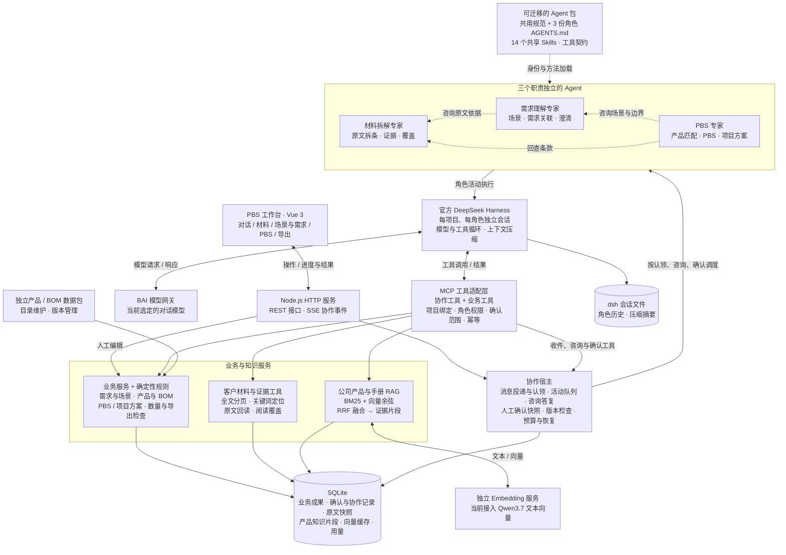

# PBS 工作台技术架构图

更新日期：2026-10-21。依据当前实现，包含上下文压缩、预算控制与保存成果恢复。详细说明见[技术架构](architecture.md)。

图中虚线标明角色配置或专家发起的咨询。咨询由宿主关联、排队、投递和恢复会话；不是 Agent 之间绕过工具的直接调用。当前同一任务内按活动顺序执行。三个角色分别维护会话，共享项目成果与 14 个可按需加载的 Skills。

## 必须保留的业务边界

| 边界 | 当前规则 |
| --- | --- |
| 人工确认 | 场景与需求一并审阅、统一确认。有效确认前，PBS 可交流，但不认领或执行成果任务。确认后的范围变动会触发重新校验。 |
| 专家协作 | PBS 可咨询需求理解和材料专家；需求理解可咨询材料专家。咨询对象由当前角色权限决定，提问时机和内容由 Agent 决定。 |
| 产品、方案、BOM | 公司目录维护产品能力、限制和 BOM。解决方案属于项目，自由组合 PBS 产品项。BOM 表达产品组成。 |
| 知识分域 | 客户材料按项目隔离，支持全文阅读与原文回查。公司产品与手册采用混合检索。Skills、业务成果和客户标书目前不统一进入向量库。 |
| 向量存储 | 当前是 SQLite 向量缓存与应用内余弦计算；BM25 和 RRF 在应用内运行。向量服务不可用时降级为 BM25。 |

## 本次新增的运行保障

- **精简上下文**：确认范围向模型提供完整编号索引，保留共性约束、答复和参数；详情按需分页读取。完整审批快照保存在数据库中。
- **历史压缩**：官方 dsh 在配置窗口约 20% 的上下文压力下压缩历史，保留近期上下文；摘要用量也计入预算。
- **从成果恢复**：预算中止后，新会话读取已保存成果、咨询和待办；保留旧会话、操作幂等与人工确认检查。
- **有界续接**：单次角色 token 额度耗尽且确有新成果保存时，最多自动续接一次。内部续接共享本轮预算；用户明确继续才建立新一轮预算，历史用量仍保留。

默认单次角色活动上限为 15 分钟、160 个模型步骤、100 万累计 token；每次用户发起的协作运行上限为 30 分钟、36 次活动、300 万累计 token。详见[运行时说明](../runtime/README.md)。

## 迁移到公司工作台

保留图中的 **Agent 包与工具契约**，由公司工作台提供兼容的 dsh 运行时、协作宿主、业务存储和工具实现。公司 RAG 可替换知识服务，但须继续提供原文全文读取、稳定证据 ID、版本与权限过滤。项目数据、审批记录和历史会话单独迁移。接口边界见[迁移说明](architecture.md#5-公司工作台迁移边界)。

实现依据：[角色权限](../agents/pbs/roles.mjs)、[Agent 组合](../agents/pbs/preset.mjs)、[协作调度](../app/server/collaboration.mjs)、[MCP 工具](../app/server/collaboration-tools.mjs)、[dsh 宿主](../runtime/host.mjs)、[材料工具](../app/server/agent-adapter.mjs)、[混合检索](../app/server/rag.mjs)、[上下文索引](../app/server/agent-context.mjs)、[预算管理](../app/server/agent-budget.mjs)。
