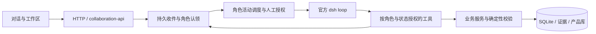

# 当前架构

更新日期：2026-10-21。本文描述当前可执行实现；历史方案与验收记录不覆盖本规范。

## 一条业务执行入口

普通聊天、@ 消息、材料理解、场景整理和 PBS 编制统一进入协作入口。旧生成按钮的单个 action 仅转换为任务意图；旧的修改指令或混合 action 批次返回明确错误，不能直接执行。

模型决定是否认领、如何核查、需要向谁提问及如何使用答复。宿主调度已记录的活动，不另写模型循环，也不在材料完成后硬编码自动调用下一阶段。初始群聊可由材料和需求理解专家分别认领相关工作；未认领的工作不会因固定流程而启动。

手动工作区编辑继续使用业务服务。产品手册整理、客户答复影响分析、单项重新匹配是有明确输入输出的分析工具，通过 dsh 的 `submit_result` 提交校验结果，不加载三位专家的业务 Skills，也没有业务写入工具。单项重新匹配及建议采纳同样检查有效确认范围。

## 层次和依赖

- `agents/pbs/`：共用业务规范、独立角色职责、共享 Skills、传输无关工具 schema。不能依赖本地数据库、HTTP 或 Vue。
- `runtime/`：dsh profile、模型连接、MCP、进程清理与会话。通过 Agent 包组合专家；未指定角色的受限分析不加载业务技能。
- `app/server/collaboration*.mjs`、`conversation*.mjs`：投递、认领、会话关联、活动恢复、人工确认和权限。
- `app/server/understanding-scope.mjs`：只读确认快照与版本判断，供工具和自动选型共用；`collaboration-approval.mjs` 负责用户确认后的快照创建。
- `app/server/agent-adapter.mjs`：本地业务工具实现；`collaboration-tools.mjs` 叠加角色、活动和人工授权限制。
- `app/server/services.mjs`、`scenarios.mjs`、`project-solutions.mjs`：确定性校验、业务修改和版本；`repo.mjs`、`db.mjs`：持久化与增量迁移。
- `app/engine/`：来源、需求参数、场景、产品、数量和审核规则；不依赖宿主或界面。命名为 `requirements.mjs` 的模块只保留需求规则，不包含旧模型抽取循环。
- `app/shared/`：无平台副作用的提及解析、状态与展示语义。浏览器通过 `/shared/` 加载；服务端直接导入。页面层不会成为服务端依赖。
- `app/catalogs/`：行业产品和 BOM 示例；项目解决方案单独维护。

## 不变量

1. 无 @ 的消息投递三个角色；有 @ 只投递指定角色。收件认领本身只读，未认领不执行业务工作。
2. PBS 确认前只交流。有效人工确认后才能认领和执行成果任务，且不能超出获批范围；在认领、调度及每次写入时检查，涵盖重启、旧队列和执行中版本变化。
3. “描述已确认”、专家解释、一般继续指令不等于整轮确认。文字确认关联用户发送前已展示的范围、完整原话、版本和明确决定。
4. 需求理解变化使批准失效；PBS 在既定范围内保存自己的草稿，不因此撤销需求理解确认。
5. Skills 只有方法权限。咨询只读；持久化成果只能由对应角色的业务工具或人的工作区操作执行。
6. 真实工具回执、咨询关联和来源版本支持对话内容。工具输出不能被口头声称替代，历史内容不能描述为本次刚完成。
7. operation_id、项目绑定、引用和乐观版本在宿主校验。失败或取消时保留成功批次，拒绝过期写入；旧运行时清理完成前不释放任务锁。
8. ★/▲ 是来源标记，不自动改写要求强度；可提高审阅关注度，不能直接推导废标条件。数量未知保持未知，不能由并发指标或产品 BOM 倍算采购数量。
9. 用户在聊天中直接确认、补充或纠正；不新增快捷建议、暂停、补充纠正或确认按钮。进度来自实际活动，回复只说关键业务信息。

## 历史兼容

保留数据库增量迁移、人工成果、历史会话与卡片、原文快照、产品证据、旧能力记录及 seed 规则引用。
旧能力维护接口仅用于已存数据兼容；当前 Agent 不再生成旧业务能力对象。
保留旧生成接口作为协作意图适配，不保留第二套生成逻辑。原有裸 JSON 操作执行入口已停用。

## 公司工作台迁移

可迁移的是 Agent 规范、角色、共享 Skills、工具契约与评测资料。公司宿主还必须提供身份/项目绑定、工具权限、收件队列、事件、人工确认快照、幂等、版本与证据、会话恢复、取消及预算。公司 RAG 实现对应检索与原文读取契约；仅复制 Markdown 不等于完成基础设施迁移。

当前专家活动顺序调度，咨询方向为 PBS→需求理解/材料、需求理解→材料。完整双向专家网络、并行活动与循环依赖治理尚未实现。咨询事实引用当前只校验项目材料，产品引用类型仍需扩展契约；不能用提示词宣称这些能力已存在。

## 质量门禁

`npm run check --prefix app` 检查全仓 JS、依赖边界、循环依赖、角色工具、Skill 元数据、Vue 模板与离线测试。真实模型检查必须显式启用 `--live`，只使用合成项目和临时数据库。
