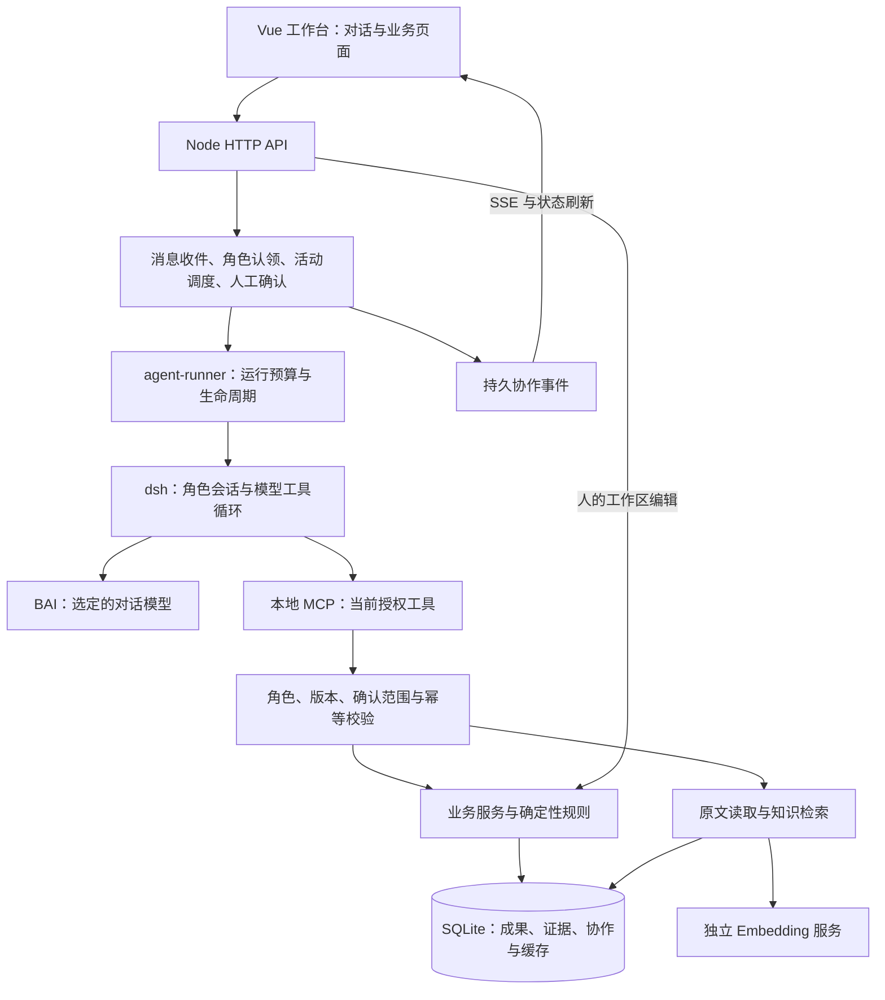
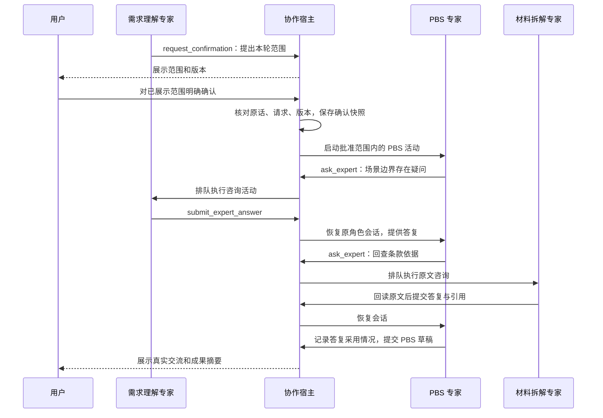
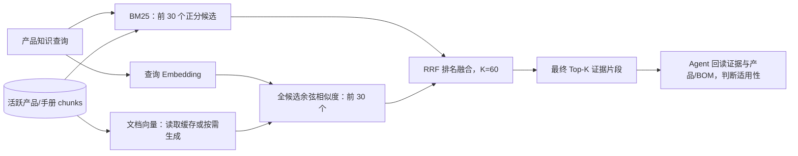

# PBS 专家工作台：当前技术架构

更新日期：2026-10-21。基于当前仓库实现梳理，已同步场景与需求工作区、共享技能、上下文压缩和预算恢复；描述已经实现的能力。可先看[技术架构总图](architecture-overview.md)。历史方案见[文档索引](README.md)，开发约束见[仓库 AGENTS.md](../AGENTS.md)。

本文围绕三个部分展开：系统技术架构、Agent 与 Skill 设计、知识库与检索设计。末尾说明运行保障和公司工作台迁移边界。

## 1. 整体架构

### 1.1 系统定位与技术组成

系统将客户材料整理为有证据的需求条目、场景需求和待澄清事项，经人工确认后编制 PBS，并按客户目标组合项目解决方案。产品库维护产品、能力、限制与 BOM；解决方案属于具体项目。

当前采用本地模块化单体：一个 Node.js HTTP 服务承担界面、业务接口和协作调度，按角色活动启动 dsh 运行时，通过本地 MCP 调用业务工具。数据库、原文证据和向量缓存保存在 SQLite 中。

| 层次 | 当前技术与实现 | 责任 |
| --- | --- | --- |
| 工作台 | Vue 3、Element Plus、原生 ES Modules、CSS；由应用服务提供静态文件 | 对话、材料、需求理解、PBS、导出及产品/BOM 维护 |
| HTTP 与事件 | Node.js `http`，REST/JSON，SSE；前端同时保留定时刷新 | 接收消息、上传、编辑、任务查询和真实协作事件展示 |
| 协作宿主 | `collaboration*.mjs`、`conversation*.mjs` | 投递、认领、活动队列、角色会话、人工确认、版本和预算 |
| Agent 运行时 | `@deepseek-ai/dsh` 与 `dsh-sdk-client`，均固定为 `0.2.1-rc.2` | 模型与工具循环、会话、错误反馈后的继续执行 |
| 业务工具传输 | 本地 Streamable HTTP MCP，JSON-RPC，临时端口及随机 Bearer 凭据 | 将当前项目和活动获授权的工具暴露给 dsh |
| 模型接入 | BAI 网关，OpenAI 兼容调用格式；模型选择保存在 `settings` | 提供当前选定的对话/分析模型；Harness 与模型供应商分别配置 |
| 业务与规则 | JavaScript ESM；服务层持久化，engine 层确定性校验 | 原文引用、需求/场景关联、产品能力、数量、BOM、变更影响和导出检查 |
| 存储 | Node.js ≥22.19 的 `node:sqlite`，WAL，当前 schema 7 | 业务数据、协作记录、原文快照、目录版本、知识片段和向量缓存 |
| 检索 | 本地 BM25、稠密向量余弦相似度、RRF 排名融合 | 公司产品与已关联手册的混合检索 |
| 文件处理 | `pdf-parse`、`mammoth`、ExcelJS | PDF/DOCX 文本提取，以及 Excel 导入导出 |

实现入口：[HTTP 服务](../app/server/index.mjs)、[运行时宿主](../runtime/host.mjs)、[依赖版本](../runtime/package.json)、[数据库](../app/server/db.mjs)。

### 1.2 组件与依赖



代码按以下边界组织，服务端不从页面目录导入业务语义：

| 目录/模块 | 维护内容 |
| --- | --- |
| `agents/pbs/` | 可迁移的共用规范、角色职责、共享 Skills、工具契约和评测资料 |
| `runtime/` | dsh profile、模型连接、MCP、进程清理、会话运行 |
| `app/server/collaboration*.mjs`、`conversation*.mjs` | 业务协作状态与人工授权 |
| `app/server/agent-adapter.mjs`、`collaboration-tools.mjs` | 工具的业务实现与权限限制 |
| `app/server/services.mjs`、`scenarios.mjs`、`project-solutions.mjs` | 业务保存、人工编辑、版本与影响处理 |
| `app/server/repo.mjs`、`db.mjs` | 数据读写、事务、迁移 |
| `app/engine/` | 不依赖 UI 和数据库的业务校验、文档切分、数量与产品规则 |
| `app/shared/` | 前后端共用的提及解析、状态与展示语义 |
| `app/web/` | 页面与交互；共享模块通过 `/shared/` 加载 |
| `app/catalogs/` | 独立行业产品/BOM 示例包，不包含全局解决方案模板 |

### 1.3 从用户消息到业务成果

1. 消息进入 `/api/projects/:id/chat`，附件先提取文本并保存为项目材料。
2. `collaboration-api.mjs` 把消息交给持久收件机制。无 @ 投递三个角色；有 @ 只投递指定角色。
3. 接收角色分别执行只读认领活动。全部接收者完成判断后，认领者按各自范围进入讨论或业务执行，无关角色保持安静。
4. 每次角色活动通过 `runRole` 启动或恢复该项目下的角色会话。dsh 决定工具调用及错误修正；宿主处理排队、权限、版本和持久化。
5. 业务工具校验后保存成果，返回成功项、失败原因和新版本。批量提交可以保留已成功项，模型仅修正失败项。
6. 专家咨询通过真实工具请求与答复推进；需要人工确认时，在对话中展示明确范围，由用户直接回复。
7. PBS 的成果执行必须持有有效确认快照。工作区展示详细结果，对话展示关键结论、咨询和实际进度。

材料完成后没有硬编码的“自动执行需求理解”分支。多人认领可以依据先前已保存成果衔接；认领、咨询和人工确认是活动来源。宿主仍有必要的状态机与权限规则，模型不负责决定谁有权确认或跨项目写入。

产品手册整理、客户答复影响分析、单项重新匹配使用 `createHarnessLlm` 进行受限结构化分析，同样由 dsh 执行，但只开放 `submit_result`，不加载业务 Skills 或业务写工具。结果经业务服务校验和相应采纳流程处理；重新匹配也检查人工确认范围。

## 2. Agent 与 Skill 设计

### 2.1 Agent 的组成

每位专家由五部分共同定义：

| 部分 | 作用 | 维护位置 |
| --- | --- | --- |
| 共用规范 | 业务概念、事实/建议区分、证据、人工授权和简短表达 | `agents/pbs/AGENTS.md` |
| 独立角色指令 | 目标、输入、责任、成果、能力边界、协作与完成条件 | `agents/pbs/roles/<role>/AGENTS.md` |
| 角色权限 | 允许写入的工具及可咨询对象 | `agents/pbs/roles.mjs` |
| 共享 Skills | 可选择加载的专业方法 | `agents/pbs/skills/*/SKILL.md` |
| 宿主执行上下文 | 项目、活动模式、消息、真实成果、版本、确认范围及会话 | `collaboration*.mjs`、`agent-runner.mjs` |

根目录的 `AGENTS.md` 是**研发规范**；`agents/pbs/AGENTS.md` 才是**产品内专家共用规范**。三个角色分别维护自己的 `AGENTS.md`。Markdown 描述职责，工具过滤和执行校验落实权限，不能只靠提示词约束写入。

### 2.2 三位专家的职责和写入边界

| 专家 | 核心职责 | 可提交的业务成果 | 可主动咨询 |
| --- | --- | --- | --- |
| 材料拆解 `materials` | 原文拆条、出处核对、完整性与需求初稿 | `submit_requirements`、`submit_questions`、`propose_change` | 当前无主动咨询目标；可回答其他专家的问题 |
| 需求理解 `understanding` | 客户目标、业务场景、活动、约束、需求关联与疑点 | `submit_scenarios`、`submit_questions`、`propose_change` | 材料专家 |
| PBS `pbs` | 在批准范围内匹配产品、编制 PBS、组合项目方案及求证 | `submit_pbs`、`submit_solutions`、`submit_questions`、`propose_change` | 需求理解、材料专家 |

这是角色具备的工具上限。实际可用工具还受活动模式、版本和人工授权约束：

- 认领活动只读业务数据，并通过 `respond_to_message` 记录认领、跳过或解释用户确认意图。
- 咨询活动读取证据并提交咨询答复，不保存需求、场景或 PBS 成果。
- 普通讨论不重新生成成果；有权限时可提出待人审阅的变更建议。
- **需求理解未经人工确认，或确认版本失效时，PBS 可以交流和向上游求证，但不能认领或执行成果任务，也不能提交澄清或变更建议绕过确认。**

工具库目前共 25 个定义：17 个业务工具、8 个协作工具。各次活动仅注册获授权的子集。`finish_task` 用于记录本次结果，不能替人确认需求或宣布整个项目完成。

实现依据：[角色与权限](../agents/pbs/roles.mjs)、[业务工具契约](../agents/pbs/contracts/tools.mjs)、[协作契约](../agents/pbs/contracts/collaboration.mjs)、[执行时校验](../app/server/collaboration-tools.mjs)。

### 2.3 多轮协作如何运行

当前多 Agent 由业务宿主调度多个独立角色会话实现。dsh 的内置子 Agent、任意文件、Shell、网页等工具在本应用 profile 中禁用；每位业务专家通过明确的 MCP 工具与其他专家协作。



图中是一个可能的协作案例，不代表每次都必须问两位专家，也不规定提问顺序。咨询可通过 `followup_to` 继续追问；发问后结束当前活动，答复到达后宿主恢复调用方，不让模型轮询等待。

`collaboration_sessions` 按“项目＋角色”保存会话 ID，实际 dsh 状态保存在 `runtime/.state/`。角色共享项目成果和明确投递的消息，通过咨询共享解释，角色会话分别维护。

用户补充进入持久收件箱，触发活动版本变化和必要的中断/重新调度。已保存成果保留，过期咨询与过期写入被拒绝。对话展示的是实际问题、答复、采用情况和结果，不展示内部推理。

当前同一协作任务的专家活动顺序执行，咨询方向为 PBS→需求理解/材料、需求理解→材料。完整双向咨询、专家并行执行和通用循环依赖治理尚未实现。

### 2.4 共享 Skill 设计

三个角色均可发现同一组 **14 个方法 Skills**。Skill 是方法说明，工具是可执行能力，知识库是事实来源；三者独立维护。

| Skill | 方法与适用问题 |
| --- | --- |
| `pbs-requirement-extraction` | 将材料拆为保留原意的需求初稿，核对引用与覆盖 |
| `pbs-scenario-modeling` | 围绕目标组织场景、活动、边界与要求 |
| `pbs-product-mapping` | 匹配产品能力、识别缺口、编制 PBS、组合方案与读取 BOM |
| `pbs-evidence-verification` | 回读证据、校验版本、连续引用和事实冲突 |
| `pbs-clarification` | 将客户决策缺口转为可回答的问题，说明影响及补充方向 |
| `pbs-document-map` | 盘点多源材料用途、适用范围、附件关系与解析缺损 |
| `pbs-requirement-quality` | 核对歧义、复合需求、重复、冲突和无依据扩展 |
| `pbs-interface-boundaries` | 核对数据、控制、部署、对接与交付责任 |
| `pbs-acceptance-criteria` | 核对指标、工况、判定方式和验收依据 |
| `pbs-capacity-sizing` | 核对设备、容量、带宽、存储、许可和 BOM 计量 |
| `pbs-option-analysis` | 比较产品组合、自研、外采及集成路径 |
| `pbs-traceability` | 双向核对原文、需求、场景、PBS 与产品能力 |
| `pbs-change-impact` | 分析新输入对已有草稿或确认成果、数量和证据的影响 |
| `pbs-low-altitude-review` | 按需核查政府客户角色、业务对象、低空任务及交付边界 |

协作协议常驻共用规范和工具定义，不依赖可选 Skill。材料拆解、条目质量、场景建模、单条证据核验、跨成果追溯各有不同检查对象；澄清负责客户信息缺口，变更影响负责已有成果的连带变化。所有检查维度按当前任务选用，不引入固定调用链或新审批步骤。

政府项目中的角色、服务对象和依赖使用现有场景字段；建议确认角色与补充资料方向记录在澄清 `reason`，当前没有独立负责人分派或角色台账。材料类别用于理解来源用途，不自动证明政策适用性、采购范围或审批已满足。

加载方式由 [preset.mjs](../agents/pbs/preset.mjs) 定义：每个 Skill 使用 `name`、`description` frontmatter；运行时向模型提供可发现的技能信息，模型通过 `skill` 工具按需加载正文，不要求每轮全量加载或固定顺序执行。

共享技能不会扩大角色写权限。例如材料专家可以学习产品匹配方法，但不能因此保存 PBS。行业方法放在 `pbs-low-altitude-review`，具体产品事实放在产品数据包，通用角色规范不写死低空设备编号或客户参数。

当前 `watch: false`，新增/删除/更名 Skill 在下一次宿主激活时重新发现，dsh 对变化的名录发布替换消息；已经加载的历史正文不会自动替换，继续任务时按当前名录重新加载相关技能。`agents/pbs/evals/` 保存行为评测资料；这些用例是验证输入，不代表每次运行或每次提交都已完成真实模型评测。

### 2.5 人工确认与成果可靠性

人工确认绑定一个明确的需求/场景范围和输入版本，保存在 `collaboration_approvals`。版本取决于需求、场景、分类处置、材料版本、客户答复及参数覆盖等事实。

普通继续指令、单条“描述已确认”、专家共识均不能替代本轮确认。对话确认必须关联用户发送前已展示的请求，核对完整原话、决定、范围和版本；带疑问、条件或修改的回复不直接当作批准。

宿主在认领、排队执行及每次写入时检查授权。理解内容变化会使原确认失效；PBS 在原范围内保存自己的成果不会使理解确认失效。单项重新匹配在分析前后及建议采纳时也检查同一边界。

结论依据、引用核验和人工确认分别表达。后端拒绝标为推断的招标需求，不再静默去掉推断标记；非招标推断可以保留 inferred，引用匹配仍不代表人工批准。该校验只能检查显式标记，不能自动证明每项语义忠实。原文引用必须匹配真实片段，参数需要依据校验，未知数量保留未知，人工修改过的成果受保护。★/▲ 仅作为来源和关注标记，不能直接推导要求强度或废标条件。

实现依据：[确认范围](../app/server/understanding-scope.mjs)、[快照创建](../app/server/collaboration-approval.mjs)、[对话确认](../app/server/conversation-review.mjs)。

### 2.6 场景与需求的一页工作区

需求理解以业务场景为主线，在同一页展示目标、具体要求、原文依据及关联问题。共性约束、交付商务、背景/范围外和待安排要求保留独立分组。旧的需求、场景、澄清深链接在本页定位；完整台账、测算参数、历史和合并能力保留在辅助抽屉。

场景无需单独人工确认。场景及支撑需求一起输出，交给 PBS 前按本轮范围统一确认。范围审阅按场景展示关联要求及适用的共性约束，共享需求按编号去重。持久化状态仍保留以兼容历史和确认快照，不因界面取消单独确认就放开 PBS 权限。

`app/shared/understanding.js` 从现有关系投影页面，不复制需求。需求编辑后，各场景显示最新文本；`links.req_revision` 与需求版本不一致时提示关联待核对。新增/失去关联的要求进入待安排分组；项目级共性约束自动出现在新场景的适用约束中，指定范围的约束不会自动扩大。

语义归类由需求理解 Agent 处理。用户可直接编辑关联，或发起一次更新任务；不在每次输入时隐式运行模型。`submit_scenarios` 可用 `code`、`revision` 与完整字段更新未人工维护的草稿，同时校验 `expected_version`，保留编号、历史并返回关联增减及刷新项。同名新增仍去重，不会默默替换已有记录。人工维护/已确认内容只能通过人工编辑或 `propose_change` 的 `edit_scenario` 提案调整。适配新需求时更新涉及的场景，范围确认仍采用全局版本失效规则。

核心验证覆盖多场景共用、动态版本、失效关联、约束适用范围、增量更新和人工内容保护。页面视觉效果需要浏览器验收，离线校验不代表模型归类质量或视觉验收通过。

## 3. 知识库与检索设计

### 3.1 知识分域与事实存储

当前知识分为项目材料、公司产品知识、历史参考和方法规范。它们没有全部进入同一个向量库。

| 知识域 | 存储与内容 | 当前访问方式 |
| --- | --- | --- |
| 客户项目材料 | `materials` 保存文本和元数据，`segments` 保存条款/段落，`source_snapshots` 保留来源快照 | 顺序分页读全文、按 ID 回读、项目内关键词定位；当前不走产品混合检索 |
| 公司产品 | `products` 保存能力、限制、适配与元数据；目录数据包维护 BOM 和版本 | 结构化 `read_product`，以及从产品字段建立的混合检索片段 |
| 产品手册 | `product_docs` 保存原文与分析草稿，关联产品后建立 `manual` 片段 | 原文片段参与 BM25＋向量检索，按证据 ID 回读 |
| 历史项目参考 | 当前运行配置中的历史样例转换为 `history` 片段 | 检索引擎支持按 kind 查询；默认产品检索不包含 history |
| 需求、场景、PBS、项目方案 | 对应业务表、关联表、版本及快照 | 通过结构化业务工具读取；当前未统一向量化 |
| 角色和 Skills | 仓库 Markdown 文件 | 指令组合和 Skill 按需加载，当前不进入向量检索 |

历史参考目前来源于运行配置样例。当前业务主链没有自动把已完成项目归档为案例并检索复用的完整流程，不能把 `indexHistory` 等同于已经建成企业历史项目知识库。

产品库中的方案不作为全局模板维护。项目解决方案自由组合 PBS 产品项，BOM 是产品组成；BOM 数量与版本由结构化服务处理，当前不会把整棵 BOM 自动生成向量知识片段。

### 3.2 客户材料：以完整阅读和来源追溯为主

材料支持 TXT、Markdown、DOCX 和可提取文字的 PDF。`ingest.mjs` 提取文本，`segment.mjs` 识别条款编号、章节、段落和句子；来源 ID 形如 `M1:1.2.3` 或 `M1:S001`，并保存材料快照和文本版本。

材料专家使用以下工具读取：

- `list_document_sections`：枚举目录、片段摘要及处理状态。
- `read_document_batch`：顺序读原文；单次最多 6,000 字符、默认最多 60 个片段，支持跨长片段游标；后续分页携带文档版本。
- `read_evidence`：按稳定 ID 回读原文及相邻片段，检查来源版本。
- `search_evidence(domain="materials")`：将规范化查询切为 1～2 字符片段，按原文包含这些片段的命中数排序。这一路是简单关键词定位，当前没有 BM25 权重或向量计算。

`agent_coverage` 按项目、来源 ID 和文档版本记录已提取或明确忽略的片段，忽略需有原因；`run_report` 汇总覆盖及剩余片段。**Top-K 检索不能证明整份标书已读完。** 覆盖记录用于发现遗漏，不保证提取出的需求一定语义完整。

当前 PDF/DOCX 管线以提取后的文字为依据，没有 OCR、版面理解或可靠的页坐标引用。扫描件、复杂表格、跨页续表需要额外检查；Skill 提醒核查，不会自动补齐底层解析能力。

实现依据：[文件解析](../app/engine/ingest.mjs)、[切分](../app/engine/segment.mjs)、[材料与快照](../app/server/repo.mjs)、[读取和检索工具](../app/server/agent-adapter.mjs)。

### 3.3 产品知识：分块、索引和证据版本

`rag.mjs` 为产品字段建立多种片段：产品摘要 `summary`、能力 `capability`、限制 `limit`、信创 `xinchuang`、适配条件 `compatibility`，以及手册 `manual`。能力和限制分别成块，使模型能同时检索“能做什么”和“不满足什么”。

手册按段落与标题附近边界合并，目标大小约 400 字符；长段落按该大小切分，短于 10 字符的片段不入库。当前没有固定重叠窗口、表格专用切分或语义模型分块。

片段表 `chunks` 保存 `id/kind/product_id/doc_id/history_id/text/hash/active`。产品维护、手册入库和索引重建同步这些片段：

1. 未变化片段复用原 ID。
2. 变化或移除的旧片段标记 `active=0`，保留原文供历史证据回查。
3. 检索只使用活跃片段和未归档产品；引用已退休片段的 PBS 项标记待复核。
4. Agent 看到 `product-chunk:<id>` 和内容 hash，可再用 `read_evidence` 回读；PBS 保存对应的产品证据 ID。

产品手册的结构化能力/限制草稿需要审阅。已关联产品的手册在分析时即可建立原文检索片段，因此“命中手册原文”与“已经确认的产品能力字段”是两种依据，仍需专家核对。

### 3.4 BM25：词面相关性检索

BM25 在应用进程内实现，不依赖独立搜索服务。索引读取当前活跃知识片段，统计词频 `tf`、文档频率 `df`、片段长度和平均长度。

分词方式是规范化文本后生成相邻两个字符的滑动片段，并额外保留连续字母/数字串；不是中文词典分词。查询词去重，匹配数值、型号和原文术语主要依靠这一支路。

当前参数：`k1=1.2`、`b=0.75`，每个查询最多保留前 30 个正分候选。具体计算为：

```text
idf(t) = ln(1 + (N - df(t) + 0.5) / (df(t) + 0.5))
BM25(q, d) = Σ idf(t) × tf(t,d) × (k1+1)
               / [tf(t,d) + k1 × (1-b + b × len(d)/avgLen)]
```

`N/df/avgLen` 来自当前整个活跃片段索引，打分时再按 `kind` 筛选候选。索引在进程内缓存，片段同步使版本变化，下次搜索重建；当前按片段扫描评分，未采用持久倒排索引或 SQLite FTS。

### 3.5 向量：语义相关性检索与本地缓存

Embedding 与对话模型独立配置。`embed.mjs` 支持 OpenAI 兼容协议和阿里云原生 DashScope 协议；包含 `qwen3.7-text-embedding` 的请求适配。

| 配置 | 作用 |
| --- | --- |
| `EMBED_PROVIDER` | `openai` 或 `dashscope` |
| `EMBED_BASE_URL` | 独立向量服务地址；DashScope 可填 `/api/v1` 根地址或完整原生接口地址 |
| `EMBED_MODEL` | 向量模型；代码缺省值为 `text-embedding-3-small`，实际部署可覆盖 |
| `EMBED_API_KEY` | 独立向量服务凭据，仅在环境配置中维护 |
| `APP_EMBED=off` | 强制关闭向量分支，保留 BM25 |

OpenAI 模式未配置独立地址时沿用 BAI 的 embeddings 接口及凭据。DashScope 通过 `input.texts` 提交文本，区分 `text_type=query/document`，请求 `dense` 输出；对应 Qwen3.7 查询会附加检索任务说明。兼容接口中的 Qwen3-Embedding 查询使用 `Instruct/Query` 前缀。

当前向量存储由 **SQLite `embed_cache` 表＋应用内余弦计算**构成：

- 文档片段首次参与向量搜索时，缺失的向量按批调用远端服务；已缓存片段复用。
- `hash` 是片段文本 SHA-1；表中 `model` 字段实际存储服务配置 SHA-256 指纹，包含 provider、endpoint、model 和文档编码版本，避免更换模型/服务后混用向量空间。
- 向量以 Float32 BLOB 保存，查询向量按请求生成，当前不缓存查询向量。
- 查询与当前允许 kind 的全部片段做余弦相似度计算，选前 30 个。维度不同会报错并触发降级。
- 当前没有 ANN/HNSW 索引或独立向量数据库。首次搜索可能需要为整个候选知识池补建向量，耗时与成本随片段数量增加。

代码中的批大小为：Qwen3.7 原生接口和兼容接口每批最多 20 条，其他原生模型每批最多 10 条；独立服务单次请求超时 60 秒。它们是当前适配参数，切换供应商时需要重新验证服务约束。

实现依据：[Embedding 适配](../app/server/embed.mjs)、[向量缓存与相似度](../app/server/rag.mjs)、[缓存表](../app/server/db.mjs)。

### 3.6 混合检索：BM25＋向量＋RRF



两路按片段 ID 合并，使用排名而非原始分数求和：

```text
RRF(chunk) = Σ 1 / (60 + rank)
rank 从 1 开始；未命中某一路时，该路不贡献分数。
```

`rag.search()` 默认返回 Top 8；Agent 工具允许指定最多 12。默认检索类型为产品摘要、能力、限制、信创、适配条件和手册，不包括 `history`。没有单独的交叉编码器 reranker，也没有按余弦阈值拒答的机制。

RRF 分数是排序分数，不是置信度、满足率或“产品符合招标”的概率。召回片段后，Agent 仍需读取产品结构化字段、原文依据、适用条件和 BOM，再提出匹配并接受确定性校验。

另外，单项重新匹配工具使用业务服务中的 `retrieve()`：按当前需求/能力查询，聚合片段对产品的得分，挑选候选产品；候选少于 3 个时从活跃目录补充。因此候选产品集合也不能视为已经验证符合要求。

### 3.7 失效、降级和当前规模边界

应用启动时 `probeEmbeddings()` 用短文本检测向量服务。成功进入 `hybrid`，失败或 `APP_EMBED=off` 时进入 `keyword`。运行中向量服务或维度校验失败，也回退 BM25，保留可读原因；当前没有自动定时恢复探测，通常在重启时重新检测。

向量模式为进程级状态，当前产品目录也是单公司共享目录。产品片段和文档向量保存在 SQLite，BM25 索引和排序在内存中；适合当前原型与有限规模资料集，尚未做大规模企业知识库的性能和召回评测。

迁移企业知识库时需补齐统一权限过滤、可扩展索引、后台向量化、可观测性与检索质量评测。当前材料检索按 `project_id` 绑定，但这不能代替企业登录、多租户或跨部门 ACL。

## 4. 状态、证据与运行保障

### 4.1 主要持久数据

| 数据组 | 主要表/位置 | 用途 |
| --- | --- | --- |
| 客户材料与来源 | `materials`、`segments`、`source_snapshots`、`agent_coverage` | 原文、稳定引用、版本、处理覆盖 |
| 需求理解 | `requirements`、`scenarios`、`scenario_requirements`、`scenario_revisions`、`requirement_dispositions`、`questions`、`param_overrides` | 需求、场景、约束分类、疑点、答复和参数 |
| 产品与知识 | `products`、`product_docs`、`chunks`、`embed_cache`、`catalog_revisions`、`catalog_imports` | 产品事实、检索、BOM 所在目录版本与导入基线 |
| 项目交付 | `pbs_items`、项目方案及 BOM 快照记录 | 产品对应、数量、方案组合、历史交付依据 |
| 协作与人工确认 | `collaboration_*`、`conversation_*` | 队列、咨询、收件/认领、范围确认、会话关联和事件 |
| 运行记录 | `jobs`、`agent_runs`、`agent_operations`、`llm_calls`、`chat_messages`、`runtime/.state/` | 作业、每次角色执行、幂等、用量、对话及 dsh 会话 |

`agent_runs` 仍用于当前角色活动的状态、用量和会话记录，不只是历史兼容表。旧 `capabilities`、`scenario_runs` 等记录继续保留兼容读取，当前主链已不调用旧批量生成器。

### 4.2 写入和恢复

项目身份由宿主绑定；工具参数按 schema 校验，写入使用事务、operation_id 幂等和乐观版本检查。咨询答复必须关联真实咨询与当前版本；原文事实需要本次回读的连续引用。

客户材料删除或产品证据退休时保留历史快照，相关成果提示待复核；公司目录变更保留修订，项目方案/BOM 快照独立保留。成功保存的批次不会因后续模型失败全部丢失。

服务重启把执行中的活动恢复为可继续状态，但不自动重新发起付费模型任务。普通续接恢复角色会话；预算耗尽的活动持久化恢复标记，下一次用新会话读取已保存成果、当前确认范围、咨询和剩余待办。旧会话及运行记录保留，同一活动的 operation_id 作用域不变。取消/新消息导致的中断需要完成旧运行时清理，才能释放锁和继续，避免重复写入。

`collaboration_state.confirmation.snapshot` 向模型提供完整编号范围索引（`projection=scope_index`），不反复注入整份审批快照；需求、场景和原文分别通过分页工具回读。数据库中的审批快照保持完整，写入权限仍按完整快照和当前版本校验。

### 4.3 预算与可见进度

默认单次角色运行限制为 15 分钟、160 个模型步骤、100 万累计 token；同工具同类校验错误重复 5 次停止。每次由用户发起的协作运行共享 30 分钟、300 万累计 token、36 次活动上限；单任务咨询最多 18 次。用户明确继续时建立新的运行预算，历史消耗不删除，通过 `agent_runs.stats.launchId` 区分各轮。token 包含重复历史、缓存输入、输出及 dsh 摘要压缩报告的用量，不等于当前上下文长度。

官方 dsh `compaction-basic` 在上下文压力约达到配置窗口的 20% 时压缩历史，保留最近 12,000 token，摘要输出最多 4,000 token。宿主不另建模型循环。若单次角色 token 额度仍耗尽，且本次确有新成果保存，宿主在关闭旧运行时后最多自动续接一次；续接共用上述协作预算。没有进展、时间/步骤/校验错误、整轮预算耗尽或清理失败均停止自动续接。失败消息区分具体原因和可恢复方式，恢复活动只显示进度，不伪装成专家回复或固定声称有人工补充。

这些是模型循环与业务协作的运行限制，不是承诺每份标书会消耗的时间或 token。主要可配置项见 [.env.example](../.env.example)。

协作事件存储后通过 SSE 发送，使用递增序号支持续接；当前服务每 800 毫秒检查新增事件、每 15 秒发心跳，前端还有 2.5 秒刷新兜底。UI 展示工具进度、真实咨询和最终摘要，不把模型内部 token 流直接当作专家交流记录。

## 5. 公司工作台迁移边界

可以迁移的业务资产是 `agents/pbs/` 中的共用规范、三份角色指令、14 个共享 Skills、工具契约和评测资料。迁移时还需要兼容的 dsh profile/SDK，以及公司宿主对工具和协作契约的实现。

| 资产/能力 | 迁移方式 |
| --- | --- |
| 角色与 Skills | 保留业务定义，适配公司工作台的加载路径和发布方式 |
| Agent loop | 由兼容 dsh 提供，接好模型、工具、事件、会话恢复和预算 |
| 协作宿主 | 实现收件/认领、咨询关联、排队、版本、人工确认和中断规则 |
| 公司 RAG | 实现 `search_evidence`、`read_evidence`；保留证据 ID、版本、领域与权限语义 |
| 全文阅读 | 实现 `list_document_sections`、`read_document_batch`、稳定游标和覆盖台账，不能仅提供 Top-K 搜索 |
| 产品与交付 | 实现 `read_product`、需求/场景/PBS/方案写工具，保留数量、BOM 与人工成果校验 |
| 数据与审计 | 单独迁移项目、来源、目录版本、确认快照、操作记录和历史会话 |

单纯复制 Markdown 不能替代这些宿主能力。目前还存在三项明确边界：完整双向/并行专家协作未实现；咨询事实引用校验仅接受项目材料，产品证据需扩展咨询契约；材料 OCR、版面和企业级检索基础设施尚未接入。

## 6. 维护与验证入口

- 修改职责与技能：见 [Agent 包说明](../agents/pbs/README.md)。
- 维护产品/BOM：见 [数据包规范](../app/catalogs/README.md)。
- 修改模型、MCP 与运行时：见 [runtime/README.md](../runtime/README.md)。
- 验证代码边界与核心流程：`npm run check --prefix app`，包含全仓 ESLint、导入/循环检查、角色工具与 Skill 元数据、模板编译和离线测试。
- 检索适配测试：`app/test/embed.test.mjs`、`dashscope.test.mjs`；它们使用模拟服务，不证明真实模型的召回质量。
- 真实模型验收需显式 `--live`，业务脚本使用合成材料和临时数据库；PBS 合成范围还需 `--approve-test-scope`。

本次架构整理依据代码阅读，不包含新的真实模型、OCR 或检索质量验收。前次代码核查结果见[仓库核查记录](2026-10-21-repository-audit.md)。
