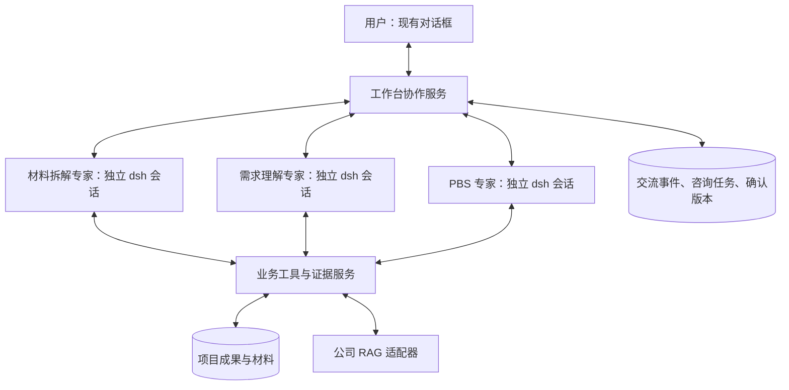

# PBS 三 Agent 协作、可见交流与人工介入设计

日期：2026-10-21。状态：业务方向已获用户确认；本文细化该方向，供后续实施使用。本轮交付设计文档，不代表多 Agent 功能已经接入运行中的应用。

## 1. 已确认的业务目标

用户的工作过程：材料拆解 Agent 阅读标书等客户材料，交给需求理解 Agent 汇总需求、组织业务场景。人审阅并确认本轮理解成果后，交给 PBS Agent。PBS 编制中可以多轮咨询需求理解 Agent，也可以直接请材料拆解 Agent 回查原文、其他章节与附件。

三个 Agent 各自持续承担专业职责。阶段交付以后，仍可接受咨询。咨询不能代替客户澄清或人工确认，不能擅自改写已确认成果。

用户新增的明确要求：在现有对话框中看到几个 Agent 的实际交流过程；处理期间可以随时补充信息、纠正方向。沿用此前要求：聊天简短，业务明细在右侧工作区展示；测试只覆盖核心链路；业务 Agent 与公司未来提供的工作台、RAG 解耦。

## 2. 核心业务决策

| 决策 | 选定行为 | 原因 |
| --- | --- | --- |
| 阶段推进 | 材料拆解可自动交接需求理解；进入 PBS 必须具有人确认的输入版本 | 对应用户明确的人工确认环节 |
| 专家协作 | PBS 可多轮咨询需求理解或材料拆解；需求理解可回查材料专家 | 支持业务解释与原文求证，保留相应专业上下文 |
| 谁决定咨询内容 | 当前业务 Agent 自主提出具体问题；程序负责寻址、送达、超时和记录 | 专家承担判断，消息传输不增加一层模型转述 |
| 谁确认需求 | 人确认需求含义、范围和变更；Agent 答复只提供事实、解释或建议 | 多个模型达成一致不能成为客户确认 |
| 看见什么 | 实际业务提问、答复、交接、依据和采用结果，按发生顺序展示 | 用户能判断工作依据并及时纠正 |
| 人如何介入 | 运行中输入框保持可用，默认补充当前任务，可选择定向给某位专家 | 不要求理解后台会话和调度细节 |
| 既有成果 | 需求、场景、PBS、原文引用和人工修改继续保留 | 新增协作能力不清空业务数据 |

## 3. 架构选择

比较两种实现：

| 方式 | 特点 | 决策 |
| --- | --- | --- |
| 工作台维护三个独立的 dsh 角色会话，通过业务咨询工具转交消息 | 三个角色各自保留上下文；支持指定项目与成果版本；程序管理消息关联和恢复 | 采用 |
| 增加总控 Agent，原生创建三个子 Agent，由总控代为转发 | 主要顺应原生父子通信；增加总控模型的运行及转述环节 | 本次不采用 |

选择第一种方式。三个角色均使用官方 dsh Agent loop，由宿主通过 SDK 管理。它们在业务上是协作专家；不宣称原生 sibling `send_message` 已支持任意互通。不修改 dsh 核心，不另造一套模型推理循环。

### 已核实的框架边界

- 当前项目固定 `@deepseek-ai/dsh` 与 SDK `0.2.1-rc.2`，主流程为单 Agent。`runtime/host.mjs` 明确关闭子 Agent 工具，仅装载一个 PBS preset。
- 官方原生 `send_message` 限直接父子等相邻关系；同级专家通信需要工作台提供转交能力。[官方控制工具](https://github.com/deepseek-ai/deepseek-harness/blob/master/packages/subagent/tool-subagent-control/README.md)
- SDK 支持持久会话恢复、消息入队及运行事件。入队回执只表示接收，不表示已完成；`run().finalResponse` 是活动区间的最后答复，不能据此推断它属于哪一个并发问题。[SDK 文档](https://github.com/deepseek-ai/deepseek-harness/blob/master/packages/sdk/client/README.md)
- 当前 SDK 没有单条 prompt 的 mid-turn cancel。强制停止需关闭相应运行时后恢复原会话。不能在设计中假定存在未验证的即时 steer/cancel 接口。[协议文档](https://github.com/deepseek-ai/deepseek-harness/blob/master/packages/sdk/protocol/README.md)
- 本地安装包 README 已逐项核对上述限制。后续实现继续锁定版本；框架升级独立验证。

## 4. 三个角色的边界

| 角色 | 负责的主任务与成果 | 咨询时提供什么 | 写入边界 |
| --- | --- | --- | --- |
| 材料拆解专家 | 按目录与章节完整处理材料，提取有来源的条款，保留非场景要求与遗漏说明 | 回查原文、附件、上下文、数值、适用范围和冲突位置 | 可提交材料来源需求草稿与覆盖记录；不确认需求，不写 PBS |
| 需求理解专家 | 汇总需求、组织客户业务场景、区分共性约束、提出澄清 | 解释确认场景、活动、边界、需求对应和未明确内容 | 可提交场景、归类和澄清草稿；涉及已有需求文本的修改提交建议 |
| PBS 专家 | 匹配产品能力、限制和数量依据，组合项目方案、PBS 与 BOM | 组织选型说明和需求响应关系，按需咨询两位上游专家 | 可提交 PBS、客户方案草稿；不修改已确认需求与场景 |

角色写入范围由服务端校验，不能仅靠提示词约束。项目、角色、激活任务和允许操作由宿主绑定，模型不能通过参数切换其他项目或身份。咨询激活为只读：允许回查资料及提交咨询答复，禁止顺便修改业务成果。

上下文使用项目成果和版本引用。会话历史有助于继续讨论，业务数据库及不可变原文证据才是事实来源。三者共用公司的 RAG 能力，每位专家按需检索并回读来源。专家提问和答复始终保留消息来源，不能伪装成人类确认或正式招标答疑；传来的文字不能自行扩大权限。

## 5. 阶段交接与人工确认

主流程状态：

`材料拆解中 → 需求理解中 → 待人工确认 → PBS编制中 → 待人工审阅`

另有：`正在同步人工补充`、`等待专家答复`、`等待客户澄清`、`已暂停`、`可恢复的失败`。这些状态描述当前任务，不等同于项目验收或需求正确性。

### 5.1 材料交给需求理解

材料专家提交成功批次后生成交接记录，包含来源版本、需求编号、已处理与未处理范围、疑点。需求理解专家可以分批汇总，但全文尚未处理完时，成果显式标注范围未完整，不宣称完成整份标书理解。

交接由持久任务驱动；失败只重试尚未完成的任务，不能重复新增已保存条款。

### 5.2 人确认以后交给 PBS

聊天中的“确认本轮理解并交给 PBS”卡片展示：本轮需求与场景范围、共同约束、来源版本、尚待客户回答的事项，以及未纳入的范围。右侧保留完整明细。

- 交接包绑定明确的需求、场景、归类、原文与答复版本。确认时重新比对，版本变化则要求核对最新成果，不能批准旧页面上看不见的新内容。
- 只有用户明确审阅确认的条目进入确认包；可仅提交已确认范围，其他范围仍保留待审状态并在范围清单中显示。不能按模型审核分级自动批准全部条目。
- 单条“确认描述”不自动启动 PBS；阶段交接是一项明确操作。自然语言发起阶段交接时，展示同一份范围卡片。
- 已知不确定性可作为不确定性一起确认交接，不能代填答案。PBS 允许据此形成带待办的草稿，相关数量、范围或选型继续标为待确认。
- 需求、场景确认与澄清处理分别记录；阶段交接不把全部澄清标为已解决。

PBS 编制依据该确认包，并检查当前版本是否仍有效。后续获批变更产生新确认包，受影响的 PBS 项提示复核，未受影响的成果保留。

## 6. 多轮业务咨询

以下工具与字段是拟新增的业务契约，不是 dsh 自带 API：

- `ask_expert`：向允许的角色提出业务问题，指定关联成果与基准版本，持久化后由宿主安排对应会话处理。
- `submit_expert_answer`：由被咨询专家提交关联到指定咨询编号的结构化答复。
- `record_consultation_outcome`：发问专家说明采用、部分采用、不采用或转为人工/客户待办，并关联实际产物。
- `read_interventions`、`acknowledge_intervention`：读取当前待处理人工消息，记录处理结果和相关成果。

一条咨询保存：`consultation_id`、项目与协作任务、发问/答复角色、问题正文、关联需求/场景/PBS、确认包、上下文版本、答复、原文引用、答复性质、仍未知内容、处置结果与时间。答复性质区分：原文事实、人工已确认、分析建议、仍待澄清。

咨询全过程：

1. PBS 专家实际调用咨询工具，宿主保存提问并推送可见事件。工具立即返回咨询编号与“等待答复”，不占住一个工具请求等待另一位专家完成长任务。
2. 宿主读取目标角色的项目会话和允许资料，发起只读咨询激活；运行中的同一角色不另开并发激活。
3. 对方回读相关成果与证据，通过带咨询编号的提交工具答复；不能用任意最后一句 SDK 输出冒充这个问题的答案。
4. 宿主核对咨询编号、角色、项目、输入版本和引用，保存答复，展示在聊天中，给发问角色建立接续任务。接续输入包含这条咨询编号和答复的持久引用。
5. PBS 专家可继续追问，也可换材料专家补充求证；使用答案时记录处置，写入仍受业务校验。

有待答复咨询时，发问者可以继续不依赖该答案的工作；没有独立工作则结束当前模型活动区间，协作任务保持“等待专家答复”。宿主在答复到达后安排新激活，不用模型反复调用查询工具或等待空转。角色进入 SDK 的 idle 不等于协作任务完成。引用尚未答复或已经失效的咨询，不得作为成果写入依据。

允许的咨询方向：PBS → 需求理解、PBS → 材料拆解、需求理解 → 材料拆解。初版材料专家不反向发起依赖下游的咨询，避免等待环。PBS 可以对同一问题多轮追问，也可先咨询需求理解再直接向材料专家求证。

多轮有共同预算、最大轮次、超时和重复问题检查。达到限额或无新证据时，保留已有答复并生成明确待办，不以“专家已讨论过”替代证据。启动阶段建议并发最多3个角色激活，每角色同一时刻1个激活；受角色路径约束的只读咨询可以与不冲突的工作并行。

## 7. 当前对话框的展示

### 7.1 统一时间线

仍使用一个聊天窗口。每条业务交流都显示发送者、接收者、所属任务和当前状态。右侧继续展示材料、需求理解、PBS 和导出。

事件类型：阶段交接、专家提问、专家答复、继续追问、咨询处置、人工补充、补充处理结果、变更待确认、任务暂停/恢复及本轮总结。

默认每条展示一至三个短句，可展开完整业务答复、引用与影响范围。相同咨询用编号关联，可收起整段讨论。来源编号、场景和 PBS 编码均可跳转右侧对应记录。

显示内容必须来自实际咨询调用和答复提交。不得由一个模型事后编造三个角色的对话。模型内部推理、原始工具 JSON、密钥和运行堆栈不进入业务聊天；必要的运行排查信息保持折叠。

不把发出的消息直接标为“对方已采纳”。进度标识区分：已接收、已送达、正在处理、已答复、已据此调整、需人工确认。咨询往返与成果保存分别记录，引用定位也不表示业务解释已获批准。

### 7.2 一段交互示例

以下仅为设计示例，不是现有项目中已经发生的咨询：

> **PBS 专家 → 需求理解专家**  
> 夜间巡查场景是否包含异常后的完整工单处置？这会影响是否选用事件闭环产品。
>
> **需求理解专家 → PBS 专家**  
> 已确认范围包含异常通知，完整工单处置尚未确认。请把增强功能单独说明。
>
> **PBS 专家 → 材料拆解专家**  
> 请回查相关条款及附件，核对是否要求签收、派单和关闭流程，并返回原文位置。
>
> **我 · 补充到当前任务**  
> 这个客户已有工单系统，我们只负责把异常推送过去。
>
> **系统 · 正在同步补充**  
> 已收到，正在请需求理解专家核对范围，PBS 草稿调整暂缓。
>
> **需求理解专家**  
> 建议把完整工单闭环改为对接已有系统。该调整涉及已确认范围，已提交变更建议，等待你确认。
>
> **PBS 专家 · 变更获批后**  
> 已按新范围调整相关 PBS 草稿，接口数量仍待客户明确。详情见右侧。

### 7.3 输入与操作

- 输入框在运行中可用，提示“补充信息、纠正当前任务，或询问进展……”。默认作用于当前任务，不要求输入 `@`。
- 每条专家消息提供“补充/纠正这段讨论”，可把输入关联到具体咨询。输入区可选“当前任务 / 材料拆解专家 / 需求理解专家 / PBS专家”；普通用户无需选择。
- 发送后立即展示用户原话和“已接收”。服务端持久化成功才清空输入；失败保留输入并允许按同一消息编号重试。
- 人工补充可包含新材料；上传说明、用户口头补充与正式原文来源分开记录。口头补充与正式招标条款冲突时，显示冲突及待确认依据，不能悄悄覆盖招标文件。
- 保留“暂停任务”和“继续处理”。恢复时先处理尚未送达的人工补充，再继续剩余咨询或编制。
- 用户向上滚动阅读时不强制跳回底部，显示新增消息数量；在底部阅读时自动跟随。重连后按事件编号去重补齐。

## 8. 人工补充如何真正影响执行

### 8.1 接收与业务写入之间的顺序

人工消息先持久化，关联当前任务、可选角色、咨询或成果。运行中的任务收到新输入时先建立待处理消息屏障；有关角色处理新输入前，不能再依据旧上下文提交新业务写入。该屏障发生在服务端，不能只禁用前端按钮。

事务中的顺序决定接收与提交的先后：用户消息接收成功以后，相关写入必须重新校验消息屏障、上下文版本和业务成果版本。接收以前已经保存的成果不自动回滚；如受到纠正影响，则保留并标记待复核。

明确改变业务判断的补充使 `context_revision` 前进。纯询问进展按只读回答处理，不改变确认包；其临时消息屏障在确认处理性质后解除。无法确定是否影响范围时，保留为待判断并暂缓相关写入，不自行忽略。

### 8.2 与当前 SDK 的衔接

普通补充先入工作台消息箱。宿主在可控处理点交给相关 Agent；需要立即中止旧依据下的工作时，关闭该角色运行时，等待在途工具退出，再恢复原会话并提交新输入。界面显示“正在同步补充”或“等待当前处理结束”，不承诺即时改变正在生成的 token。

为此，角色激活的停止信号与项目整体停止信号分开。人工纠正引发的角色重启不是项目失败，也不自动取消已经保存的草稿。若旧激活不能确认退出，继续保持写入屏障，显示处理异常，不能同时启动一个可能重复写入的替代激活。

### 8.3 处理结果

Agent 读取用户原话、任务基准和关联成果后，提交处理结果：只读答复、已调整未确认草稿、已补充资料、需人工确认变更、仍需客户澄清。宿主依据实际保存结果和待办发布对应状态。

“已送达”需要 SDK 消息被纳入会话的回执，或者目标 Agent 通过业务工具读取该消息的可核对回执；“已处理”需要明确的业务处理结果，不能仅凭 `prompt()` 接收回执或一个不相关的最终回复。没有回执时保留为待送达；已经变更版本的旧答复不得解除新补充造成的屏障。

补充影响已确认需求、场景或人工 PBS 时，咨询 Agent 只提交差异建议。新范围获批以前，相关项暂停自动调整；不受影响的成果继续保留。单次补充的影响范围没有确定以前，项目写入暂缓；确定范围后才可收窄屏障。

## 9. 数据与接口设计

以下为后续实施的新增模型，既有业务表继续使用：

| 模型 | 关键内容 |
| --- | --- |
| 协作任务 | 项目、目标、当前阶段、基准确认包、上下文版本、预算、状态、恢复点 |
| 角色会话 | 项目、角色、指令/契约版本、SDK会话ID、存储位置、当前激活与最后处理消息 |
| 咨询任务 | 咨询编号、发问与答复角色、基准版本、问题、状态、答复与处置、轮次与依赖 |
| 人工介入消息 | 用户原话、附件来源、接收序号、目标、关联咨询、送达与处理回执、影响范围 |
| 需求理解确认包 | 人确认的条目与版本、来源、归类、已知不确定性、范围、确认记录与后续替代关系 |
| 交流事件 | 项目内递增序号、事件ID、任务、咨询/消息ID、发送与接收角色、业务正文、引用、实际发生时间 |

会话、咨询和事件由协作服务统一管理，业务事实仍经业务工具写入。幂等身份包含项目、任务、角色、消息/咨询及操作编号，防止三个 Agent 恰好使用相同 `operation_id` 相互命中。业务写入继续校验引用、人工保护和原有版本，并新增上下文与确认包校验。

拟新增接口：启动协作任务、读取交流事件、订阅 SSE、提交人工补充、提交需求理解确认、暂停与继续。人工补充接口必须能绕过“已有项目任务”的启动冲突检查，因为它向同一任务投递消息，不是再启动一个独立项目任务。咨询子任务也不能再次抢占顶层项目锁。

交流事件先持久化，再通过 SSE 发出；断开连接后按项目内事件序号补拉。用户消息与专家交流统一投影到聊天时间线。既有聊天记录作为历史消息原样保留；新事件ID避免重复插入，不能从旧消息文本猜测角色。

业务日志与 UI 投影分开：清空聊天显示不删除人工确认、原文依据、咨询决策或恢复所需记录。清空操作的既有文案需要随实现准确说明其新范围；“仅清空展示”通过保存可见起点实现，继续受项目权限约束。

## 10. 可迁移的代码边界

拟在 `agents/pbs/` 维护三个角色的指令、Skills、preset 定义与工具/事件契约，保留一个可安装的 PBS 业务包。角色的流程约束、证据要求和咨询规则属于包内容。

宿主负责角色会话生命周期、持久任务与事件、消息转交、用户身份、SSE、预算和取消；本地使用 Node/SQLite，未来由公司工作台适配。RAG 继续通过既有证据/产品读取边界提供，不把本地向量服务写进角色提示词。

预计修改位置：

- `runtime/host.mjs`：接受角色定义，按角色隔离存储、配置及工具凭据；保留版本固定与官方 SDK 生命周期。
- `app/server/agent-runner.mjs`：分离角色运行适配与协作任务调度；保存角色身份与关联消息，不再把最后一句回复视为所有子任务结果。
- 新增协作服务及消息、确认包、事件模块，避免把它们全部塞进现有聊天文件。
- `agent-adapter.mjs` 与业务服务：执行角色/咨询模式权限、上下文屏障、输入版本及人工成果保护。
- `jobs.mjs`：顶层任务锁与内部角色激活分离；停止/恢复有明确顺序。
- `index.mjs`：新增消息投递、确认包、事件与流接口；忙碌期间的补充不走重复启动路径。
- `web/pages/chat.js`：提取交流时间线和人工输入组件，支持事件增量展示、关联回复与运行中输入。
- 需求理解页：提供本轮理解确认与交接范围视图；其他工作区继续作为业务成果展示。

未来迁移内容为角色指令/Skills/presets、业务契约与协作约定；公司工作台需实现对应会话、事件与业务适配。不能承诺只复制三份 AGENTS.md 就自动获得全部交互能力。

## 11. 故障与已有项目兼容

- 专家不可用、超时或未提交匹配咨询编号的答复：保存未完成咨询，允许恢复或提交人工待办；不伪造专家回答。
- 旧版本的咨询答复：保留历史记录并标为“依据已变化，需重新核对”，不能用于新确认包的自动写入。
- 服务重启：恢复任务、会话身份、未处理人工输入与未完成咨询；先处理人工输入。不能只恢复一个旧项目 Agent 就宣称三个角色全部恢复。
- 用户暂停：先阻止新派工与写入，取消/排空角色和相关咨询，再标为已暂停；已提交人工消息与业务成果保留。
- 已有单 Agent 历史：继续可读；三个角色创建各自的新会话并读取真实项目成果，不把一份历史冒认为三份独立会话。
- 旧项目首次进入新版 PBS 编制时补建明确的确认包；已有 PBS 可继续查看、人工编辑与导出，不因缺少新元数据被删除或自动重生成。
- 初始化与恢复失败不覆盖已有版本，不静默创建一个失忆的替代专家。

## 12. 开发顺序与核心验收

实施顺序：

1. 角色定义、权限与持久确认包，打通“材料 → 理解 → 人确认 → PBS”。
2. 咨询任务与三角色会话，打通 PBS → 需求理解及 PBS → 材料的真实多轮答复。
3. 交流事件与统一聊天时间线，支持刷新/重连后的完整回放。
4. 人工补充、写入屏障、角色恢复及确认变更，支持工作中纠正。
5. 与现有界面和历史数据兼容，进行一次真实模型合成场景验收。

核心验收控制为六组，不扩大到大量样式快照或重复字符串断言：

1. **阶段确认**：A交B自动进行；未经人确认的输入不能进入PBS；确认范围与版本可复查，已有澄清不被误置为已解决。
2. **真实多轮咨询**：PBS分别向两位专家提问并追问，答复匹配咨询与版本；聊天记录和引用来自实际不同角色的执行，咨询期间不写业务成果。
3. **人工纠正竞态**：人工消息持久化后，旧激活的后续写入被拒绝；相关角色处理新输入后继续，已确认成果仍需获批变更。
4. **幂等与恢复**：重复消息、断线和服务重启不重复建需求/PBS；待处理人工输入优先恢复，旧答复不被新请求误用。
5. **证据与权限**：不能跨项目、跨角色越权；需求来源、确认版本、产品能力与数量依据都可回读；错误引用进入工具反馈，不成为有效依据。
6. **真实模型合成验收**：一个小型合成标书完成交接、人确认、两类咨询、一次运行中纠正和草稿导出。只检查核心结果、可见问答、人工保护与恢复，不跑整套业务全量回归。

实际开发前，重点验证锁定SDK的事件回执、关闭后原会话恢复以及咨询答复关联三个技术点。验收通过的记录必须与设计文档分开，不能把拟新增接口当成已经可用。

## 13. 设计自检

- 三个专业角色、人工确认、PBS按需双向求证及实时人工补充均有对应业务状态与责任主体。
- 没有额外要求用户操作一个总控业务 Agent，也没有假设原生框架支持任意同级消息。
- 可见的是实际交流；消息接收、送达、处理及成果改变具有不同证据。
- 人工补充能约束业务写入；SDK暂不能即时取消单条prompt的限制有明确处理方式。
- 单条描述确认、整轮交接确认与客户澄清保持区分；工作台事件记录与当前业务事实保持区分。
- 没有改写运行中的系统，也没有执行新模型任务。本文件是后续实现的明确设计基线。
